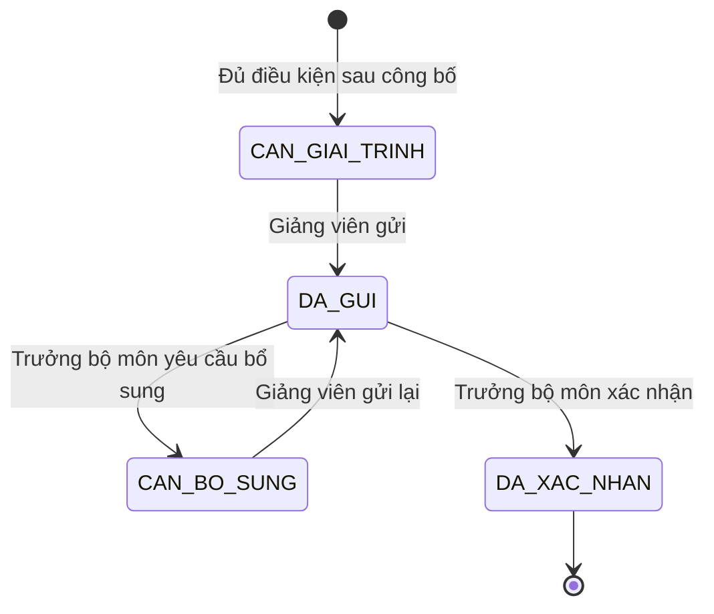
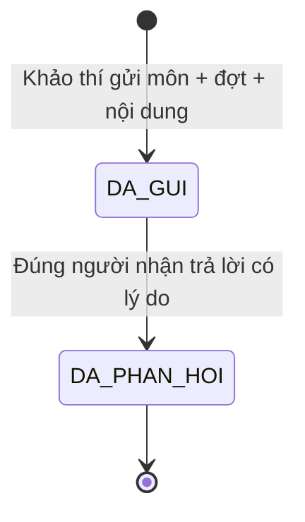
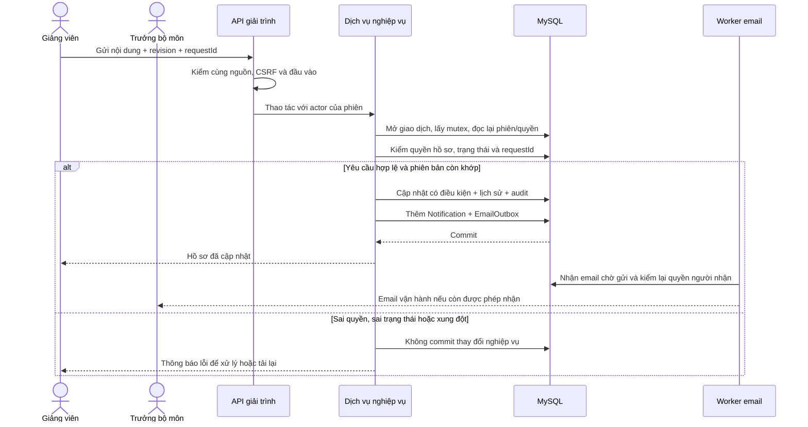

# Nháp chương hiện thực — Tuần 11

Ngày triển khai thực tế: **02–03/11/2026**. Phần này mô tả giải trình cải tiến và kiến nghị rà soát đã được viết trong Tuần 11; dùng để ghép vào chương hiện thực của tiểu luận. Kết quả nghiệm thu, ảnh giao diện và CI được chốt riêng theo lần chạy thực tế, không suy ra từ việc đã có mã nguồn.

## 1. Phạm vi và cách tổ chức

Giải trình cải tiến thực hiện **FR-66/BR-10**: khi một lớp đủ điều kiện công bố có điểm tổng dưới ngưỡng của đợt, hệ thống tạo yêu cầu cho giảng viên. Giảng viên nêu nguyên nhân, gửi kế hoạch cải tiến; trưởng bộ môn xem xét và xác nhận hoặc yêu cầu bổ sung.

Kiến nghị rà soát thực hiện **FR-152/BR-58**: Phòng Khảo thí gửi kiến nghị gắn với môn học và đợt khảo sát đến trưởng bộ môn. Trưởng bộ môn trả lời đã tiếp thu hoặc không tiếp thu, kèm lý do. Chức năng này không lưu điểm thi và không thay quy trình phúc khảo.

Hai luồng dùng chung cơ chế kiểm phiên, phạm vi, giao dịch, thông báo trong ứng dụng và hàng đợi email. Không bổ sung quan hệ từ `SurveyResponse` hoặc `SurveyAnswer` sang người dùng; giải trình chỉ tham chiếu kết quả tổng hợp theo lớp và giảng viên phụ trách.

| Thành phần | Vai trò trong hiện thực |
| --- | --- |
| [improvements.ts](../src/server/services/improvements.ts) | Tạo yêu cầu, đọc danh sách/chi tiết, gửi, xem xét và nhắc hạn giải trình |
| [exam-recommendations.ts](../src/server/services/exam-recommendations.ts) | Chọn đợt/môn/người nhận, gửi kiến nghị và ghi phản hồi |
| [improvement-workflows.ts](../src/server/policies/improvement-workflows.ts) | Quyền theo chủ hồ sơ, phân công hiện tại, bộ môn và khoa |
| [workflow-access.ts](../src/server/services/workflow-access.ts) | Khóa giao dịch, đọc lại phiên, kiểm quyền và từ chối cập nhật xung đột |
| [improvement-types.ts](../src/server/services/improvement-types.ts) | Kiểm đầu vào Zod và các cấu trúc dữ liệu trả cho giao diện |
| [domain-notifications.ts](../src/server/services/domain-notifications.ts) | Tạo thông báo và email chờ gửi trong cùng giao dịch nghiệp vụ |
| [scheduler.ts](../scripts/scheduler.ts) | Chạy các lượt bảo đảm dữ liệu đến hạn, nhắc hạn và gửi email |

Các trang sử dụng là `/giai-trinh`, `/giai-trinh/:id`, `/kien-nghi`, `/kien-nghi/gui` và `/kien-nghi/:id`. API tương ứng nằm dưới `/api/improvements` và `/api/exam-recommendations`. Dữ liệu gửi lên được kiểm ở máy chủ; việc ẩn hoặc hiện nút trên giao diện không thay cho kiểm quyền.

## 2. Giải trình cải tiến từ kết quả công bố

### Điều kiện tạo yêu cầu

Trong giao dịch công bố, sau khi cập nhật đợt và thêm lịch sử `DA_CONG_BO`, dịch vụ kết quả gọi `ensureRequiredImprovements(tx, campaignId)`. Hàm này chỉ tạo yêu cầu khi:

- Đợt đang `DA_CONG_BO` và học kỳ chưa khóa sổ.
- Kết quả lớp có `eligibleToPublish = true`; lớp thiếu mẫu không được dùng để phát sinh yêu cầu có thể làm lộ kết quả chưa công bố.
- Điểm tổng nhỏ hơn `warningScore` của chính đợt, mặc định 3,0.
- Giảng viên còn hoạt động, có gán vai trò giảng viên hợp lệ, còn được phân công lớp và có trong bản chụp giảng viên tại lúc tổng hợp.

Mỗi bộ `(đợt, lớp học phần, giảng viên)` chỉ có một `ImprovementPlan`, được bảo vệ bằng khóa duy nhất của database. Hạn gửi tính từ thời điểm công bố đầu tiên cộng `explanationDays` của đợt, mặc định **14 ngày theo lịch**. Chạy lại hàm không tạo yêu cầu mới hoặc kéo dài hạn cũ. Không có nguồn cấu hình toàn cục thứ hai ghi đè hai giá trị đã được cấu hình theo đợt này.

### Trạng thái và thao tác

Khi gửi, giảng viên phải nhập cả phần giải trình và kế hoạch cải tiến, mỗi phần tối thiểu 20 ký tự sau khi bỏ khoảng trắng thừa ở hai đầu. Khi xác nhận hoặc yêu cầu bổ sung, trưởng bộ môn phải nhập nhận xét tối thiểu 10 ký tự. Chuyển trạng thái sai thứ tự bị từ chối; hồ sơ đã xác nhận không có thao tác gửi lại trong phạm vi hiện tại.

Thời hạn hiển thị được so với giờ máy chủ khi đọc hồ sơ. Cờ quá hạn chỉ áp dụng lúc còn chờ giảng viên ở `CAN_GIAI_TRINH` hoặc `CAN_BO_SUNG`; `DA_GUI` thể hiện giảng viên đã gửi và đang chờ xem xét. Bổ sung dùng lại hạn của yêu cầu, không tự cộng thêm ngày.

`ImprovementHistory` giữ các lần gửi, yêu cầu bổ sung và xác nhận theo cách chỉ thêm. Lúc tạo yêu cầu, hệ thống ghi `AuditLog` với hành động `IMPROVEMENT_REQUIRED`; không tạo một lịch sử gửi giả thay cho giảng viên.

## 3. Kiến nghị rà soát của Phòng Khảo thí

Danh sách lựa chọn chỉ trả về đợt đã công bố, học kỳ chưa khóa và môn học còn hoạt động trong khoa/bộ môn còn hoạt động. Môn phải có nhóm tiêu chí mang cờ `isAssessmentGroup`, đủ tổng số phiếu theo `minResponses` và có dữ liệu từ ít nhất hai giảng viên khác nhau. Lớp không có phiếu không được dùng để đủ số giảng viên. API lựa chọn không trả mã lớp, danh sách giảng viên, điểm tổng hoặc tự luận.

Người nhận phải là tài khoản trưởng bộ môn đang hoạt động và có gán phạm vi đúng bộ môn của môn học. Phòng Khảo thí không thể gửi đến người ngoài phạm vi bằng cách thay ID trong yêu cầu. Nội dung kiến nghị tối thiểu 20 ký tự. Hạn phản hồi lấy từ `examReviewDays` trong cấu hình quy trình, mặc định **14 ngày theo lịch kể từ lúc gửi**.

`DA_TIEP_THU` và `KHONG_TIEP_THU` là kết quả xem xét, không phải hai trạng thái mới. Cả hai đều bắt buộc có lý do. `respondedAt`, người nhận và nội dung phản hồi được giữ trên hồ sơ; thao tác ghi audit không sao chép phần nội dung này vào nhật ký.

Sau hạn, nếu hồ sơ vẫn `DA_GUI`, hệ thống nhắc trưởng bộ môn nhận kiến nghị và báo trưởng khoa trong đúng phạm vi. Khi đã `DA_PHAN_HOI`, hồ sơ không còn thuộc lượt nhắc quá hạn. Học kỳ khóa sổ chặn gửi hoặc phản hồi mới; người có quyền vẫn xem được hồ sơ cũ.

## 4. Kiểm quyền và chống ghi đè

| Nhóm người dùng | Giải trình | Kiến nghị rà soát |
| --- | --- | --- |
| Giảng viên | Đọc/gửi hồ sơ của mình khi còn được phân công lớp | Không có quyền chỉ nhờ vai trò giảng viên |
| Trưởng bộ môn | Đọc trong bộ môn; xem xét hồ sơ của giảng viên khác | Đọc trong bộ môn; chỉ người nhận được chỉ định mới phản hồi |
| Trưởng khoa | Đọc giải trình trong khoa | Đọc kiến nghị trong khoa, gồm thông báo quá hạn |
| ĐBCL/Lãnh đạo | Đọc giải trình | Không có quyền chỉ nhờ các vai trò này |
| Phòng Khảo thí | Không có quyền giải trình | Đọc và gửi kiến nghị theo quyền nghiệp vụ |
| ADMIN | Không đọc nội dung, kể cả khi có thêm vai trò khác | Không đọc nội dung, kể cả khi có thêm vai trò khác |

Một thao tác dịch vụ thực hiện theo thứ tự: kiểm quyền đầu vào → lấy `ADMIN_MUTATION_LOCK` → đọc lại phiên và các gán phạm vi qua `assertFreshActor` → kiểm quyền đối tượng → ghi dữ liệu. Nhờ đọc lại trong giao dịch, việc thu hồi vai trò, vô hiệu hóa tài khoản hoặc thu hồi phiên có hiệu lực ngay; không chỉ dựa vào vai trò trong token đã phát trước đó. Truy cập ID của hồ sơ ngoài phạm vi trả lỗi không tìm thấy.

Mỗi thay đổi gửi `revision` và `requestId`. Cập nhật chỉ thành công khi cả trạng thái cũ lẫn phiên bản còn khớp, và số dòng bị ảnh hưởng bằng một. Cơ chế này gọi là so sánh rồi cập nhật có điều kiện (CAS). Nếu hai người mở cùng một phiên bản, người ghi sau phải tải lại thay vì âm thầm ghi đè.

`requestId` kết hợp mã băm của dữ liệu giúp xử lý việc gửi lại sau gián đoạn mạng. Cùng mã, cùng người và cùng nội dung trả về hồ sơ hiện có; cùng mã nhưng khác nội dung bị từ chối. Giải trình lưu dấu yêu cầu trong lịch sử; kiến nghị lưu riêng dấu yêu cầu tạo và dấu yêu cầu phản hồi. Kiểm lại quyền luôn diễn ra trước khi trả kết quả gửi lại.

## 5. Giao dịch và thông báo

Lịch sử, audit, thông báo trong ứng dụng và hàng chờ email được ghi trong cùng giao dịch với thay đổi nghiệp vụ. Nếu một bước ghi thất bại, giao dịch rollback; không có thông báo đã lưu cho một thay đổi chưa được lưu.

Nội dung thông báo chỉ nêu loại công việc và việc cần xem, không chép phần giải trình, kế hoạch, kiến nghị, lý do trả lời hoặc định danh sinh viên. Liên kết mở hồ sơ vẫn qua policy. Danh sách thông báo và worker email kiểm lại quyền đích trước khi hiển thị/gửi, để thông báo cũ không trở thành đường vòng khi quyền đã bị thu hồi.

Mã thông báo được tạo ổn định từ đích, sự kiện và người nhận; outbox có khóa idempotency duy nhất. Vì vậy chạy lại cùng sự kiện không thêm bản ghi trùng. SMTP thực hiện sau khi giao dịch kết thúc; worker có lease, giới hạn số lần gửi và thử lại có thời gian chờ. Không khẳng định SMTP gửi đúng một lần tuyệt đối: nếu máy dừng sau khi SMTP nhận thư nhưng trước lúc ghi nhận thành công, việc thử lại có thể gửi lại thư.

## 6. Truy cập đầu tiên và scheduler

Yêu cầu mới được tạo ngay trong giao dịch công bố, nên không cần đợi cron. Ngoài ra:

- `listImprovements` và `getImprovement` chạy bù yêu cầu cho đợt đã công bố trước đó, rồi bảo đảm các thông báo nhắc hạn đến thời điểm đọc.
- Đọc danh sách/chi tiết kiến nghị cũng bảo đảm lượt nhắc hạn; cờ quá hạn được tính trực tiếp theo `dueAt` và trạng thái.
- Scheduler gọi `ensureDueImprovements` và `remindDomainWorkflows`, sau đó xử lý email nghiệp vụ và email khảo sát. Các lượt dùng cùng mutex với thao tác của người dùng.
- Giải trình chờ giảng viên được nhắc trong khoảng một ngày trước hạn hoặc khi đã quá hạn; kiến nghị nhắc khi đã quá hạn. Khóa thông báo gồm ID hồ sơ và ngày UTC, nên đọc lại trang và chạy job cùng ngày không nhân đôi thông báo.

Mỗi lượt quét xử lý tối đa 100 ứng viên mỗi loại. Ba con trỏ riêng trong `SystemSetting` ghi mã đã xử lý cuối của lượt tạo bù, nhắc giải trình và nhắc kiến nghị. Lượt sau lấy các mã lớn hơn, theo thứ tự mã; khi hết lô thì quay lại đầu. Con trỏ được cập nhật trong cùng giao dịch có mutex, nên hai worker không cùng bỏ qua một đoạn. Ứng viên mới nằm trước con trỏ sẽ được nhận ở vòng kế tiếp, không bị bỏ đói vì cứ chọn lại 100 hồ sơ đầu. Việc tạo ngay khi công bố không dùng giới hạn 100 này. Chưa có đánh giá hiệu năng quy mô lớn trong tài liệu nháp.

## 7. Cách kiểm chứng và năm câu giải thích khi bảo vệ

[improvement-workflows.test.ts](../tests/improvement-workflows.test.ts) kiểm điều kiện tạo theo công bố, ngưỡng/hạn theo đợt, bản chụp giảng viên, chống trùng, máy trạng thái, phạm vi và yêu cầu lý do. Trường hợp lớp không có phiếu được thêm để đối chứng điều kiện hai giảng viên.

[workflow-batch-cursors.test.ts](../tests/workflow-batch-cursors.test.ts) chạy bảy ứng viên qua nhiều lô có giới hạn hai, kiểm cả lượt tạo bù và hai hàng đợi nhắc. Kiểm này xác nhận các ứng viên phía sau được xử lý, con trỏ quay vòng và con trỏ cũ không giữ lượt quét ở trạng thái rỗng mãi.

[verify-week11-workflows.ts](../scripts/verify-week11-workflows.ts) xác minh marker và database thử riêng trước khi tạo fixture; kiểm giao dịch đồng thời, gửi lại, bổ sung/xác nhận, khóa kỳ, nhắc hạn, quyền đích và thu hồi phiên trên MySQL thật. Script chỉ dọn fixture do chính lượt chạy tạo. Kết quả và phạm vi đã chạy phải đối chiếu báo cáo nghiệm thu của phiên; phần này không tự chứng nhận CI, mọi vai trò trên giao diện hoặc mọi thiết bị.

**1. Vì sao phải đợi công bố mới tạo giải trình?** Vì chỉ những kết quả đủ điều kiện công bố mới được dùng cho quy trình có giảng viên đọc. Tạo sớm có thể làm lộ rằng lớp chưa đủ mẫu đã bị đánh giá thấp.

**2. Nếu lịch chạy tự động bị dừng thì sao?** Yêu cầu mới đã được tạo trong giao dịch công bố. Khi mở danh sách hoặc hồ sơ, dịch vụ còn tính hạn theo giờ máy chủ và chạy phần bảo đảm dữ liệu đến hạn. Lượt quét bù có giới hạn đã nêu ở Mục 6.

**3. Vì sao gửi lại không sinh hai yêu cầu hoặc hai lịch sử?** Database có khóa duy nhất cho đợt–lớp–giảng viên và mã yêu cầu. Dịch vụ kiểm mã băm nội dung, trạng thái và phiên bản trong giao dịch, nên phân biệt được gửi lại cùng thao tác với thao tác mới đang ghi đè dữ liệu cũ.

**4. Người dùng đổi ID trong đường dẫn có đọc được hồ sơ khác không?** Không chỉ dựa vào ID. Máy chủ đọc lại phiên, vai trò, phạm vi và phân công của lớp, rồi kiểm hồ sơ cụ thể. ID tồn tại nhưng ngoài phạm vi vẫn bị từ chối.

**5. Vì sao email không chứa toàn bộ nội dung hồ sơ?** Email có thể còn nằm trong hộp thư sau khi người nhận đã mất quyền. Thư chỉ báo có công việc và dẫn về ứng dụng; khi mở hồ sơ, hệ thống kiểm quyền hiện tại lần nữa.
