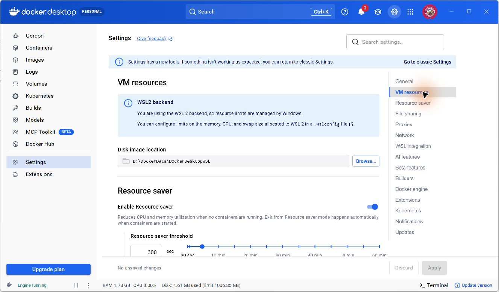

# Docker dùng chung một kho dữ liệu trên Windows

Ngày xác minh: **05/11/2026**. Docker Desktop **4.97.0**, Engine **29.9.2**, backend **WSL 2**. Bốn cách mở đã kiểm đều dùng kho `D:\DockerData\DockerDesktopWSL` và giữ nguyên dữ liệu tại checkpoint trước sửa. [Bằng chứng tổng hợp](assets/van-hanh/docker-single-store-20261105.json) không chứa SQL, VHDX, thông tin xác thực hoặc định danh máy thô.

## Vì sao trước đây có hai bộ dữ liệu?

Cùng chương trình Docker Desktop all-users từng chọn hai tệp dữ liệu vật lý tùy tiến trình khởi động. Explorer truy cập AppData thật, nơi giữ database chính mới. Tiến trình Codex đóng gói MSIX có thể bị Windows chuyển hướng AppData sang LocalCache riêng, nơi còn kho cũ. Vì vậy cùng lệnh Compose có thể thấy schema và dữ liệu khác nhau; đây là sự khác biệt kho dữ liệu theo ngữ cảnh mở chương trình.

Lần sửa này chuyển kho chính bằng chức năng chính thức **Settings → VM resources → Disk image location** trong giao diện Docker Desktop 4.97.0. Đường dẫn được lưu là `D:\DockerData\DockerDesktopWSL`, ngoài AppData. [Tài liệu Docker về WSL](https://docs.docker.com/desktop/features/wsl/) cũng hướng dẫn đổi vị trí dữ liệu qua Settings; tên nhóm trong tài liệu có thể là Resources → Advanced.

Sau khi Docker dừng hoàn toàn, chỉ khóa `CustomWslDistroDir` trong cấu hình của ngữ cảnh Codex được đồng bộ với đường dẫn đã lưu bởi giao diện. Hai cấu hình vật lý hiện trùng kho D:; đăng ký WSL của `docker-desktop` cũng trỏ tới thư mục `main` dưới kho này. Các khóa khác được giữ nguyên, không cài lại Docker.

Thư mục đích đã bỏ quyền rộng kế thừa từ gốc ổ D:. Tài khoản Windows hiện tại, SYSTEM và Administrators có FullControl; quyền này được kiểm cả trên thư mục gốc, các thư mục con và tệp VHDX dữ liệu.

## Dữ liệu được bảo toàn

Hai kho lịch sử có bản sao ngoại tuyến riêng, đã đối chiếu SHA-256. Ngay trước di chuyển còn tạo bản sao ngoại tuyến mới nhất của kho chính, bản xuất SQL nhất quán và bản sao hai cấu hình. Các bản lịch sử được giữ nguyên ngoài Git.

Checkpoint mới gồm **45 bảng ứng dụng, 1.575 người dùng, 9.827 bản ghi ứng dụng**, cộng **13 bản ghi migration**: tổng **46 bảng/9.840 bản ghi**. Khóa chính và hash giá trị từng hàng của cả 46 bảng khớp trước/sau xuất SQL, sau di chuyển và trong cả bốn lần kiểm cách mở. Engine, container, volume MySQL và server UUID cũng giữ nguyên.

Bản xuất SQL mới dùng `--single-transaction` trên toàn bộ bảng InnoDB, dài **1.768.166 byte**, SHA-256 `6b886e5944505338625ea96c57a033b802ae679224151e4287f6c11920134897`. Không migrate/seed/reset, đổi credential hay MFA để sửa sự cố này.

Mốc Tuần 13 lịch sử gồm **9.709 bản ghi ứng dụng** vẫn được giữ riêng tại [bằng chứng khôi phục độc lập](assets/tuan-13/main-data-verification.json). Trước checkpoint mới, runtime đã thêm 118 bản ghi và cập nhật tám hàng hiện có, không xóa hàng. Vì vậy số liệu mới không được dùng để thay thế hoặc viết lại mốc lịch sử.

## Kết quả kiểm các cách mở

| Cách mở | Kiểm toàn bộ 46 bảng/9.840 hàng, danh tính và backend D: | Bằng chứng khởi động |
| --- | --- | --- |
| `Start-Process` trực tiếp từ Codex | Qua | Dấu vết thao tác trong phiên và guard đầy đủ; không lưu tệp kiểm tiến trình trước/sau riêng cho lần này |
| `docker desktop start` từ Codex | Qua | Có tệp riêng ghi không còn tiến trình Docker trước mở và tiến trình mới sau mở |
| Mở ứng dụng qua CUA | Qua | Có tệp riêng ghi không còn tiến trình Docker trước mở và tiến trình mới sau mở |
| Nhấp shortcut Docker Desktop trong Explorer | Qua | Có tệp riêng ghi không còn tiến trình Docker trước mở và tiến trình mới sau mở |

Cả bốn guard đều yêu cầu **hai cấu hình vật lý trùng đường dẫn** và đã đọc được backend đang dùng D:. Ba cặp nhật ký CLI/CUA/Explorer xác nhận tiến trình gốc/backend mới, thời điểm tạo sau lần kiểm dừng và các PID khác nhau giữa ba lần mở; định danh thô được giữ riêng.

Qua năm lần quan sát gồm ngay sau di chuyển và bốn cách mở: đường dẫn local/UNC của VHDX D: cùng volume/file identity; tệp dữ liệu AppData thật cũ không xuất hiện lại; kích thước, mtime và file identity của kho LocalCache cũ giữ nguyên. Kho cũ còn trên đĩa để khôi phục, không được sử dụng làm kho hoạt động trong các lần kiểm.

Phiên cuối được mở bằng Explorer. Giao diện hiển thị đúng D:, **No unsaved changes** và **Engine running**:

## Sử dụng sau sửa và phạm vi xác minh

Mở Docker Desktop, đợi engine chạy rồi dùng `KHOI_DONG_DU_AN.cmd` theo [README](../README.md). Trên tài khoản và cấu hình đã kiểm, bốn cách mở trên cùng dùng kho D:. Nếu schema hoặc dữ liệu khác checkpoint mong đợi, kiểm đường dẫn kho và danh tính database trước khi ghi; không dùng migrate/seed/reset để xử lý chênh lệch chưa rõ nguyên nhân.

Các phép đối chiếu hash ở đây được thực hiện khi web/scheduler đã dừng. Sau khi mở lại, scheduler có thể ghi audit, email, thông báo và trạng thái theo nghiệp vụ bình thường; không suy rằng hash sẽ bất biến sau các tác vụ đó.

Chưa kiểm reboot/đăng nhập lại Windows, cập nhật Docker/Codex hoặc tài khoản Windows khác. Bản xuất SQL mới chưa được restore thử; kết quả restore độc lập ngày 04/11 áp dụng cho bản xuất lịch sử của ngày đó. Guard so sánh danh sách cột/khóa chính và giá trị hàng, chưa đối chiếu toàn bộ DDL/index/FK. Phép kiểm file identity kết hợp cấu hình backend, đăng ký WSL và dấu vết kho cũ; chưa liệt kê trực tiếp toàn bộ handle VHDX đang gắn.
