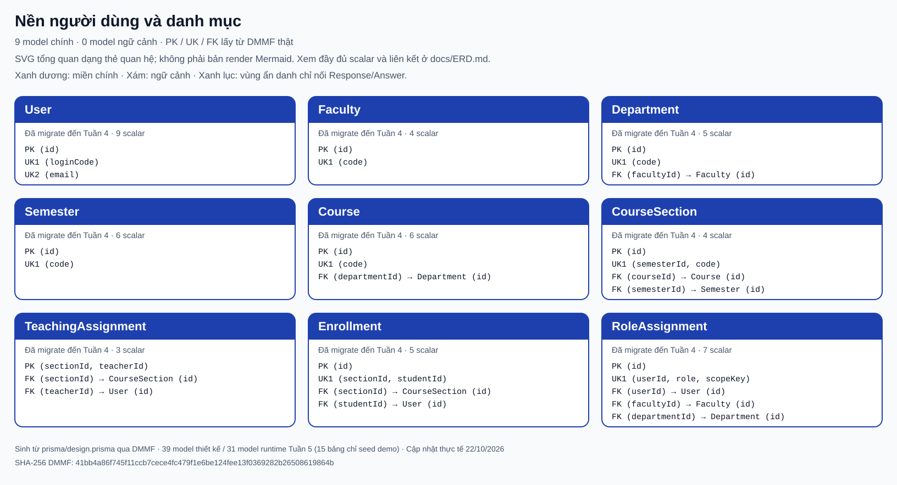
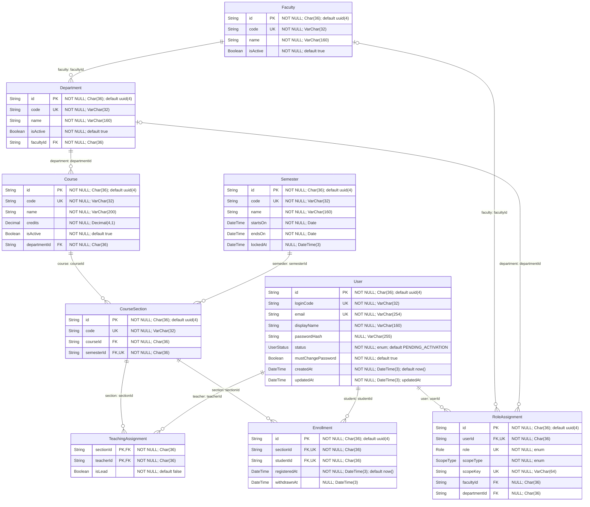
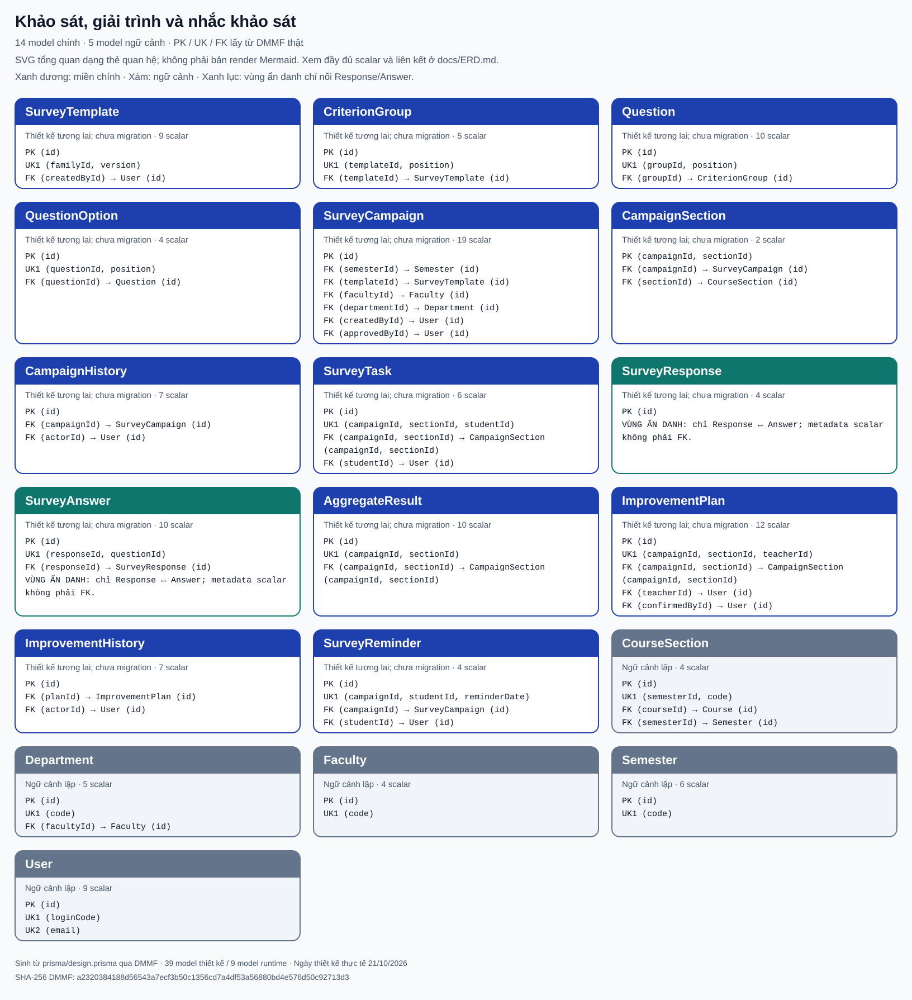
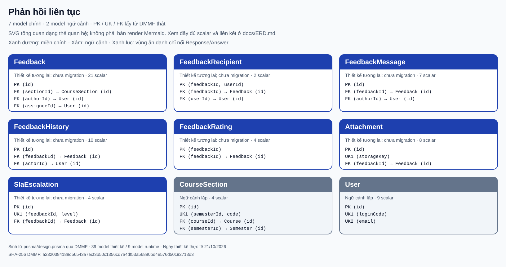
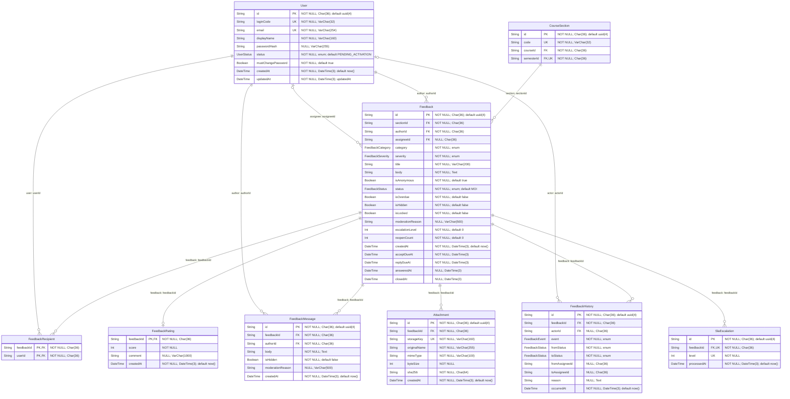
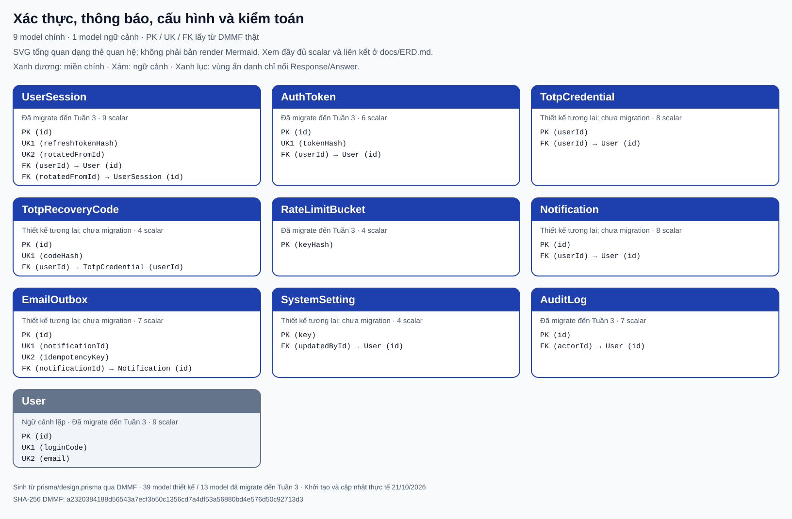

# ERD toàn hệ thống — cập nhật Tuần 4

<!-- Tự sinh bởi scripts/export-erd.mjs. Sửa schema rồi generate và chạy exporter; không sửa tay phần sinh. -->

Thiết kế khởi tạo **21/10/2026**, cập nhật phạm vi migration Tuần 4 ngày **22/10/2026**. Kế hoạch Tuần 2 giả định 07–13/10/2026; không ghi lùi ngày. ERD phân biệt thiết kế dữ liệu với schema đã migrate; có bảng không đồng nghĩa toàn bộ chức năng nghiệp vụ đã hoàn thành.

Nguồn: DMMF thật được Prisma sinh từ `prisma/design.prisma` (**39 model thiết kế**), đối chiếu `prisma/schema.prisma` runtime (**16 model đã migrate đến Tuần 4**). SHA-256 DMMF thiết kế: `41bb4a86f745f11ccb7cece4fc479f1e6be124fee13f0369282b26508619864b`.

## Cách đọc và tái tạo

- Tuần 2 đã migrate chín model nền người dùng/danh mục. Đến Tuần 3, runtime thêm `UserSession`, `AuthToken`, `RateLimitBucket`, `AuditLog`, Tuần 4 thêm TotpCredential/TotpRecoveryCode/SystemSetting và trạng thái MFA của phiên, tổng **16 model đã migrate đến Tuần 4**. **23 model còn lại** là thiết kế tương lai, chưa migrate hay có service/UI nghiệp vụ. Bản báo cáo nghiệm thu Tuần 2 giữ kết quả chín bảng tại thời điểm đó.
- Bốn sơ đồ có đúng 39 model chính (9 + 14 + 7 + 9); model ngữ cảnh lặp để đọc FK vượt miền, không cộng vào tổng. Tất cả scalar/enum và PK/UK/FK được sinh từ DMMF; object navigation không được lặp thành cột.
- `PK` là khóa chính; `UK` là thành viên khóa duy nhất; `FK` chỉ xuất hiện khi DMMF có relationFromFields thật. Với khóa ghép, ký hiệu trên cột không nói từng cột duy nhất riêng: đọc bảng khóa ngay sau sơ đồ. Kiểu vật lý, NULL/default được ghi trong chú thích thuộc tính; danh mục enum ở cuối.
- Cardinality sinh từ required/optional của quan hệ và unique của tập FK: cha bắt buộc/một hoặc tùy chọn/không–một; phía con không–nhiều hoặc không–một khi FK unique. Không khẳng định cha phải có ít nhất một con chỉ từ sự tồn tại FK.
- SVG tổng quan dạng thẻ được exporter sinh trực tiếp từ DMMF, **không phải render Mermaid**. SVG liệt kê PK/UK/FK và số scalar; các khối Mermaid là ERD đầy đủ thuộc tính/liên kết. Mở SVG trong trình xem để đọc ngay cả khi trình xem Markdown không hỗ trợ Mermaid.
- Chạy `npm run db:generate`, rồi `node scripts/export-erd.mjs` để ghi lại Markdown/SVG; chạy `node scripts/export-erd.mjs --check` để chỉ so nội dung hiện có với DMMF và thoát lỗi nếu cũ/thiếu. Không cần thêm thư viện. Check này kiểm tài liệu khớp schema, không thay test ẩn danh, migration hay kết quả render Mermaid.

## Ranh giới ẩn danh bắt buộc

`SurveyResponse` và `SurveyAnswer` chỉ nối với nhau qua `SurveyAnswer.responseId`. `SurveyResponse.campaignId`, `sectionId` và `SurveyAnswer.questionId` là **scalar metadata không có FK/navigation** tới Campaign/Section/Question. Không vẽ đường liên kết giả chỉ vì tên cột kết thúc bằng Id. Không có studentId/taskId/IP/User-Agent hoặc đường quan hệ từ hai model phiếu tới User/SurveyTask; không dùng các ID metadata để xây include/join làm tái định danh.

`SurveyTask` giữ trạng thái hoàn thành và ngày DONE, độc lập với phiếu. Hạn chế vẫn là ẩn danh mức ứng dụng: người có quyền hạ tầng có thể suy luận từ DB/log và lớp ít người; ngưỡng công bố BR-07 vẫn bắt buộc. Kênh Feedback có liên kết tác giả để đối thoại, khác thiết kế SurveyResponse.

## 1. Nền người dùng và danh mục — 9 model chính

Model chính: `User`, `Faculty`, `Department`, `Semester`, `Course`, `CourseSection`, `TeachingAssignment`, `Enrollment`, `RoleAssignment`.

Không cần model ngữ cảnh ngoài nhóm.

[Mở SVG tổng quan](assets/tuan-02/erd-nen-danh-muc.svg) — SVG sinh trực tiếp từ DMMF, không render Mermaid.

| Model chính        | PK                     | UK (mỗi cặp ngoặc là một khóa, không phải từng cột độc lập) |
| ------------------ | ---------------------- | ----------------------------------------------------------- |
| User               | (id)                   | (loginCode); (email)                                        |
| Faculty            | (id)                   | (code)                                                      |
| Department         | (id)                   | (code)                                                      |
| Semester           | (id)                   | (code)                                                      |
| Course             | (id)                   | (code)                                                      |
| CourseSection      | (id)                   | (semesterId, code)                                          |
| TeachingAssignment | (sectionId, teacherId) | —                                                           |
| Enrollment         | (id)                   | (sectionId, studentId)                                      |
| RoleAssignment     | (id)                   | (userId, role, scopeKey)                                    |

| Model.field                | FK → đích                       | Bắt buộc | onDelete / onUpdate |
| -------------------------- | ------------------------------- | -------- | ------------------- |
| Department.faculty         | (facultyId) → Faculty(id)       | Có       | Restrict / Restrict |
| Course.department          | (departmentId) → Department(id) | Có       | Restrict / Restrict |
| CourseSection.course       | (courseId) → Course(id)         | Có       | Restrict / Restrict |
| CourseSection.semester     | (semesterId) → Semester(id)     | Có       | Restrict / Restrict |
| TeachingAssignment.section | (sectionId) → CourseSection(id) | Có       | Restrict / Restrict |
| TeachingAssignment.teacher | (teacherId) → User(id)          | Có       | Restrict / Restrict |
| Enrollment.section         | (sectionId) → CourseSection(id) | Có       | Restrict / Restrict |
| Enrollment.student         | (studentId) → User(id)          | Có       | Restrict / Restrict |
| RoleAssignment.user        | (userId) → User(id)             | Có       | Restrict / Restrict |
| RoleAssignment.faculty     | (facultyId) → Faculty(id)       | Không    | Restrict / Restrict |
| RoleAssignment.department  | (departmentId) → Department(id) | Không    | Restrict / Restrict |

## 2. Khảo sát, giải trình và nhắc khảo sát — 14 model chính

Model chính: `SurveyTemplate`, `CriterionGroup`, `Question`, `QuestionOption`, `SurveyCampaign`, `CampaignSection`, `CampaignHistory`, `SurveyTask`, `SurveyResponse`, `SurveyAnswer`, `AggregateResult`, `ImprovementPlan`, `ImprovementHistory`, `SurveyReminder`.

Ngữ cảnh lặp: `CourseSection`, `Department`, `Faculty`, `Semester`, `User`. Chỉ vẽ FK từ model chính; không mở rộng đệ quy quan hệ của model ngữ cảnh.

[Mở SVG tổng quan](assets/tuan-02/erd-khao-sat.svg) — SVG sinh trực tiếp từ DMMF, không render Mermaid.

```mermaid
erDiagram
  %% SurveyTemplate: model chính
  SurveyTemplate {
    String id PK "NOT NULL; Char(36); default uuid(4)"
    String familyId UK "NOT NULL; Char(36)"
    Int version UK "NOT NULL"
    String name "NOT NULL; VarChar(200)"
    TemplateStatus status "NOT NULL; enum; default NHAP"
    Boolean isDefault "NOT NULL; default false"
    String createdById FK "NOT NULL; Char(36)"
    DateTime createdAt "NOT NULL; DateTime(3); default now()"
    DateTime lockedAt "NULL; DateTime(3)"
  }
  %% CriterionGroup: model chính
  CriterionGroup {
    String id PK "NOT NULL; Char(36); default uuid(4)"
    String templateId FK, UK "NOT NULL; Char(36)"
    String title "NOT NULL; VarChar(200)"
    Int position UK "NOT NULL"
    Decimal weight "NOT NULL; Decimal(10,4); default 1"
  }
  %% Question: model chính
  Question {
    String id PK "NOT NULL; Char(36); default uuid(4)"
    String groupId FK, UK "NOT NULL; Char(36)"
    String label "NOT NULL; VarChar(1000)"
    QuestionType type "NOT NULL; enum"
    Int position UK "NOT NULL"
    Boolean required "NOT NULL; default true"
    Boolean allowNA "NOT NULL; default false"
    Decimal weight "NOT NULL; Decimal(10,4); default 1"
    Int scaleMin "NULL"
    Int scaleMax "NULL"
  }
  %% QuestionOption: model chính
  QuestionOption {
    String id PK "NOT NULL; Char(36); default uuid(4)"
    String questionId FK, UK "NOT NULL; Char(36)"
    String label "NOT NULL; VarChar(500)"
    Int position UK "NOT NULL"
  }
  %% SurveyCampaign: model chính
  SurveyCampaign {
    String id PK "NOT NULL; Char(36); default uuid(4)"
    String title "NOT NULL; VarChar(200)"
    String semesterId FK "NOT NULL; Char(36)"
    String templateId FK "NOT NULL; Char(36)"
    CampaignScope scope "NOT NULL; enum"
    String facultyId FK "NULL; Char(36)"
    String departmentId FK "NULL; Char(36)"
    DateTime startsAt "NOT NULL; DateTime(3)"
    DateTime endsAt "NOT NULL; DateTime(3)"
    CampaignStatus status "NOT NULL; enum; default NHAP"
    Int minResponses "NOT NULL; default 5"
    Decimal minRate "NOT NULL; Decimal(5,4); default 0.3"
    Decimal warningScore "NOT NULL; Decimal(5,2); default 3"
    Int explanationDays "NOT NULL; default 14"
    Boolean mandatory "NOT NULL; default false"
    String createdById FK "NOT NULL; Char(36)"
    String approvedById FK "NULL; Char(36)"
    DateTime approvedAt "NULL; DateTime(3)"
    DateTime createdAt "NOT NULL; DateTime(3); default now()"
  }
  %% CampaignSection: model chính
  CampaignSection {
    String campaignId PK, FK "NOT NULL; Char(36)"
    String sectionId PK, FK "NOT NULL; Char(36)"
  }
  %% CampaignHistory: model chính
  CampaignHistory {
    String id PK "NOT NULL; Char(36); default uuid(4)"
    String campaignId FK "NOT NULL; Char(36)"
    String actorId FK "NULL; Char(36)"
    CampaignStatus fromStatus "NOT NULL; enum"
    CampaignStatus toStatus "NOT NULL; enum"
    String reason "NULL; Text"
    DateTime occurredAt "NOT NULL; DateTime(3); default now()"
  }
  %% SurveyTask: model chính
  SurveyTask {
    String id PK "NOT NULL; Char(36); default uuid(4)"
    String campaignId FK, UK "NOT NULL; Char(36)"
    String sectionId FK, UK "NOT NULL; Char(36)"
    String studentId FK, UK "NOT NULL; Char(36)"
    TaskStatus status "NOT NULL; enum; default PENDING"
    DateTime doneDate "NULL; Date"
  }
  %% SurveyResponse: model chính
  SurveyResponse {
    String id PK "NOT NULL; Char(36); default uuid(4)"
    String campaignId "NOT NULL; Char(36); metadata scalar - NO FK"
    String sectionId "NOT NULL; Char(36); metadata scalar - NO FK"
    DateTime submittedDate "NOT NULL; Date"
  }
  %% SurveyAnswer: model chính
  SurveyAnswer {
    String id PK "NOT NULL; Char(36); default uuid(4)"
    String responseId FK, UK "NOT NULL; Char(36)"
    String questionId UK "NOT NULL; Char(36); metadata scalar - NO FK"
    Decimal valueNumber "NULL; Decimal(10,4)"
    String valueText "NULL; Text"
    Json valueOptionIds "NULL"
    Boolean valueBoolean "NULL"
    Boolean isNotApplicable "NOT NULL; default false"
    ModerationStatus moderationStatus "NOT NULL; enum; default CHO_KIEM_DUYET"
    String moderationReason "NULL; VarChar(500)"
  }
  %% AggregateResult: model chính
  AggregateResult {
    String id PK "NOT NULL; Char(36); default uuid(4)"
    String campaignId FK, UK "NOT NULL; Char(36)"
    String sectionId FK, UK "NOT NULL; Char(36)"
    Int responseCount "NOT NULL"
    Int taskCount "NOT NULL"
    Decimal participationRate "NOT NULL; Decimal(7,4)"
    Decimal overallScore "NULL; Decimal(5,2)"
    Json details "NOT NULL"
    Boolean eligibleToPublish "NOT NULL"
    DateTime aggregatedAt "NOT NULL; DateTime(3)"
  }
  %% ImprovementPlan: model chính
  ImprovementPlan {
    String id PK "NOT NULL; Char(36); default uuid(4)"
    String campaignId FK, UK "NOT NULL; Char(36)"
    String sectionId FK, UK "NOT NULL; Char(36)"
    String teacherId FK, UK "NOT NULL; Char(36)"
    ImprovementStatus status "NOT NULL; enum; default CAN_GIAI_TRINH"
    String explanation "NULL; Text"
    String actionPlan "NULL; Text"
    DateTime dueAt "NOT NULL; DateTime(3)"
    DateTime submittedAt "NULL; DateTime(3)"
    String confirmedById FK "NULL; Char(36)"
    DateTime confirmedAt "NULL; DateTime(3)"
    String reviewComment "NULL; Text"
  }
  %% ImprovementHistory: model chính
  ImprovementHistory {
    String id PK "NOT NULL; Char(36); default uuid(4)"
    String planId FK "NOT NULL; Char(36)"
    String actorId FK "NOT NULL; Char(36)"
    ImprovementStatus fromStatus "NOT NULL; enum"
    ImprovementStatus toStatus "NOT NULL; enum"
    String note "NULL; Text"
    DateTime occurredAt "NOT NULL; DateTime(3); default now()"
  }
  %% SurveyReminder: model chính
  SurveyReminder {
    String id PK "NOT NULL; Char(36); default uuid(4)"
    String campaignId FK, UK "NOT NULL; Char(36)"
    String studentId FK, UK "NOT NULL; Char(36)"
    DateTime reminderDate UK "NOT NULL; Date"
  }
  %% CourseSection: model ngữ cảnh lặp; chỉ FK từ nhóm chính được vẽ
  CourseSection {
    String id PK "NOT NULL; Char(36); default uuid(4)"
    String code UK "NOT NULL; VarChar(32)"
    String courseId FK "NOT NULL; Char(36)"
    String semesterId FK, UK "NOT NULL; Char(36)"
  }
  %% Department: model ngữ cảnh lặp; chỉ FK từ nhóm chính được vẽ
  Department {
    String id PK "NOT NULL; Char(36); default uuid(4)"
    String code UK "NOT NULL; VarChar(32)"
    String name "NOT NULL; VarChar(160)"
    Boolean isActive "NOT NULL; default true"
    String facultyId FK "NOT NULL; Char(36)"
  }
  %% Faculty: model ngữ cảnh lặp; chỉ FK từ nhóm chính được vẽ
  Faculty {
    String id PK "NOT NULL; Char(36); default uuid(4)"
    String code UK "NOT NULL; VarChar(32)"
    String name "NOT NULL; VarChar(160)"
    Boolean isActive "NOT NULL; default true"
  }
  %% Semester: model ngữ cảnh lặp; chỉ FK từ nhóm chính được vẽ
  Semester {
    String id PK "NOT NULL; Char(36); default uuid(4)"
    String code UK "NOT NULL; VarChar(32)"
    String name "NOT NULL; VarChar(160)"
    DateTime startsOn "NOT NULL; Date"
    DateTime endsOn "NOT NULL; Date"
    DateTime lockedAt "NULL; DateTime(3)"
  }
  %% User: model ngữ cảnh lặp; chỉ FK từ nhóm chính được vẽ
  User {
    String id PK "NOT NULL; Char(36); default uuid(4)"
    String loginCode UK "NOT NULL; VarChar(32)"
    String email UK "NOT NULL; VarChar(254)"
    String displayName "NOT NULL; VarChar(160)"
    String passwordHash "NULL; VarChar(255)"
    UserStatus status "NOT NULL; enum; default PENDING_ACTIVATION"
    Boolean mustChangePassword "NOT NULL; default true"
    DateTime createdAt "NOT NULL; DateTime(3); default now()"
    DateTime updatedAt "NOT NULL; DateTime(3); updatedAt"
  }
  User ||--o{ SurveyTemplate : "createdBy: createdById"
  SurveyTemplate ||--o{ CriterionGroup : "template: templateId"
  CriterionGroup ||--o{ Question : "group: groupId"
  Question ||--o{ QuestionOption : "question: questionId"
  Semester ||--o{ SurveyCampaign : "semester: semesterId"
  SurveyTemplate ||--o{ SurveyCampaign : "template: templateId"
  Faculty |o--o{ SurveyCampaign : "faculty: facultyId"
  Department |o--o{ SurveyCampaign : "department: departmentId"
  User ||--o{ SurveyCampaign : "createdBy: createdById"
  User |o--o{ SurveyCampaign : "approvedBy: approvedById"
  SurveyCampaign ||--o{ CampaignSection : "campaign: campaignId"
  CourseSection ||--o{ CampaignSection : "section: sectionId"
  SurveyCampaign ||--o{ CampaignHistory : "campaign: campaignId"
  User |o--o{ CampaignHistory : "actor: actorId"
  CampaignSection ||--o{ SurveyTask : "cohort: campaignId+sectionId"
  User ||--o{ SurveyTask : "student: studentId"
  SurveyResponse ||--o{ SurveyAnswer : "response: responseId"
  CampaignSection ||--o| AggregateResult : "cohort: campaignId+sectionId"
  CampaignSection ||--o{ ImprovementPlan : "cohort: campaignId+sectionId"
  User ||--o{ ImprovementPlan : "teacher: teacherId"
  User |o--o{ ImprovementPlan : "confirmedBy: confirmedById"
  ImprovementPlan ||--o{ ImprovementHistory : "plan: planId"
  User ||--o{ ImprovementHistory : "actor: actorId"
  SurveyCampaign ||--o{ SurveyReminder : "campaign: campaignId"
  User ||--o{ SurveyReminder : "student: studentId"
```

| Model chính        | PK                      | UK (mỗi cặp ngoặc là một khóa, không phải từng cột độc lập) |
| ------------------ | ----------------------- | ----------------------------------------------------------- |
| SurveyTemplate     | (id)                    | (familyId, version)                                         |
| CriterionGroup     | (id)                    | (templateId, position)                                      |
| Question           | (id)                    | (groupId, position)                                         |
| QuestionOption     | (id)                    | (questionId, position)                                      |
| SurveyCampaign     | (id)                    | —                                                           |
| CampaignSection    | (campaignId, sectionId) | —                                                           |
| CampaignHistory    | (id)                    | —                                                           |
| SurveyTask         | (id)                    | (campaignId, sectionId, studentId)                          |
| SurveyResponse     | (id)                    | —                                                           |
| SurveyAnswer       | (id)                    | (responseId, questionId)                                    |
| AggregateResult    | (id)                    | (campaignId, sectionId)                                     |
| ImprovementPlan    | (id)                    | (campaignId, sectionId, teacherId)                          |
| ImprovementHistory | (id)                    | —                                                           |
| SurveyReminder     | (id)                    | (campaignId, studentId, reminderDate)                       |

| Model.field                 | FK → đích                                                        | Bắt buộc | onDelete / onUpdate |
| --------------------------- | ---------------------------------------------------------------- | -------- | ------------------- |
| SurveyTemplate.createdBy    | (createdById) → User(id)                                         | Có       | Restrict / Restrict |
| CriterionGroup.template     | (templateId) → SurveyTemplate(id)                                | Có       | Restrict / Restrict |
| Question.group              | (groupId) → CriterionGroup(id)                                   | Có       | Restrict / Restrict |
| QuestionOption.question     | (questionId) → Question(id)                                      | Có       | Restrict / Restrict |
| SurveyCampaign.semester     | (semesterId) → Semester(id)                                      | Có       | Restrict / Restrict |
| SurveyCampaign.template     | (templateId) → SurveyTemplate(id)                                | Có       | Restrict / Restrict |
| SurveyCampaign.faculty      | (facultyId) → Faculty(id)                                        | Không    | Restrict / Restrict |
| SurveyCampaign.department   | (departmentId) → Department(id)                                  | Không    | Restrict / Restrict |
| SurveyCampaign.createdBy    | (createdById) → User(id)                                         | Có       | Restrict / Restrict |
| SurveyCampaign.approvedBy   | (approvedById) → User(id)                                        | Không    | Restrict / Restrict |
| CampaignSection.campaign    | (campaignId) → SurveyCampaign(id)                                | Có       | Restrict / Restrict |
| CampaignSection.section     | (sectionId) → CourseSection(id)                                  | Có       | Restrict / Restrict |
| CampaignHistory.campaign    | (campaignId) → SurveyCampaign(id)                                | Có       | Restrict / Restrict |
| CampaignHistory.actor       | (actorId) → User(id)                                             | Không    | Restrict / Restrict |
| SurveyTask.cohort           | (campaignId, sectionId) → CampaignSection(campaignId, sectionId) | Có       | Restrict / Restrict |
| SurveyTask.student          | (studentId) → User(id)                                           | Có       | Restrict / Restrict |
| SurveyAnswer.response       | (responseId) → SurveyResponse(id)                                | Có       | Restrict / Restrict |
| AggregateResult.cohort      | (campaignId, sectionId) → CampaignSection(campaignId, sectionId) | Có       | Restrict / Restrict |
| ImprovementPlan.cohort      | (campaignId, sectionId) → CampaignSection(campaignId, sectionId) | Có       | Restrict / Restrict |
| ImprovementPlan.teacher     | (teacherId) → User(id)                                           | Có       | Restrict / Restrict |
| ImprovementPlan.confirmedBy | (confirmedById) → User(id)                                       | Không    | Restrict / Restrict |
| ImprovementHistory.plan     | (planId) → ImprovementPlan(id)                                   | Có       | Restrict / Restrict |
| ImprovementHistory.actor    | (actorId) → User(id)                                             | Có       | Restrict / Restrict |
| SurveyReminder.campaign     | (campaignId) → SurveyCampaign(id)                                | Có       | Restrict / Restrict |
| SurveyReminder.student      | (studentId) → User(id)                                           | Có       | Restrict / Restrict |

## 3. Phản hồi liên tục — 7 model chính

Model chính: `Feedback`, `FeedbackRecipient`, `FeedbackMessage`, `FeedbackHistory`, `FeedbackRating`, `Attachment`, `SlaEscalation`.

Ngữ cảnh lặp: `CourseSection`, `User`. Chỉ vẽ FK từ model chính; không mở rộng đệ quy quan hệ của model ngữ cảnh.

[Mở SVG tổng quan](assets/tuan-02/erd-phan-hoi.svg) — SVG sinh trực tiếp từ DMMF, không render Mermaid.

| Model chính       | PK                   | UK (mỗi cặp ngoặc là một khóa, không phải từng cột độc lập) |
| ----------------- | -------------------- | ----------------------------------------------------------- |
| Feedback          | (id)                 | —                                                           |
| FeedbackRecipient | (feedbackId, userId) | —                                                           |
| FeedbackMessage   | (id)                 | —                                                           |
| FeedbackHistory   | (id)                 | —                                                           |
| FeedbackRating    | (feedbackId)         | —                                                           |
| Attachment        | (id)                 | (storageKey)                                                |
| SlaEscalation     | (id)                 | (feedbackId, level)                                         |

| Model.field                | FK → đích                       | Bắt buộc | onDelete / onUpdate |
| -------------------------- | ------------------------------- | -------- | ------------------- |
| Feedback.section           | (sectionId) → CourseSection(id) | Có       | Restrict / Restrict |
| Feedback.author            | (authorId) → User(id)           | Có       | Restrict / Restrict |
| Feedback.assignee          | (assigneeId) → User(id)         | Không    | Restrict / Restrict |
| FeedbackRecipient.feedback | (feedbackId) → Feedback(id)     | Có       | Restrict / Restrict |
| FeedbackRecipient.user     | (userId) → User(id)             | Có       | Restrict / Restrict |
| FeedbackMessage.feedback   | (feedbackId) → Feedback(id)     | Có       | Restrict / Restrict |
| FeedbackMessage.author     | (authorId) → User(id)           | Có       | Restrict / Restrict |
| FeedbackHistory.feedback   | (feedbackId) → Feedback(id)     | Có       | Restrict / Restrict |
| FeedbackHistory.actor      | (actorId) → User(id)            | Không    | Restrict / Restrict |
| FeedbackRating.feedback    | (feedbackId) → Feedback(id)     | Có       | Restrict / Restrict |
| Attachment.feedback        | (feedbackId) → Feedback(id)     | Có       | Restrict / Restrict |
| SlaEscalation.feedback     | (feedbackId) → Feedback(id)     | Có       | Restrict / Restrict |

## 4. Xác thực, thông báo, cấu hình và kiểm toán — 9 model chính

Model chính: `UserSession`, `AuthToken`, `TotpCredential`, `TotpRecoveryCode`, `RateLimitBucket`, `Notification`, `EmailOutbox`, `SystemSetting`, `AuditLog`.

Ngữ cảnh lặp: `User`. Chỉ vẽ FK từ model chính; không mở rộng đệ quy quan hệ của model ngữ cảnh.

[Mở SVG tổng quan](assets/tuan-02/erd-he-thong.svg) — SVG sinh trực tiếp từ DMMF, không render Mermaid.

```mermaid
erDiagram
  %% UserSession: model chính
  UserSession {
    String id PK "NOT NULL; Char(36); default uuid(4)"
    String userId FK "NOT NULL; Char(36)"
    String refreshTokenHash UK "NOT NULL; Char(64)"
    String familyId "NOT NULL; Char(36)"
    SessionPurpose purpose "NOT NULL; enum; default FULL"
    DateTime mfaVerifiedAt "NULL; DateTime(3)"
    DateTime expiresAt "NOT NULL; DateTime(3)"
    DateTime createdAt "NOT NULL; DateTime(3); default now()"
    DateTime revokedAt "NULL; DateTime(3)"
    String userAgent "NULL; VarChar(512)"
    String rotatedFromId FK, UK "NULL; Char(36)"
  }
  %% AuthToken: model chính
  AuthToken {
    String id PK "NOT NULL; Char(36); default uuid(4)"
    String userId FK "NOT NULL; Char(36)"
    AuthTokenKind kind "NOT NULL; enum"
    String tokenHash UK "NOT NULL; Char(64)"
    DateTime expiresAt "NOT NULL; DateTime(3)"
    DateTime usedAt "NULL; DateTime(3)"
  }
  %% TotpCredential: model chính
  TotpCredential {
    String userId PK, FK "NOT NULL; Char(36)"
    String encryptedSecret "NOT NULL; Text"
    String keyVersion "NOT NULL; VarChar(32)"
    DateTime enabledAt "NULL; DateTime(3)"
    DateTime pendingExpiresAt "NULL; DateTime(3)"
    BigInt lastUsedStep "NULL"
    Int failedAttempts "NOT NULL; default 0"
    DateTime lockedUntil "NULL; DateTime(3)"
  }
  %% TotpRecoveryCode: model chính
  TotpRecoveryCode {
    String id PK "NOT NULL; Char(36); default uuid(4)"
    String userId FK "NOT NULL; Char(36)"
    String codeHash UK "NOT NULL; Char(64)"
    DateTime usedAt "NULL; DateTime(3)"
  }
  %% RateLimitBucket: model chính
  RateLimitBucket {
    String keyHash PK "NOT NULL; Char(64)"
    Int attempts "NOT NULL; default 0"
    DateTime windowStart "NOT NULL; DateTime(3)"
    DateTime lockedUntil "NULL; DateTime(3)"
  }
  %% Notification: model chính
  Notification {
    String id PK "NOT NULL; Char(36); default uuid(4)"
    String userId FK "NOT NULL; Char(36)"
    String title "NOT NULL; VarChar(200)"
    String body "NOT NULL; Text"
    String targetType "NOT NULL; VarChar(64)"
    String targetId "NULL; Char(36)"
    DateTime createdAt "NOT NULL; DateTime(3); default now()"
    DateTime readAt "NULL; DateTime(3)"
  }
  %% EmailOutbox: model chính
  EmailOutbox {
    String id PK "NOT NULL; Char(36); default uuid(4)"
    String notificationId FK, UK "NOT NULL; Char(36)"
    String idempotencyKey UK "NOT NULL; VarChar(160)"
    DeliveryStatus status "NOT NULL; enum; default PENDING"
    Int attempts "NOT NULL; default 0"
    DateTime nextAttemptAt "NOT NULL; DateTime(3)"
    DateTime sentAt "NULL; DateTime(3)"
  }
  %% SystemSetting: model chính
  SystemSetting {
    String key PK "NOT NULL; VarChar(100)"
    Json value "NOT NULL"
    String updatedById FK "NULL; Char(36)"
    DateTime updatedAt "NOT NULL; DateTime(3); updatedAt"
  }
  %% AuditLog: model chính
  AuditLog {
    String id PK "NOT NULL; Char(36); default uuid(4)"
    String actorId FK "NULL; Char(36)"
    String action "NOT NULL; VarChar(100)"
    String objectType "NOT NULL; VarChar(64)"
    String objectId "NULL; Char(36)"
    Json redactedSummary "NULL"
    DateTime occurredAt "NOT NULL; DateTime(3); default now()"
  }
  %% User: model ngữ cảnh lặp; chỉ FK từ nhóm chính được vẽ
  User {
    String id PK "NOT NULL; Char(36); default uuid(4)"
    String loginCode UK "NOT NULL; VarChar(32)"
    String email UK "NOT NULL; VarChar(254)"
    String displayName "NOT NULL; VarChar(160)"
    String passwordHash "NULL; VarChar(255)"
    UserStatus status "NOT NULL; enum; default PENDING_ACTIVATION"
    Boolean mustChangePassword "NOT NULL; default true"
    DateTime createdAt "NOT NULL; DateTime(3); default now()"
    DateTime updatedAt "NOT NULL; DateTime(3); updatedAt"
  }
  User ||--o{ UserSession : "user: userId"
  UserSession |o--o| UserSession : "previous: rotatedFromId"
  User ||--o{ AuthToken : "user: userId"
  User ||--o| TotpCredential : "user: userId"
  TotpCredential ||--o{ TotpRecoveryCode : "credential: userId"
  User ||--o{ Notification : "user: userId"
  Notification ||--o| EmailOutbox : "notification: notificationId"
  User |o--o{ SystemSetting : "updatedBy: updatedById"
  User |o--o{ AuditLog : "actor: actorId"
```

| Model chính      | PK        | UK (mỗi cặp ngoặc là một khóa, không phải từng cột độc lập) |
| ---------------- | --------- | ----------------------------------------------------------- |
| UserSession      | (id)      | (refreshTokenHash); (rotatedFromId)                         |
| AuthToken        | (id)      | (tokenHash)                                                 |
| TotpCredential   | (userId)  | —                                                           |
| TotpRecoveryCode | (id)      | (codeHash)                                                  |
| RateLimitBucket  | (keyHash) | —                                                           |
| Notification     | (id)      | —                                                           |
| EmailOutbox      | (id)      | (notificationId); (idempotencyKey)                          |
| SystemSetting    | (key)     | —                                                           |
| AuditLog         | (id)      | —                                                           |

| Model.field                 | FK → đích                           | Bắt buộc | onDelete / onUpdate |
| --------------------------- | ----------------------------------- | -------- | ------------------- |
| UserSession.user            | (userId) → User(id)                 | Có       | Restrict / Restrict |
| UserSession.previous        | (rotatedFromId) → UserSession(id)   | Không    | Restrict / Restrict |
| AuthToken.user              | (userId) → User(id)                 | Có       | Restrict / Restrict |
| TotpCredential.user         | (userId) → User(id)                 | Có       | Restrict / Restrict |
| TotpRecoveryCode.credential | (userId) → TotpCredential(userId)   | Có       | Restrict / Restrict |
| Notification.user           | (userId) → User(id)                 | Có       | Restrict / Restrict |
| EmailOutbox.notification    | (notificationId) → Notification(id) | Có       | Restrict / Restrict |
| SystemSetting.updatedBy     | (updatedById) → User(id)            | Không    | Restrict / Restrict |
| AuditLog.actor              | (actorId) → User(id)                | Không    | Restrict / Restrict |

## Danh mục enum từ DMMF

| Enum              | Giá trị                                                                                           |
| ----------------- | ------------------------------------------------------------------------------------------------- |
| UserStatus        | PENDING_ACTIVATION, ACTIVE, DISABLED                                                              |
| Role              | SINH_VIEN, GIANG_VIEN, TRUONG_BO_MON, TRUONG_KHOA, CAN_BO_DBCL, LANH_DAO, ADMIN                   |
| ScopeType         | GLOBAL, FACULTY, DEPARTMENT                                                                       |
| AuthTokenKind     | ACTIVATION, PASSWORD_RESET                                                                        |
| TemplateStatus    | NHAP, DA_KHOA                                                                                     |
| QuestionType      | LIKERT, SINGLE_CHOICE, MULTIPLE_CHOICE, TEXT, BOOLEAN                                             |
| CampaignScope     | GLOBAL, FACULTY, DEPARTMENT, SECTIONS                                                             |
| CampaignStatus    | NHAP, CHO_DUYET, DA_DUYET, DANG_MO, DA_DONG, DA_TONG_HOP, DA_CONG_BO, LUU_TRU, HUY                |
| TaskStatus        | PENDING, DONE                                                                                     |
| ModerationStatus  | CHO_KIEM_DUYET, HIEN_THI, DA_AN                                                                   |
| ImprovementStatus | CAN_GIAI_TRINH, DA_GUI, CAN_BO_SUNG, DA_XAC_NHAN                                                  |
| FeedbackCategory  | GIANG_DAY, NOI_DUNG_DE_CUONG, TAI_LIEU, KIEM_TRA_DANH_GIA, CSVC_LICH_HOC, KHAC                    |
| FeedbackSeverity  | GOP_Y, DE_XUAT, KHIEU_NAI                                                                         |
| FeedbackStatus    | MOI, DA_TIEP_NHAN, DANG_XU_LY, DA_TRA_LOI, DA_DONG, TU_CHOI                                       |
| FeedbackEvent     | GUI, TIEP_NHAN, BAT_DAU_XU_LY, TRA_LOI, DONG, CHUYEN_TIEP, TU_CHOI, MO_LAI, LEO_THANG, KIEM_DUYET |
| DeliveryStatus    | PENDING, SENT, FAILED                                                                             |
| SessionPurpose    | FULL, PASSWORD_CHANGE, MFA_SETUP, MFA_VERIFY                                                      |

## Giới hạn và quy tắc ngoài ERD

ERD thể hiện cấu trúc và FK thật, không tự thực thi policy, trạng thái, SLA, ngưỡng công bố, transaction nộp phiếu hay kiểm nội dung tệp. Các CHECK bổ sung của migration nền, indexes vật lý và quyết định phân giai đoạn đọc cùng migration/ADR/kiến trúc; DMMF không cung cấp đầy đủ mọi SQL CHECK và index thường nên không nhận chúng đã được kiểm chỉ bằng hình. Thay schema cần generate lại metadata, exporter, test thiết kế và migration đúng phạm vi tuần.
