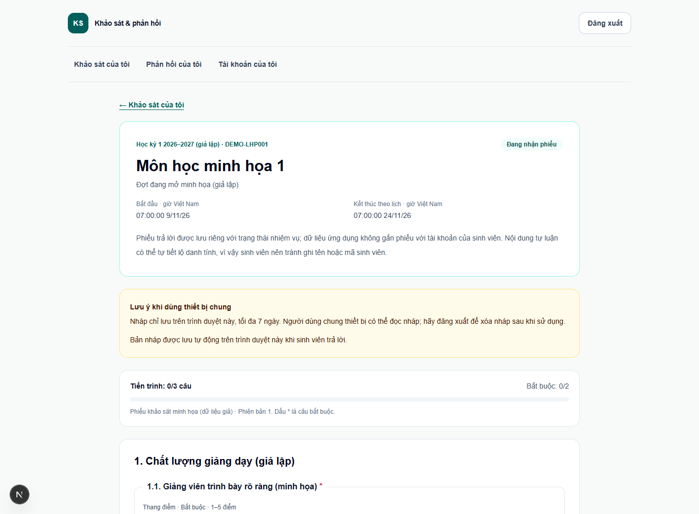
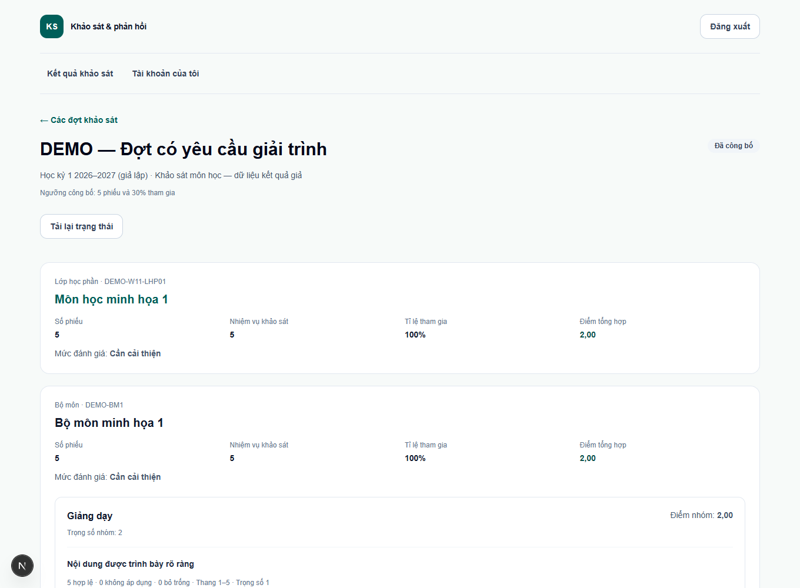
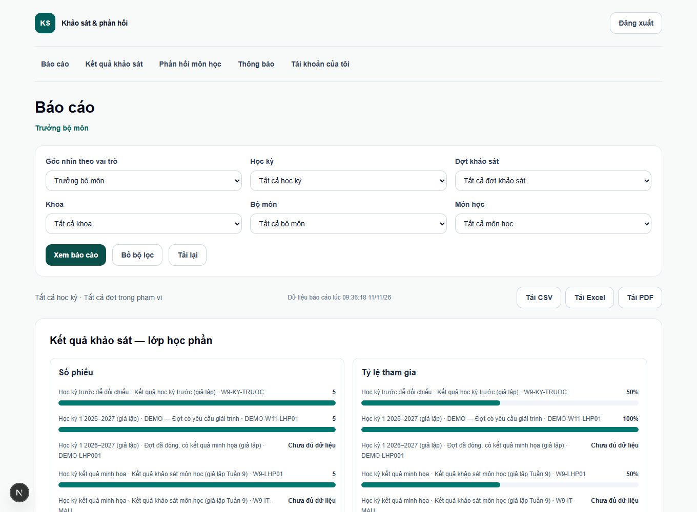
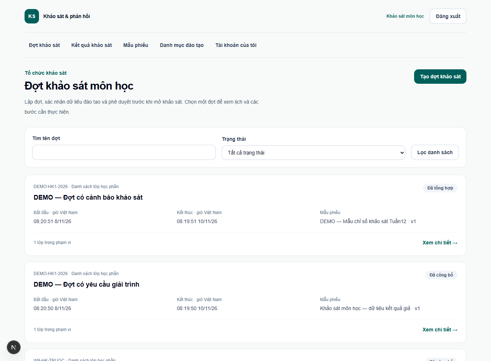
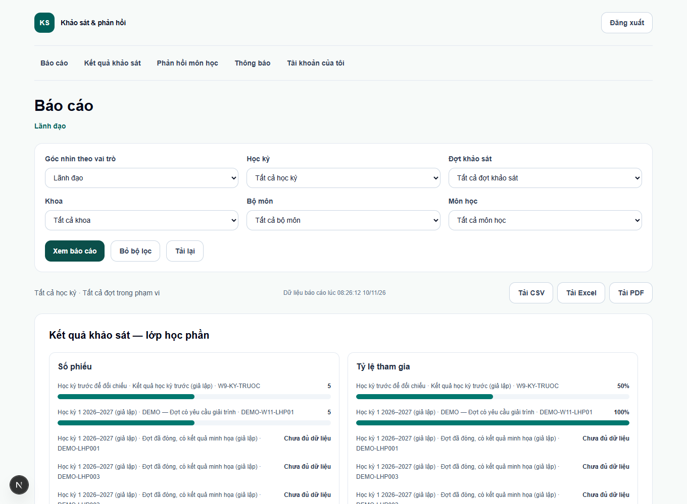
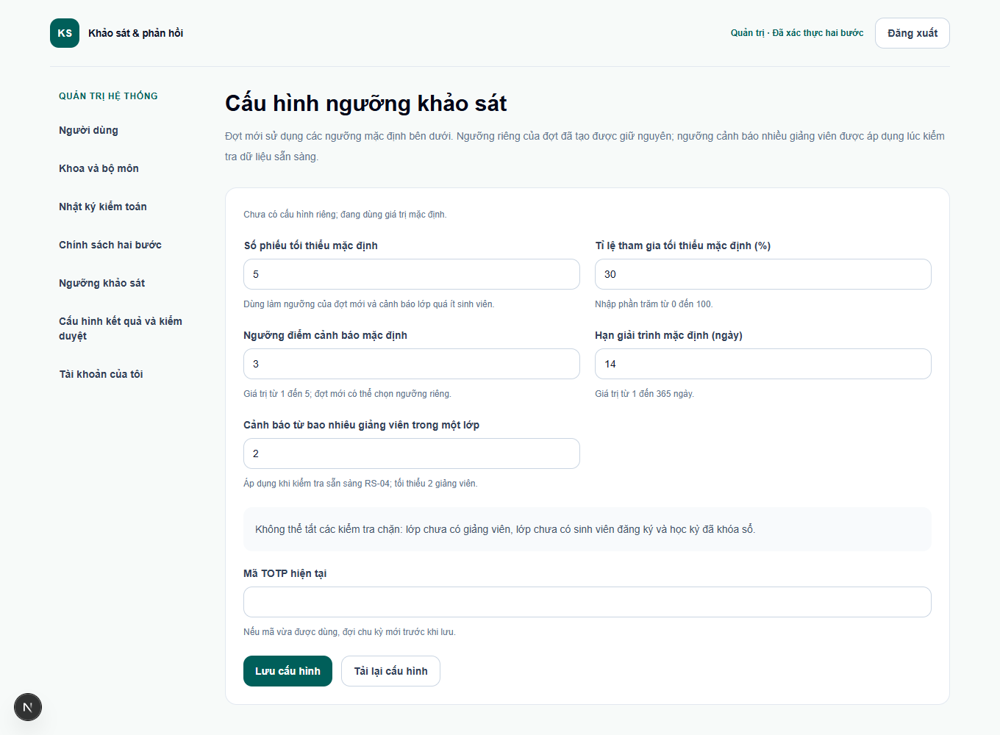
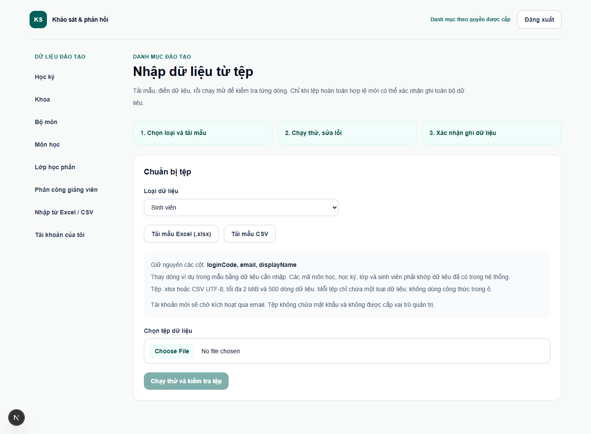
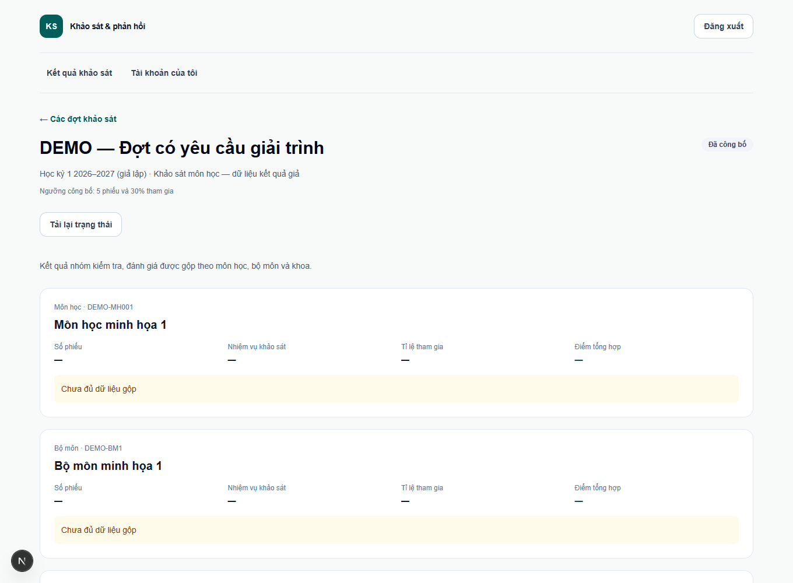
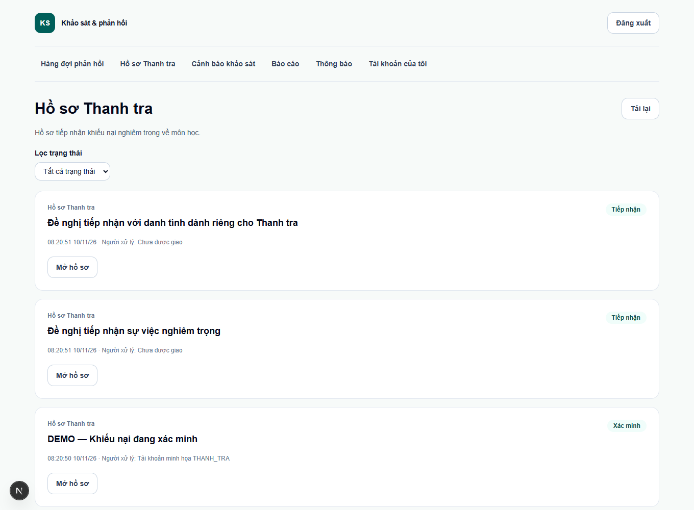

# Hướng dẫn sử dụng website khảo sát và phản hồi môn học

Tài liệu hướng dẫn thao tác theo 10 vai trò. Các ảnh ghi lại màn hình sau khi đăng nhập bằng từng tài khoản demo trên Chrome, dùng dữ liệu giả ngày 10–11/11/2026. Tên đợt, số liệu và nút hiển thị phụ thuộc vào quyền và trạng thái hiện tại. [Thông tin lượt chụp](assets/tuan-14/huong-dan/screenshots.json).

## Đăng nhập và chọn chức năng

1. Mở địa chỉ đã cài đặt theo [README](../README.md), vào **Đăng nhập**, nhập mã tài khoản hoặc email và mật khẩu. Nếu tài khoản mới ở trạng thái chờ kích hoạt, dùng **Kích hoạt tài khoản** và mở đường dẫn trong thư. Địa chỉ Mailpit của bản demo nằm trong hướng dẫn cài đặt.
2. Hoàn thành yêu cầu đổi mật khẩu hoặc xác thực hai bước nếu được nhắc. Từ **Tài khoản của tôi**, mở chức năng cần dùng. Nếu được gán nhiều vai trò, vào không gian tương ứng hoặc chọn **Góc nhìn theo vai trò** trên trang **Báo cáo**.
3. Đăng xuất trước khi đổi vai trò trong demo. Có thể dùng cửa sổ riêng cho mỗi vai trò để tránh dùng nhầm phiên. Các mã bên dưới chỉ dành cho dữ liệu giả. Mật khẩu demo ban đầu nằm trong README.

## 1. Sinh viên

Tài khoản minh họa `DEMO-SV00001`.

1. Mở **Khảo sát của tôi**. Lọc nhiệm vụ **Chưa hoàn thành**, xem tên lớp và hạn theo giờ Việt Nam rồi bấm **Làm khảo sát** ở đợt đang mở.
2. Trả lời các câu bắt buộc, xem lại và bấm **Nộp phiếu khảo sát**, sau đó xác nhận. Kiểm tra nhiệm vụ chuyển sang **Đã hoàn thành**. Phiếu chỉ nộp một lần. Nếu phải dừng giữa chừng, bản nháp chỉ được giữ trên trình duyệt đang dùng.
3. Vào **Phản hồi** để gửi và theo dõi góp ý. Chọn lớp, loại phản hồi và mức ẩn danh trước khi gửi. Khi được trả lời, mở lại phản hồi để đánh giá hài lòng hoặc đề nghị mở lại theo trạng thái. Với khiếu nại nghiêm trọng, xem kỹ lựa chọn danh tính trước khi gửi Thanh tra.

## 2. Giảng viên

Tài khoản minh họa `DEMO-GV00001`.

1. Vào **Kết quả khảo sát**, chọn đợt đã công bố và mở lớp được phân công. Xem số phiếu, tỉ lệ tham gia và thống kê. Lớp chưa đủ ngưỡng công bố sẽ ẩn điểm và nội dung góp ý.
2. Vào **Phản hồi** để mở góp ý được giao. Thực hiện tiếp nhận, bắt đầu xử lý và trả lời theo trạng thái hiển thị. Khi phản hồi ẩn danh, màn hình chỉ hiện tên thay thế.
3. Mở **Giải trình cải tiến** khi có yêu cầu. Điền nguyên nhân, biện pháp và mốc thực hiện, rồi gửi trưởng bộ môn xem xét. Theo dõi trạng thái trên hồ sơ.

## 3. Trưởng bộ môn

Tài khoản minh họa `TBM2026001`.

1. Mở **Báo cáo**, chọn góc nhìn **Trưởng bộ môn** và bấm **Xem báo cáo**. Có thể mở **Kết quả khảo sát** rồi chọn đợt đã công bố để xem thống kê thuộc bộ môn được gán. Đọc ghi chú về ngưỡng trước khi diễn giải điểm.
2. Trong **Giải trình cải tiến**, mở hồ sơ đã gửi, đọc nội dung và nhập nhận xét. Chọn xác nhận hoặc trả về để bổ sung theo tình trạng hồ sơ.
3. Vào **Phản hồi** để theo dõi công việc thuộc bộ môn, xử lý mục đến hạn và ghi rõ lý do khi chuyển tiếp. Dùng **Thông báo** để xem việc mới.

## 4. Trưởng khoa

Tài khoản minh họa `TK2026001`.

1. Mở **Báo cáo**, chọn góc nhìn **Trưởng khoa**, học kỳ hoặc đợt, rồi bấm **Xem báo cáo**.
2. Đọc thống kê trong khoa được gán. Dùng tỉ lệ tham gia và thông báo thiếu mẫu để quyết định số liệu nào có thể so sánh giữa kỳ hoặc giữa bộ môn.
3. Mở **Kết quả khảo sát** để xem chi tiết được phép sau công bố. Mở **Phản hồi** hoặc **Giải trình cải tiến** để theo dõi các mục cần xử lý thuộc phạm vi khoa.

## 5. Cán bộ Đảm bảo chất lượng

Tài khoản minh họa `DBCL2026001`.

1. Mở **Mẫu phiếu khảo sát**, tạo bản nháp từ mẫu mặc định hoặc tạo mẫu mới. Kiểm tra loại câu, thứ tự, câu bắt buộc và nhóm **Kiểm tra, đánh giá**, rồi **Xem trước**. Nếu mẫu đã khóa, tạo phiên bản mới để sửa.
2. Mở **Đợt khảo sát** → **Tạo đợt khảo sát**. Chọn học kỳ, mẫu, phạm vi, lịch và ngưỡng, lưu rồi **Trình PĐT xác nhận**. Theo dõi dữ liệu được xác nhận và quyết định phê duyệt. Đợt mở theo lịch đã duyệt.
3. Sau khi đợt đóng, vào **Kết quả khảo sát**, bấm **Tổng hợp kết quả**. Xử lý các mục **Kiểm duyệt góp ý** đang chờ bằng lựa chọn và lý do phù hợp. Khi đủ điều kiện, bấm **Công bố kết quả**. Mở **Báo cáo**, áp dụng bộ lọc rồi tải tệp cần dùng.

## 6. Lãnh đạo

Tài khoản minh họa `LD2026001`.

1. Vào **Đợt khảo sát**, mở đợt đã được Phòng Đào tạo xác nhận. Đọc phạm vi, lịch và dữ liệu sẵn sàng rồi **Phê duyệt đợt** hoặc **Từ chối phê duyệt** kèm lý do.
2. Vào **Báo cáo**, chọn góc nhìn **Lãnh đạo**, đặt học kỳ, đợt hoặc phạm vi, rồi bấm **Xem báo cáo**. Bấm **Tải CSV**, **Tải Excel** hoặc **Tải PDF** sau khi bộ lọc đã áp dụng. Kiểm tra học kỳ và đợt trên đầu tệp.
3. Trong **Hồ sơ Thanh tra**, xem thông tin tóm tắt được phép như trạng thái và kết luận. Nội dung chi tiết và tệp của hồ sơ thuộc quyền xử lý của Thanh tra.

## 7. Quản trị viên

Người vận hành tạo tài khoản riêng theo [hướng dẫn vận hành](VAN_HANH_TUAN_14.md#mở-demo-cục-bộ). Tài khoản này yêu cầu TOTP.

1. Đăng nhập, chọn **Bắt đầu thiết lập** ở lần đầu và quét mã QR bằng ứng dụng hỗ trợ chu kỳ 60 giây. Nhập mã sáu chữ số, lưu mã khôi phục ở nơi riêng rồi chọn **Tiếp tục vào tài khoản**.
2. Vào **Quản trị** để tạo tài khoản, gán vai trò kèm phạm vi, khóa hoặc mở tài khoản và đọc nhật ký. Cập nhật khoa, bộ môn trong **Danh mục**.
3. Vào **Cấu hình ngưỡng khảo sát** để xem mặc định của đợt mới. Thao tác nhạy cảm yêu cầu mã TOTP mới. Nếu mã vừa dùng bị từ chối, chờ chu kỳ kế tiếp. Quyền quản trị dành cho vận hành tài khoản và cấu hình, tách khỏi quyền đọc nghiệp vụ.

## 8. Phòng Đào tạo

Tài khoản minh họa `PDT2026001`.

1. Mở **Danh mục** để quản lý học kỳ, môn, lớp và phân công. Tại **Nhập dữ liệu**, chọn loại dữ liệu, tải tệp mẫu và điền mã danh mục tương ứng.
2. Chọn tệp rồi bấm **Chạy thử**. Sửa lỗi theo dòng trong kết quả và chạy thử lại. Khi dữ liệu hợp lệ, dùng **Xác nhận nhập**. Xem thêm [hướng dẫn nhập tệp](HUONG_DAN_IMPORT.md).
3. Trong **Đợt khảo sát**, mở đợt **Chờ xác nhận dữ liệu**, kiểm tra danh sách cảnh báo. Xác nhận khi đủ điều kiện hoặc trả về bản nháp kèm lý do. Mở **Phản hồi** để xử lý mục về tổ chức lớp. Khi khóa sổ kỳ, xử lý trước đợt còn được duyệt hoặc đang mở.

## 9. Phòng Khảo thí

Tài khoản minh họa `KT2026001`.

1. Mở **Kết quả khảo sát**, chọn đợt đã công bố. Đọc nhóm **Kiểm tra, đánh giá** theo môn học, bộ môn hoặc khoa. Điều kiện gộp cần ít nhất hai giảng viên đóng góp dữ liệu hợp lệ và đủ ngưỡng mẫu. Khi thiếu điều kiện, hệ thống hiện **Chưa đủ dữ liệu gộp**.
2. Trong **Phản hồi**, mở mục thi kết thúc học phần. Tiếp nhận, xử lý và trả lời hoặc chuyển tiếp theo thẩm quyền, kèm lý do. Phản hồi này không thay thế đơn phúc khảo.
3. Mở **Kiến nghị rà soát** để xem hoặc gửi kiến nghị đúng thẩm quyền. Báo cáo Khảo thí dùng số liệu gộp. Chi tiết lớp, giảng viên và góp ý tự luận thuộc góc nhìn khác.

## 10. Phòng Thanh tra

Tài khoản minh họa `TT2026001`.

1. Mở **Hồ sơ Thanh tra**, lọc trạng thái rồi **Mở hồ sơ** được phép. Chỉ nhận xử lý khi đủ thẩm quyền và không xung đột lợi ích.
2. Ghi thông tin xác minh, kết luận, tóm tắt để thông báo nếu hồ sơ có sinh viên cần nhận, rồi đóng theo trình tự hiển thị. Danh tính chỉ hiện khi sinh viên đã chọn cho Thanh tra biết và tài khoản có quyền. Lượt mở hồ sơ và tải tệp được ghi nhật ký.
3. Mở **Cảnh báo bất thường** để xem chỉ số. Đánh dấu bình thường, cần lưu ý hoặc chuyển xác minh, kèm ghi chú. Một cảnh báo là đầu mối để rà soát, chưa phải kết luận về lớp hay giảng viên.

## Khi màn hình chưa có dữ liệu

- Kiểm tra vai trò đang dùng, học kỳ, bộ lọc, lớp/phạm vi được giao và trạng thái đợt. Thông báo thiếu mẫu phản ánh ngưỡng bảo vệ dữ liệu.
- Khi thấy **Không tìm thấy** hoặc chức năng không xuất hiện, kiểm tra quyền với người quản lý thay vì mượn phiên tài khoản khác.
- Trong demo, dùng mã sinh viên có nhiệm vụ khảo sát. Tài khoản `SV2026001` chỉ có thể dùng để minh họa đăng nhập; danh sách khảo sát có thể trống.

[Kịch bản demo](KICH_BAN_DEMO.md) · [Ma trận quyền](MA_TRAN_QUYEN.md)
