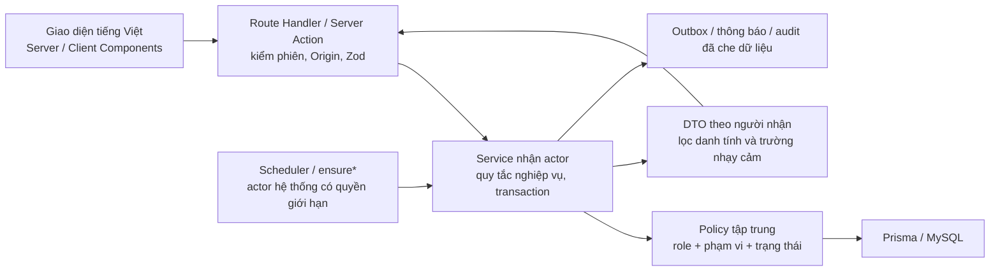

# Quy ước kiến trúc — Tuần 2

Cập nhật thực tế: **21/10/2026**. Tuần 2 theo giả định mỗi tuần 7 ngày là **07–13/10/2026**; đây không phải ngày thực hiện. Tài liệu này là thiết kế cho toàn đề tài. Tuần 2 chỉ áp dụng schema người dùng/danh mục, kiểm tra cấu trúc và tài liệu; chưa có giao diện chức năng, xác thực, policy chạy thật hoặc API nghiệp vụ.

Nguồn ràng buộc: [đặc tả](DAC_TA_NGHIEP_VU.md), [kế hoạch](KE_HOACH_15_TUAN.md), [yêu cầu](YEU_CAU.md), [ma trận quyền](PHAN_QUYEN.md). Khi có khác biệt, đối chiếu đặc tả trước khi sửa và ghi quyết định, không tự bỏ P0.

## 1. Kiểu kiến trúc và luồng xử lý

Chọn một ứng dụng Next.js full stack, tổ chức thành các module nghiệp vụ trong cùng codebase và cùng MySQL (modular monolith). Cách chia này giữ transaction nộp khảo sát trong một database, đồng thời cho phép kiểm thử service độc lập với giao diện. Chưa tách microservice, chưa thêm hàng đợi hay Redis.

Mũi tên service → policy → dữ liệu diễn tả thứ tự kiểm quyền. Policy dùng metadata tối thiểu, truy vấn có phạm vi; không đọc cả nội dung nhạy cảm rồi mới quyết định cho phép. Service gọi policy trước mọi truy cập dữ liệu nghiệp vụ. Khi cần nạp resource để kiểm IDOR, dùng truy vấn metadata đã giới hạn theo actor, không trả resource cho client trước khi policy đồng ý.

## 2. Trách nhiệm thư mục

| Vị trí                 | Trách nhiệm dự kiến                                                                            | Tránh đặt tại đây                                       |
| ---------------------- | ---------------------------------------------------------------------------------------------- | ------------------------------------------------------- |
| `src/app/`             | Giao diện, route theo vai trò, biên HTTP và chuyển lỗi sang tiếng Việt                         | Quy tắc BR, truy vấn Prisma tùy ý từ Client Component   |
| `src/components/`      | Thành phần trình bày, trạng thái form, khả năng tiếp cận                                       | Quyết định quyền truy cập dữ liệu                       |
| `src/server/services/` | Ca sử dụng theo miền: auth, catalog, templates, campaigns, surveys, results, feedback, reports | Phụ thuộc DOM hoặc tin actor do client gửi              |
| `src/server/policies/` | `can(actor, action, resource)` và bộ lọc phạm vi; từ chối mặc định                             | Cho ADMIN quyền nghiệp vụ chỉ vì là ADMIN               |
| `src/server/jobs/`     | Gọi cùng service idempotent như luồng truy cập                                                 | Một phiên bản quy tắc riêng chỉ có trong cron           |
| `src/lib/`             | db, env, crypto, mail, audit, thời gian, rate limit                                            | Dịch vụ có thể được client import cùng bí mật           |
| `src/validation/`      | Hợp đồng Zod đầu vào/DTO công khai dùng chung phù hợp                                          | Schema trả nguyên model chứa secret                     |
| `prisma/schema.prisma` | Schema **được áp dụng** trong tuần hiện tại                                                    | Model tuần sau chưa được duyệt triển khai               |
| `prisma/design.prisma` | Blueprint toàn hệ thống, validate/generate metadata                                            | Nguồn cho lệnh migrate hoặc db push cục bộ              |
| `tests/`               | Đơn vị, tích hợp MySQL, E2E theo FR/BR                                                         | Kết quả giả hoặc test chỉ sao chép biểu thức triển khai |

Các thư mục trên là quy ước thiết kế; thư mục chưa có nhu cầu triển khai không cần chứa mã khung giả. Công nghệ cố định theo đặc tả: TypeScript strict, Prisma/MySQL, Zod, Tailwind/shadcn/ui; `jose`, bcrypt/bcryptjs, `otplib`, `nodemailer`, `exceljs` được đưa vào đúng tuần sử dụng. Chưa cài thêm thư viện chỉ để thể hiện có tên trong thiết kế.

## 3. Actor, quyền và ranh giới dữ liệu

Actor được xây phía máy chủ từ phiên đã xác minh; client không được gửi `actorId`, role hoặc `mfa` để server tin trực tiếp. Actor thiết kế gồm `userId`, trạng thái tài khoản/phiên, các gán `(role, scopeType, scopeKey)` và mức MFA. Job dùng actor hệ thống được định danh, chỉ được gọi hành động cần thiết; không giả làm ADMIN hoặc sinh viên.

JWT access phải gắn được với phiên/chuỗi phiên còn hiệu lực để máy chủ kiểm trạng thái thu hồi và tài khoản; chỉ xác minh chữ ký/exp sẽ chưa bảo đảm đăng xuất, khóa tài khoản hay đổi mật khẩu vô hiệu token cũ ngay. Khi hiện thực Tuần 3 cần chốt claim định danh phiên và truy vấn trạng thái tương ứng, không tin role/MFA cũ trong token sau khi gán quyền hoặc phiên đã bị thu hồi. Refresh rotation không được vô tình làm mất khả năng nhận diện phiên access còn hợp lệ trong cùng family.

Mỗi service theo trình tự:

1. Kiểm tra actor, hành động và điều kiện MFA; mặc định từ chối.
2. Kiểm tra resource trong phạm vi quyền: lớp được phân công, khoa/bộ môn được gán, phản hồi của mình hoặc được định tuyến.
3. Kiểm tra BR, học kỳ khóa, trạng thái và thời gian từ máy chủ.
4. Ghi trong transaction khi có nhiều thay đổi phải đồng thời; kiểm tra số dòng của cập nhật có điều kiện.
5. Trả DTO cho đúng người nhận; ghi audit cho phép và thông báo sau khi dữ liệu đã nhất quán.

Kiểm quyền phải có ở service dù route đã kiểm phiên. Middleware chỉ là lớp kiểm tra thô, không thay thế kiểm quyền. Mọi route có ID phải có test tài nguyên của mình/của người khác/ngoài phạm vi (BR-34). ADMIN quản lý tài khoản, vai trò, cấu hình và audit; **không mặc định** xem kết quả khảo sát hoặc nội dung phản hồi (BR-18). Người dùng nhiều vai trò có quyền từ các gán hợp lệ, không từ nhãn giao diện hiện tại.

## 4. Hợp đồng route và DTO (thiết kế, chưa tạo endpoint)

| Biên dự kiến                                  | Đầu vào Zod chính                         | Kiểm tra trong service                                          | DTO trả về                                                                   |
| --------------------------------------------- | ----------------------------------------- | --------------------------------------------------------------- | ---------------------------------------------------------------------------- |
| `POST /api/auth/login` — Tuần 3               | Mã/email, mật khẩu; mật khẩu tính số byte | Khóa tạm, so sánh bcrypt, phiên, yêu cầu MFA                    | Kết quả chung; cookie hoặc trạng thái cần MFA; không trả hash/token vào JSON |
| `POST /api/auth/refresh` — Tuần 3             | Cookie refresh, Origin                    | Băm token, xoay vòng, phát hiện dùng lại và thu hồi family      | Cookie mới; không lộ hồ sơ phiên nội bộ                                      |
| `/api/catalog/...` — Tuần 5                   | Mã, tên, ngày, FK, phân trang             | Quyền quản lý, học kỳ khóa, dữ liệu tham chiếu                  | Trường công khai của danh mục và lỗi theo dòng khi import                    |
| `POST /api/campaigns/:id/transition` — Tuần 7 | ID, đích chuyển, lý do khi bắt buộc       | Vai trò, phạm vi, trạng thái cũ, thời hạn                       | Trạng thái mới; không lộ danh sách phiếu                                     |
| `POST /api/survey-tasks/:id/submit` — Tuần 8  | Giá trị câu trả lời, không nhận studentId | Task của actor, metadata mẫu/lớp/đợt, thời gian, PENDING → DONE | Chỉ xác nhận đã nộp; không trả responseId/answerId để ghép với danh tính     |
| `GET /api/results/...` — Tuần 9               | Phạm vi và phân trang                     | Trạng thái công bố, ngưỡng mẫu, phạm vi role                    | Số liệu gộp và tự luận đã kiểm duyệt; không phiếu gắn sinh viên              |
| `/api/feedback/...` — Tuần 10–11              | Loại, mức độ, nội dung, chuyển trạng thái | Đăng ký hợp lệ, định tuyến, SLA, quyền trao đổi                 | Projection riêng cho người gửi/người xử lý; che tác giả khi ẩn danh          |
| `/api/reports/...` — Tuần 12                  | Bộ lọc, định dạng                         | Quyền xuất, ngưỡng, danh sách trường cho phép                   | Tệp không chứa định danh phiếu; ghi audit xuất dữ liệu                       |

Tên route trên là hợp đồng đề xuất, sẽ chốt khi hiện thực. Không hiểu bảng này là API đã có. Zod kiểm cấu trúc và miền giá trị; các điều kiện cần dữ liệu như câu hỏi thuộc mẫu khóa nào phải kiểm ở service trong transaction. Không trả trực tiếp object Prisma; dùng `select` theo danh sách trường cho phép rồi ánh xạ DTO. Lỗi ngoài phạm vi dùng thông báo không tiết lộ tài nguyên có tồn tại; log nội bộ cũng phải che bí mật.

## 5. Transaction, đồng thời và job

Các luồng nộp phiếu (BR-02/04), chuyển trạng thái (BR-06/22), xoay refresh token và tiêu thụ mã khôi phục phải nguyên tử. Thiết kế dùng cập nhật có điều kiện theo trạng thái cũ, kiểm tra đúng một dòng; điều kiện không đạt thì từ chối và rollback. Unique của nhiệm vụ ngăn tạo task trùng nhưng **không tự bảo đảm** nộp đúng một lần: transaction nộp là điều kiện còn lại.

`ensureCampaignOpened`, `ensureCampaignClosed`, `ensureAggregated`, nhắc hạn và leo thang là các ca sử dụng dự kiến Tuần 7/9/11. Scheduler chỉ kích hoạt, truy cập sau thời điểm hạn cũng gọi `ensure*`; tính đúng không phụ thuộc cron chạy đúng giây. Unique trên `(campaignId, sectionId, studentId)`, `(feedbackId, level)`, `(campaignId, studentId, reminderDate)` và `EmailOutbox.idempotencyKey` hỗ trợ idempotency. Email qua outbox được gửi sau commit; gửi lại không được tạo lại chuyển trạng thái.

## 6. Thiết kế xác thực và bảo mật theo tuần

| Tuần  | Ràng buộc sẽ hiện thực và kiểm thử                                                                                                                                                                                                                                                                                                           |
| ----- | -------------------------------------------------------------------------------------------------------------------------------------------------------------------------------------------------------------------------------------------------------------------------------------------------------------------------------------------- |
| 3     | bcrypt cost ≥ 12, tối thiểu 10 ký tự/tối đa 72 byte, chặn mật khẩu phổ biến, so sánh giả khi tài khoản không tồn tại; JWT access mặc định 15 phút, thuật toán cố định và kiểm `iss/aud/exp/sub`; refresh ngẫu nhiên 256 bit chỉ lưu hash, xoay mỗi lần dùng và thu hồi family khi reuse; khóa 15 phút sau 5 lần sai/15 phút; thông báo chung |
| 3     | Cookie httpOnly, Secure ở production, SameSite=Lax; refresh path `/api/auth`; không token trong localStorage; Origin cho POST/PUT/DELETE; token reset một lần hết hạn 30 phút, đổi mật khẩu thu hồi mọi phiên; tài khoản import chờ kích hoạt hoặc buộc đổi mật khẩu tạm                                                                     |
| 4     | TOTP 6 chữ số/30 giây, lệch ±1 chu kỳ; QR + khóa nhập tay, nhập mã đầu để bật; AES-256-GCM cho secret; lưu băm 10 mã khôi phục dùng một lần; cấm reuse TOTP trong cùng bước; 5 lần sai khóa 15 phút                                                                                                                                          |
| 4     | Token tạm 5 phút chỉ dùng MFA; ADMIN chưa bật chỉ vào đăng ký MFA; mọi hành động quản trị kiểm `ADMIN && mfa`; reset bởi admin khác hoặc script máy chủ có audit; step-up thao tác nhạy cảm P1; chính sách bắt buộc 2FA vai trò khác theo cấu hình                                                                                           |
| 5, 10 | Import chạy thử trước ghi; upload tối đa 3 tệp × 5 MB, PNG/JPG/PDF, kiểm đuôi và magic bytes, tên ngẫu nhiên, ngoài public, tải qua route kiểm quyền                                                                                                                                                                                         |
| 7–12  | Kiểm chuyển trạng thái, IDOR, ngưỡng công bố; ẩn danh khảo sát; audit thao tác nhạy cảm không nội dung phiếu/token/mật khẩu; xuất danh sách trường cho phép                                                                                                                                                                                  |
| 13–14 | Rà soát CSP, frame-ancestors, nosniff, Referrer-Policy, Permissions-Policy, HSTS production; kiểm OWASP, tải đồng thời, phụ thuộc/giấy phép, sao lưu và phục hồi bằng kết quả thật                                                                                                                                                           |

Khóa JWT và khóa mã hóa lấy từ biến môi trường, ≥ 32 byte ngẫu nhiên; dự kiến có script sinh/đổi khóa và `keyVersion` cho TOTP. Rate limit áp dụng tài khoản/IP cho đăng nhập, OTP, reset; cũng giới hạn nộp phiếu và phản hồi nhưng không lưu IP/requestId liên kết với response. Không dùng `dangerouslySetInnerHTML` với dữ liệu người dùng; Prisma tham số hóa, truy vấn thô chỉ khi tham số hóa. Env phải được Zod kiểm ngay khi khởi động lúc module nghiệp vụ được triển khai. Tài khoản demo chỉ ở dev/demo và bị chặn ở production.

Các mục bảo mật trên là ràng buộc thiết kế lấy từ Mục 8; **chưa phải bằng chứng đã có lớp bảo vệ chạy thật ở Tuần 2**.

## 7. Thời gian, thông báo, log và ẩn danh

Thời điểm nghiệp vụ thông thường lưu UTC, hiển thị Asia/Ho_Chi_Minh. Dữ liệu chỉ cần ngày dùng MySQL DATE. Riêng SurveyTask chỉ có `doneDate`, SurveyResponse chỉ có `submittedDate`; không thêm timestamp chính xác vào response/answer. Nháp khảo sát chỉ lưu phía trình duyệt; không có bảng nháp máy chủ. [Thiết kế ẩn danh](THIET_KE_AN_DANH.md) và [ADR-003](decisions/ADR-003-an-danh.md) mô tả lý do không FK metadata.

Audit có actor cán bộ cho kiểm duyệt, chuyển trạng thái, xuất danh sách và thay đổi quyền. Luồng sinh viên nộp phiếu không ghi actor sinh viên cùng responseId/answerId hoặc nội dung phiếu. Các tầng reverse proxy, APM, lỗi Zod, SQL/query log và analytics cần cùng chính sách che dữ liệu khi triển khai; không dùng correlation ID để nối phiếu với request có định danh. Notification cho người chưa hoàn thành dựa SurveyTask, không dựa phiếu.

## 8. Kiểm chứng và triển khai tiếp

- Tuần 2: validate hai schema, đối chiếu DMMF nhóm nền, kiểm đồ thị quan hệ vùng ẩn danh (5.6a), migration chỉ chín bảng nền và kiểm ràng buộc MySQL. Kết quả chạy thật ghi trong báo cáo phiên, không suy từ tài liệu này.
- Tuần 3–4: test phiên, reuse refresh, giới hạn sai, MFA và ma trận policy.
- Tuần 7–9: test trạng thái/job, nộp trùng, 20 request đồng thời, công thức TC-AGG-01 và ngưỡng công bố.
- Tuần 10–12: test định tuyến/projection ẩn danh, SLA, tệp, xuất không định danh và UC-GOLD E2E.
- Tuần 13: đánh giá bảo mật, hiệu năng và giới hạn bằng số liệu thật; chưa ghi trước tỷ lệ, độ phủ hoặc thời gian phản hồi.

Phân kỳ schema được quyết định tại [ADR-002](decisions/ADR-002-schema-theo-tuan.md). Sơ đồ dữ liệu nằm ở [ERD](ERD.md), các chuyển trạng thái ở [sơ đồ nghiệp vụ](SO_DO_NGHIEP_VU.md), màn hình ở [wireframe](WIREFRAME.md).
