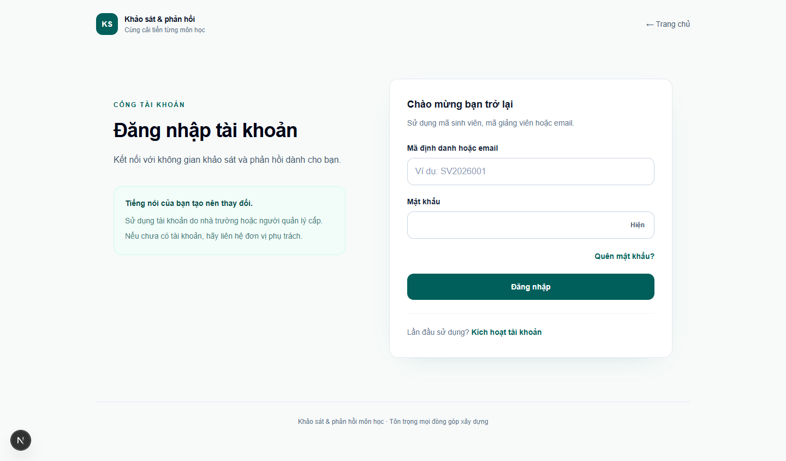
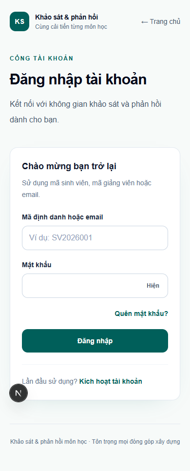
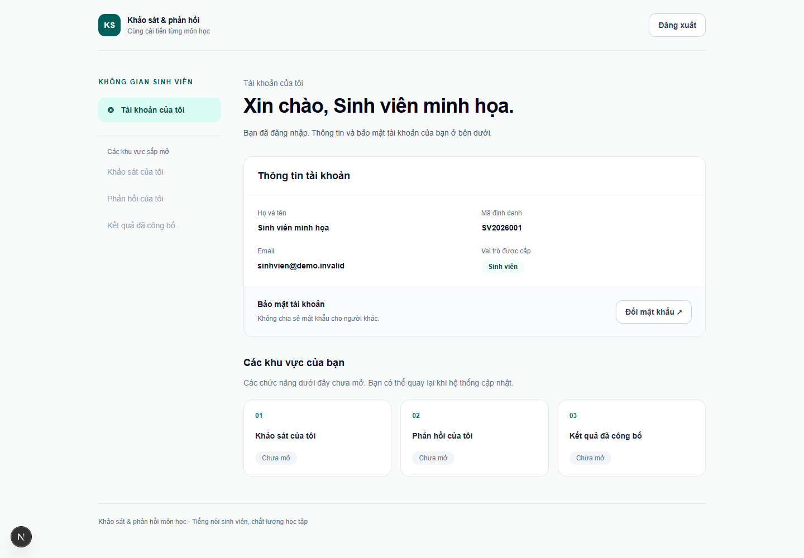
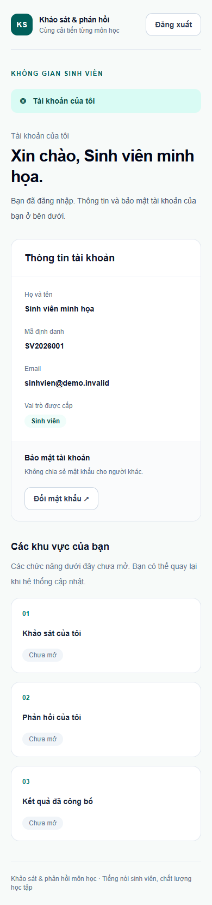
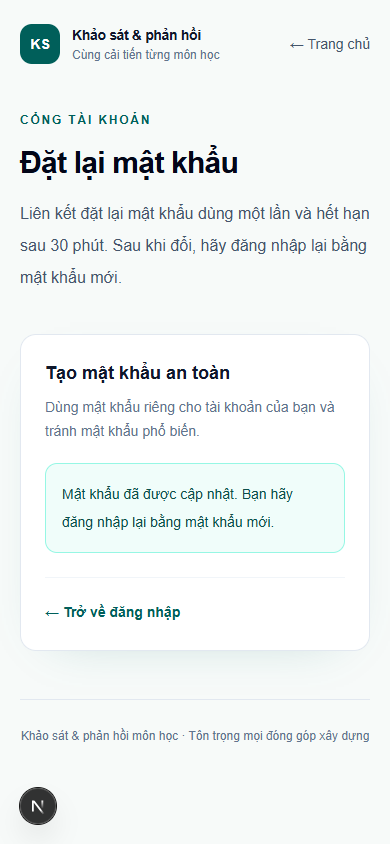

# Kiểm tra giao diện Tuần 3

## 1. Thời điểm và môi trường

- Thực hiện ngày **22/10/2026**, múi giờ Asia/Saigon, trên ứng dụng phát triển tại `http://localhost:3000`.
- Chrome chạy headless bằng Puppeteer trong một phiên và hồ sơ tạm riêng; không dùng hồ sơ trình duyệt cá nhân, không thay đổi hay dừng tiến trình ứng dụng của người dùng.
- Viewport chính: desktop **1440px**, mobile **390px**. Kiểm thêm trang chủ và đăng nhập ở **360px**.
- Kiểm đăng nhập/đăng xuất dùng sinh viên minh họa `SV2026001`; thông tin trong ảnh tài khoản là dữ liệu giả từ seed. Kiểm khôi phục bổ sung dùng fixture UUID riêng, không thay đổi mật khẩu seed.

## 2. Mười lượt kiểm tra trang

Có **5 route × 2 kích thước = 10 lượt**.

| Trang | 1440px | 390px | Kết quả quan sát |
| --- | --- | --- | --- |
| `/` | HTTP 200, đạt | HTTP 200, đạt | Đăng nhập là hành động chính; không có liên kết trang kỹ thuật trong luồng sinh viên; các khu vực nghiệp vụ ghi “Chưa mở”. |
| `/dang-nhap` | HTTP 200, đạt | HTTP 200, đạt | Form chuyển sang trạng thái sẵn sàng sau kiểm tra phiên; có nhãn cho mã định danh và mật khẩu. |
| `/quen-mat-khau` | HTTP 200, đạt | HTTP 200, đạt | Có trường email và đường quay lại đăng nhập. |
| `/dat-lai-mat-khau` không token | HTTP 200, đạt | HTTP 200, đạt | Hiển thị hướng dẫn yêu cầu liên kết mới; không giả định một liên kết hợp lệ. |
| `/kich-hoat` không token | HTTP 200, đạt | HTTP 200, đạt | Hiển thị form yêu cầu liên kết kích hoạt qua email. |

Ở cả 10 lượt: không phát hiện tràn ngang; không có input thiếu label; tất cả anchor được kiểm đều trỏ trong cùng origin. Trang chủ và đăng nhập cũng không tràn ngang ở 360px. Phạm vi tiếp cận giới hạn ở form, nhãn và thao tác bàn phím được kiểm dưới đây.

## 3. Form, bàn phím và phiên đăng nhập

| Thao tác thực hiện | Kết quả thực tế |
| --- | --- |
| Gửi form đăng nhập rỗng ở 1440/390px | Hai input có `aria-invalid=true`; focus chuyển đến mã định danh. |
| Gửi form quên mật khẩu rỗng ở 1440/390px | Email báo lỗi và nhận focus. |
| Gửi form yêu cầu kích hoạt rỗng ở 1440/390px | Email báo lỗi và nhận focus. |
| Dùng Tab trên form đăng nhập ở 360px | Thứ tự: mã định danh → mật khẩu → Hiện → Quên mật khẩu → Đăng nhập. Các nút/liên kết hiện focus bàn phím. |
| Nhấn Enter khi focus nút Đăng nhập, form rỗng | Form báo hai lỗi và đưa focus về mã định danh. |
| Đăng nhập bằng sinh viên seed | Chuyển đến `/tai-khoan`; hiển thị “Sinh viên minh họa”, mã `SV2026001` và vai trò “Sinh viên”. Không có liên kết trang sức khỏe. |
| Xem tài khoản ở 390px và 1440px | Không tràn ngang; thông tin tài khoản, đổi mật khẩu và các khu vực “Chưa mở” đọc được. Sidebar các khu vực tương lai được ẩn ở mobile để giảm nội dung lặp trước thông tin tài khoản. |
| Đăng xuất bằng nút trên tài khoản | Chuyển về `/dang-nhap`; form đăng nhập hoạt động trở lại. |

Ảnh đăng nhập được chụp sau khi kiểm tra phiên hoàn tất và hiệu ứng chuyển màu của nút kết thúc. Đã mở và xem ảnh thật sau khi chụp.

### Luồng đặt lại mật khẩu bổ sung trên trình duyệt

Thực hiện thêm ngày 22/10/2026, viewport 390px, bằng tài khoản ACTIVE có UUID/email `@example.invalid` riêng cho lần thử:

1. Điền và gửi form `/quen-mat-khau`: API trả 200, giao diện hiện thông báo trung tính.
2. Đọc đúng thư của fixture qua API Mailpit: liên kết có origin `http://localhost:3000` và token trong fragment.
3. Mở liên kết bằng Chrome: form mật khẩu xuất hiện, fragment bị xóa khỏi URL hiển thị; query không chứa token và `localStorage` rỗng.
4. Nhập mật khẩu mới và xác nhận, gửi form: API reset trả 200, giao diện báo cập nhật thành công và yêu cầu đăng nhập lại.
5. Đi theo liên kết đăng nhập, dùng mật khẩu mới: vào `/tai-khoan` đúng fixture.
6. Đăng xuất fixture: trở về đăng nhập.
7. Dọn đúng User UUID và AuthToken/Session/Role/Audit/bộ đếm tài khoản-token của fixture. So sánh seed trước/sau: giữ nguyên hash mật khẩu, trạng thái và cờ đổi mật khẩu; thư giả còn trong Mailpit để đối chiếu. Bộ đếm IP dùng chung không bị xóa.

Luồng hoàn chỉnh qua cả bảy bước. Script không ghi token/liên kết bí mật ra log. Lần thử trước đã dừng ở giả định của script về metadata request của Puppeteer: metadata điều hướng có thể còn fragment. Đã sửa phép kiểm thành fragment của URL hiển thị/query/localStorage, dọn fixture của lần thử trước và chạy lại toàn luồng thành công.

## 4. Ảnh kiểm chứng

### Đăng nhập — desktop 1440px

### Đăng nhập — mobile 390px

### Tài khoản sinh viên minh họa — desktop 1440px

### Tài khoản sinh viên minh họa — mobile 390px

### Đặt lại mật khẩu thành công — mobile 390px

## 5. Giới hạn và điểm còn lại

- Không ghi nhận lỗi JavaScript trong các lượt kiểm. Có **404 `/favicon.ico`** là điểm giao diện phụ chưa xử lý. Các HTTP 401 từ `/api/auth/me` và refresh khi chưa đăng nhập là kết quả dự kiến của kiểm tra phiên, không hiển thị lỗi cho người dùng.
- Đã kiểm một luồng email → liên kết fragment → đặt lại mật khẩu → đăng nhập bằng mật khẩu mới trên trình duyệt. Chưa kiểm luồng kích hoạt bằng token qua trình duyệt, hoặc toàn bộ trường hợp token hết hạn/dùng lại bằng giao diện.
- Không thử đổi mật khẩu sinh viên seed, quyền các vai trò khác hoặc MFA qua trình duyệt. Kiểm tra API/MySQL/Mailpit và các cổng kỹ thuật được ghi trong tài liệu nghiệm thu Tuần 3 của phiên chính.
- Trang khảo sát, phản hồi và kết quả chưa mở theo phạm vi hiện tại. QA không khẳng định các chức năng đó đã hoạt động.
- Script QA và JSON kết quả thô (`results.json`, `keyboard-results.json`, `recovery-results.json`) nằm trong `work/week3-qa` của máy thực hiện, ngoài Git; năm ảnh bằng chứng ở trên được lưu trong kho dự án. Lần đầu script đợi `networkidle0` đã timeout do luồng mạng môi trường phát triển; lần chạy nghiệm thu sử dụng DOM và trạng thái sẵn sàng của form, hoàn tất các lượt kiểm nêu trên.
