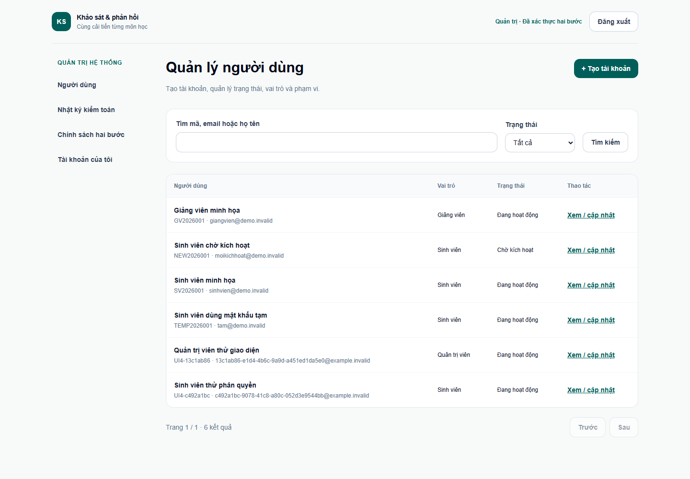
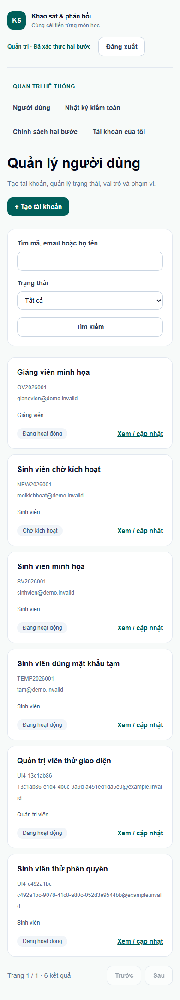
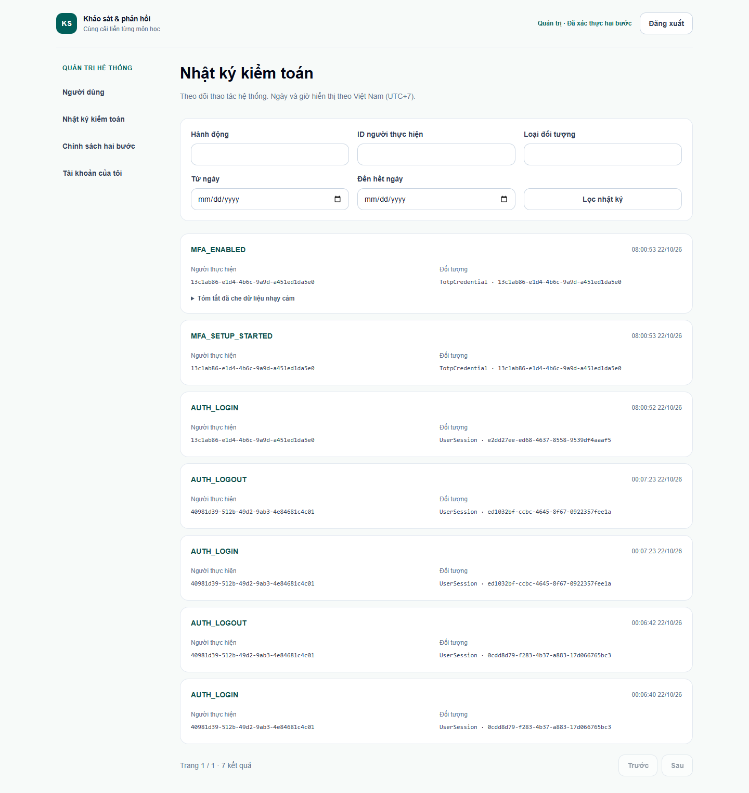
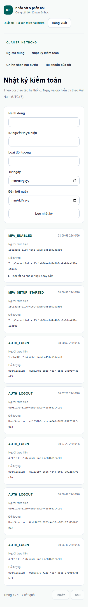
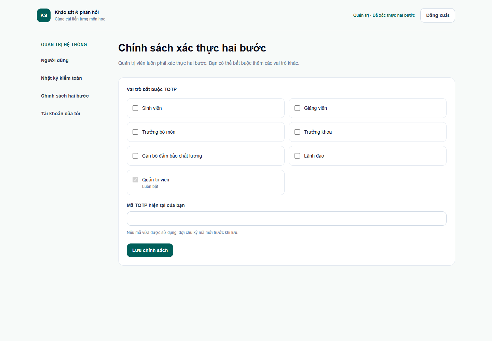
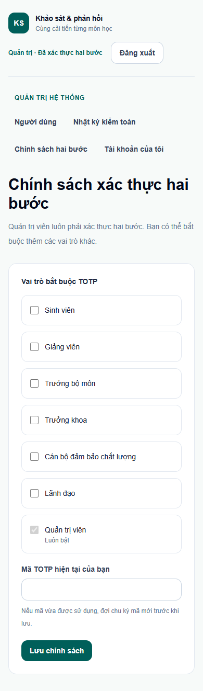

# Kiểm tra giao diện Tuần 4

## 1. Môi trường và dữ liệu

- Thực hiện ngày **22/10/2026**, múi giờ Asia/Saigon, tại `http://localhost:3000` đang chạy sẵn.
- Chrome headless/Puppeteer dùng hồ sơ tạm riêng. Không dừng server hoặc dùng hồ sơ trình duyệt cá nhân.
- Tạo ADMIN và sinh viên giả bằng UUID riêng; tài khoản thứ ba được tạo bằng form quản trị. Không thay đổi tài khoản seed hoặc chính sách MFA dùng chung.
- Mật khẩu, secret TOTP, mã OTP, cookie và 10 mã khôi phục chỉ được giữ trong bộ nhớ của lần thử. Không ghi các giá trị đó vào log, JSON hoặc ảnh.

## 2. Sáu lượt kiểm trang và ảnh

| Trang | Desktop 1440px | Mobile 390px | Quan sát |
| --- | --- | --- | --- |
| `/quan-tri/nguoi-dung` | Đạt | Đạt | Bộ lọc có nhãn, bảng ở desktop và thẻ người dùng ở mobile; liên kết chi tiết đọc được. |
| `/quan-tri/nhat-ky` | Đạt | Đạt | Bộ lọc và các bản ghi có nhãn, ID dài xuống dòng; giờ hiển thị Việt Nam UTC+7. |
| `/quan-tri/chinh-sach-mfa` | Đạt | Đạt | Vai trò ADMIN luôn được chọn và không cho bỏ chọn; có trường TOTP để xác nhận thay đổi. Chỉ xem, không gửi thay đổi chính sách. |

Cả **6/6 lượt** không tràn ngang toàn trang và không có input/select/textarea thiếu nhãn. Đã mở ảnh thật để kiểm tra bố cục; sau khi nhận thấy bảng và bộ lọc người dùng quá chật trên mobile, đã đổi danh sách mobile thành thẻ, xếp bộ lọc theo chiều dọc và chụp lại. Ảnh ẩn huy hiệu công cụ Next.js của môi trường dev, không sửa nội dung sản phẩm. Tất cả tài khoản/định danh trong ảnh là dữ liệu giả.

## 3. Luồng đã chạy thực tế

| Thao tác | Kết quả thực tế |
| --- | --- |
| Chưa đăng nhập, mở trang quản trị | Được đưa về `/dang-nhap`. |
| ADMIN chỉ nhập đúng mật khẩu | Được đưa tới `/bao-mat/thiet-lap`; mở trực tiếp quản trị vẫn bị đưa về bước thiết lập. |
| Chưa bấm Bắt đầu thiết lập | Chưa có QR hoặc khóa trong DOM. Bấm bắt đầu mới nhận QR và khóa nhập tay; `localStorage` rỗng. |
| Nhập mã TOTP đúng để xác nhận | API 200, gỡ QR/khóa và hiển thị đúng 10 mã khôi phục. Nút tiếp tục bị khóa đến khi đánh dấu đã lưu. Không chụp bước này. |
| Xác nhận đã lưu và tiếp tục | Vào quản trị bằng phiên FULL. |
| Form tạo người dùng, nhập mã TOTP chu kỳ mới | API 201 qua CSRF và step-up; MySQL có tài khoản PENDING_ACTIVATION cùng vai trò SINH_VIEN/GLOBAL đúng dữ liệu nhập. |
| Khóa/mở tài khoản pending vừa tạo | API 200; trạng thái lần lượt DISABLED rồi PENDING_ACTIVATION. Mở khóa không tự kích hoạt tài khoản chưa có mật khẩu. |
| Dùng Tab trong form tạo | Thứ tự mã định danh → email → họ tên. Gửi form rỗng bị chặn và focus về mã định danh. |
| Bộ lọc nhật ký có ngày kết thúc trước ngày bắt đầu | Hiển thị lỗi tiếng Việt, không áp dụng khoảng ngày sai. |
| Đăng xuất ADMIN rồi đăng nhập lại | Chuyển tới `/bao-mat/xac-thuc`; chọn chế độ mã khôi phục, dùng một mã chưa dùng và nhận API 200, vào lại quản trị FULL. |
| Đăng nhập sinh viên giả | Vào tài khoản của mình. Mở không gian GIANG_VIEN hoặc trang quản trị bị đưa về tài khoản. Không gian SINH_VIEN mở được, API lớp học phần trả 200 và danh sách trống đúng fixture. |
| JavaScript | Không ghi nhận sự kiện `pageerror` trong lượt cuối. |

Lượt cuối hoàn tất **13 nhóm kiểm tra**, bao gồm kiểm dữ liệu/cleanup; số nhóm này không phải số unit test. Các lượt trước bị gián đoạn ở thao tác điều hướng của script sau logout. Đã sửa script chờ status API cùng URL/form sẵn sàng thay vì điều hướng/chờ điều hướng trùng, rồi chạy lại toàn luồng thành công. Không dùng kết quả từng phần thay cho kết quả lượt cuối.

## 4. Ảnh bằng chứng

### Người dùng — desktop và mobile

### Nhật ký — desktop và mobile

### Chính sách hai bước — desktop và mobile

## 5. Dọn dữ liệu và giới hạn

- Đã dọn đúng các UUID fixture cùng RoleAssignment, UserSession/chuỗi xoay vòng, AuthToken, TotpCredential/TotpRecoveryCode, AuditLog liên quan và bucket tài khoản riêng.
- So sánh trước/sau xác nhận hash mật khẩu, trạng thái và cờ đổi mật khẩu của các seed không đổi. Không xóa bucket IP chung hoặc hàng `ADMIN_MUTATION_LOCK`. Không reset database/volume hay đổi chính sách MFA toàn hệ thống.
- Chưa thao tác đổi phạm vi vai trò, đặt lại MFA của ADMIN khác, thay đổi chính sách MFA hoặc thử mọi mã sai/hết hạn/reuse qua giao diện. Các bằng chứng API/unit/MySQL cho những trường hợp đó được ghi riêng trong nghiệm thu của phiên chính.
- Đã kiểm xác nhận thiết lập bằng mã TOTP và đăng nhập lại bằng mã khôi phục. Không coi đó là bằng chứng đã kiểm mọi nhánh TOTP trên trình duyệt.
- Chưa kiểm đủ các trình duyệt, thiết bị hay toàn bộ tiêu chí tiếp cận. Phần khảo sát, phản hồi và kết quả chưa mở theo phạm vi tuần.
- Mã TOTP trong QA được sinh bằng thư viện theo cấu hình RFC để kiểm luồng giao diện; chưa quét QR bằng điện thoại hoặc ứng dụng Authenticator thật.
- Script và kết quả JSON đã che nằm tại `work/week4-qa` trên máy thực hiện, ngoài Git. Chỉ sáu ảnh không chứa bí mật được đưa vào kho.
