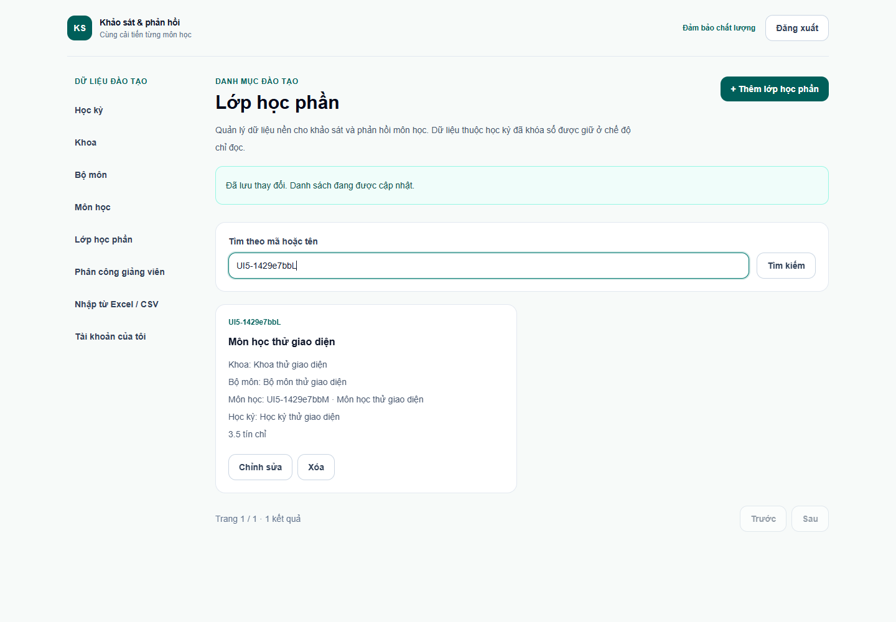
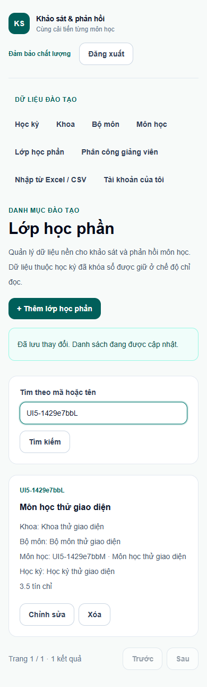
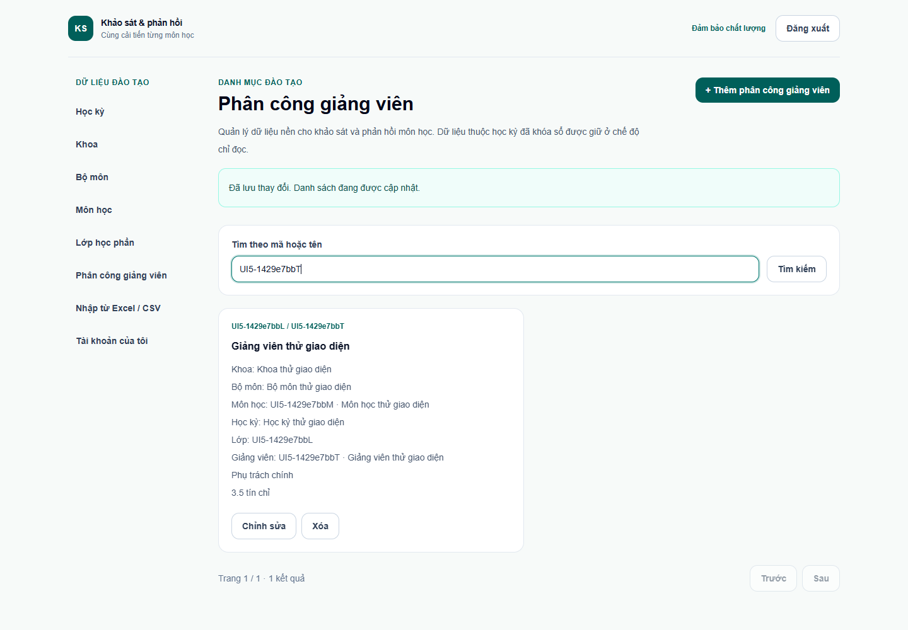
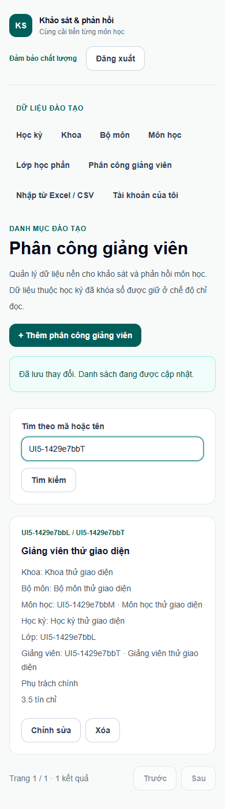
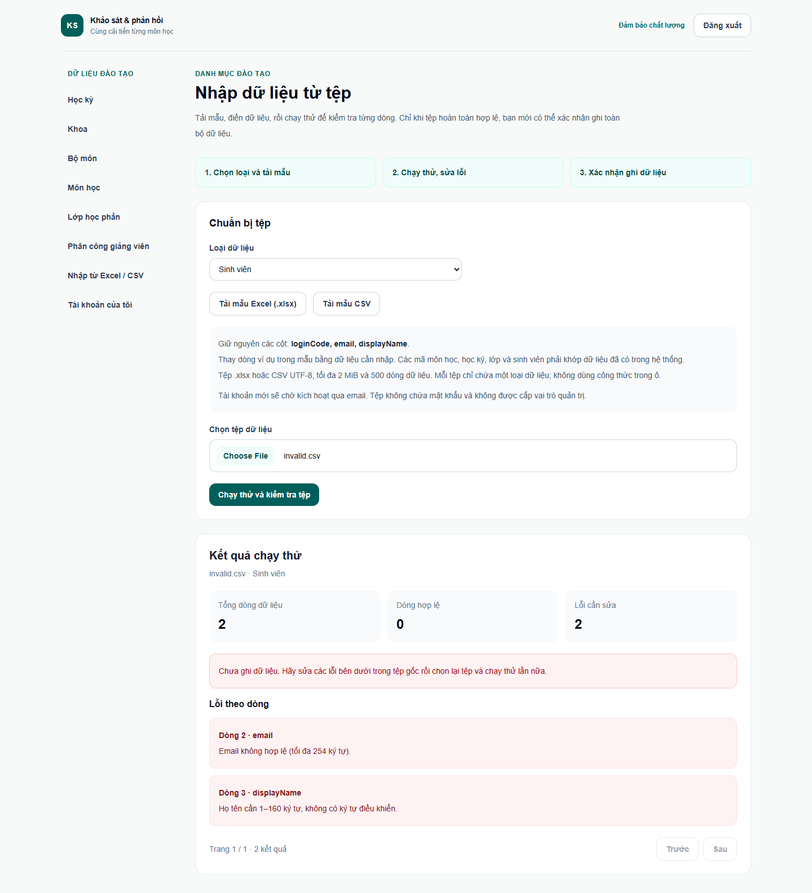
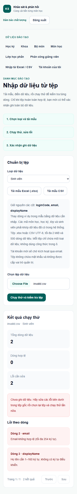
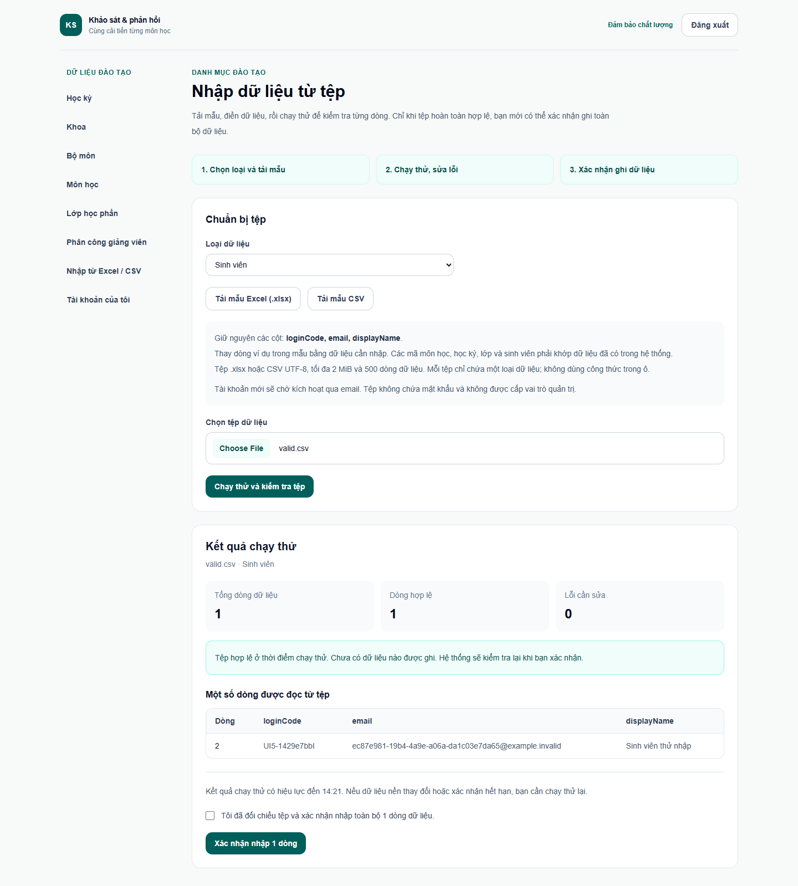
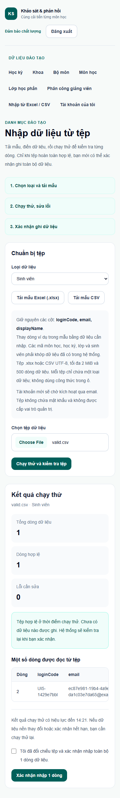
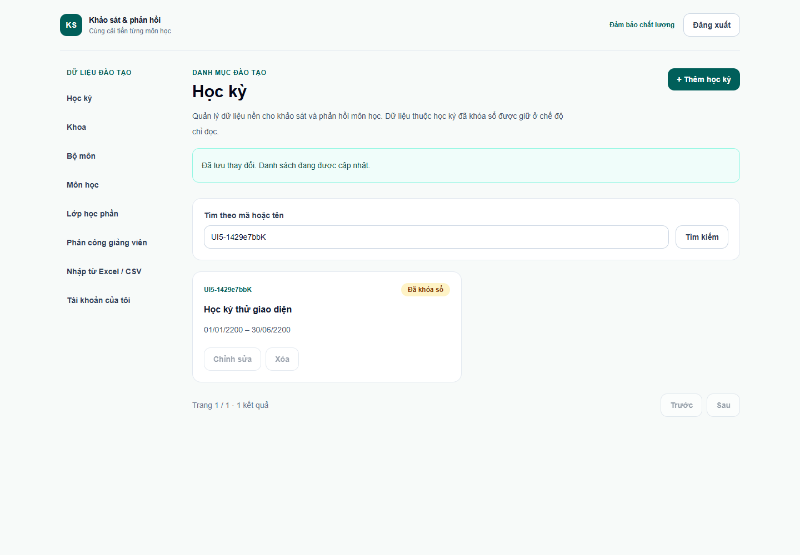
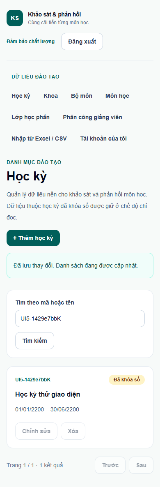

# Kiểm tra giao diện Tuần 5

## 1. Môi trường và bằng chứng

- Lượt tương tác hoàn tất lúc **14:06 ngày 22/10/2026**, múi giờ Asia/Saigon, tại `http://127.0.0.1:3001`. Dùng server và database demo riêng, kiểm marker cùng UUID MySQL trước khi tạo fixture; không chạy trên database chính hoặc cổng 3000 của người dùng.
- Chrome headless/Puppeteer dùng hồ sơ tạm riêng. Tạo cán bộ ĐBCL, giảng viên, sinh viên và danh mục giả với tiền tố/UUID riêng.
- Kết quả lưu tại `work/week5-qa/result.json`: `status=passed`, **13 nhóm kiểm tra**, **10 lượt viewport**, `pageErrors=0`, `cleaned=true`, `seedUnchanged=true`. Đây là nhóm thao tác trình duyệt, không phải số unit test.
- Sau khi phiên bị gián đoạn, đã đọc lại script và JSON, mở trực tiếp đủ **10/10 PNG** để kiểm tra bố cục. Không coi việc mở lại ảnh là một lượt chạy lại tương tác. Script và JSON nằm ngoài repository; ảnh bàn giao chỉ chứa dữ liệu giả, không có mật khẩu, cookie, khóa TOTP hoặc mã khôi phục.

## 2. Bố cục desktop và mobile

| Màn hình/trạng thái | Desktop 1440px | Mobile 390px | Quan sát từ ảnh thật |
| --- | --- | --- | --- |
| Lớp học phần | Đạt | Đạt | Hiển thị khoa, bộ môn, môn, học kỳ và tín chỉ; danh sách dạng thẻ, thao tác và phân trang đọc được. |
| Phân công giảng viên | Đạt | Đạt | Mã lớp, giảng viên và nhãn phụ trách chính đủ; tên dài xuống dòng trong thẻ. |
| Nhập CSV có lỗi | Đạt | Đạt | Tổng dòng/hợp lệ/lỗi, thông báo chưa ghi và lỗi tại dòng 2, dòng 3 được tách rõ. |
| Nhập CSV hợp lệ, trước xác nhận | Đạt | Đạt | Cho xem dữ liệu đọc được, hạn xác nhận, ô đối chiếu và nút nhập; bảng preview mobile cuộn ngang trong khung. |
| Học kỳ đã khóa sổ | Đạt | Đạt | Huy hiệu Đã khóa sổ hiện rõ; Chỉnh sửa/Xóa bị vô hiệu. |

Cả **10/10 lượt** không tràn ngang toàn trang; số input/select/textarea không có nhãn hoặc `aria-label` là **0** theo phép đo DOM. Trên mobile, điều hướng xuống dòng, bộ lọc xếp dọc; bảng preview giữ cột trong vùng cuộn riêng. Đây chưa phải đánh giá đầy đủ về tiếp cận. Ảnh ẩn huy hiệu công cụ Next.js dev bằng CSS, không đổi nội dung sản phẩm.

## 3. Các luồng đã chạy thật

| Nhóm | Thao tác và kết quả |
| --- | --- |
| 1 | Chưa đăng nhập mở `/danh-muc/hoc-ky`: chuyển về `/dang-nhap`. |
| 2 | Đăng nhập cán bộ ĐBCL giả: trang Tài khoản có liên kết Danh mục và nhập dữ liệu. |
| 3 | Tạo khoa bằng biểu mẫu: API trả 201, kiểm thấy đúng hàng trong MySQL. |
| 4 | Tạo bộ môn và môn học: tra cứu quan hệ theo mã, lưu được tín chỉ `3.5`; API 201 và dữ liệu đúng. |
| 5 | Tạo học kỳ và lớp học phần: chọn đúng học kỳ/môn qua bộ tra cứu; API 201. Chụp desktop/mobile. |
| 6 | Tạo phân công: tra cứu giảng viên, chọn phụ trách chính; API 201. Chụp desktop/mobile. |
| 7 | Tìm 22 khoa giả: trang đầu 20 thẻ, trang sau 2 thẻ; quay lại có 20 thẻ. |
| 8 | Tải CSV cố tình sai email và thiếu họ tên: chạy thử trả 200, hiện lỗi riêng từng dòng; tài khoản tương ứng chưa được tạo trong MySQL. |
| 9 | Tải CSV sinh viên hợp lệ: chạy thử không ghi tài khoản. Sau khi chọn ô xác nhận và bấm nhập, API 200, hiện đã nhập 1 bản ghi cùng kết quả gửi email; MySQL xác nhận tài khoản `PENDING_ACTIVATION`, không có hash mật khẩu và chỉ có vai trò `SINH_VIEN`. |
| 10 | Bấm tải đủ **8 mẫu**: CSV và XLSX cho sinh viên, giảng viên, lớp học phần, đăng ký học phần; từng phản hồi tải mẫu trả 200. |
| 11 | Khóa sổ học kỳ giả: nhập lý do, chọn xác nhận, API 200; huy hiệu đã khóa và nút sửa bị vô hiệu. |
| 12 | Đăng xuất ĐBCL, đăng nhập sinh viên giả, mở trực tiếp trang danh mục: chuyển về `/tai-khoan`. |
| 13 | Không ghi nhận `pageerror` trong toàn lượt; `localStorage` rỗng khi kiểm cuối. |

Ảnh CSV hợp lệ được chụp **trước khi ghi**. Phần commit được kiểm bằng phản hồi API, thông báo hoàn tất và MySQL; không dùng ảnh preview để chứng minh dữ liệu đã ghi.

## 4. Ảnh bằng chứng

### Lớp học phần

### Phân công giảng viên

### CSV có lỗi từng dòng

### CSV hợp lệ trước khi xác nhận ghi

### Học kỳ khóa sổ

## 5. Dọn fixture và giới hạn

- Đã dọn đúng tài khoản, phiên/token, vai trò, đăng ký/phân công, AuditLog và danh mục thuộc UUID của lượt thử; chỉ dọn bucket tài khoản riêng. Kết quả xác nhận không còn các tài khoản fixture.
- So sánh trước/sau xác nhận hash mật khẩu, trạng thái và cờ đổi mật khẩu của tài khoản `@demo.invalid` không đổi. Không reset database/volume; không đổi chính sách MFA dùng chung.
- Qua trình duyệt đã kiểm **tạo** sáu loại danh mục, tra cứu, tìm kiếm/phân trang, khóa sổ và CSV sinh viên. Chưa kiểm đủ thao tác sửa/xóa của từng loại qua UI; chưa commit XLSX hoặc ba loại import còn lại qua UI. Các bằng chứng API/MySQL/unit của những nhánh đó phải đọc tại [nghiệm thu Tuần 5](NGHIEM_THU_TUAN_05.md).
- Đã bấm tải mẫu và kiểm HTTP 200; kiểm cấu trúc/nội dung mẫu thuộc kiểm thử import, không suy ra chỉ từ nút tải.
- Chưa kiểm tất cả trình duyệt, bàn phím/trình đọc màn hình hoặc mọi nhánh lỗi. Chưa có UI nghiệp vụ khảo sát/phản hồi: các bảng bổ sung theo ngoại lệ người dùng chỉ phục vụ seed demo.
