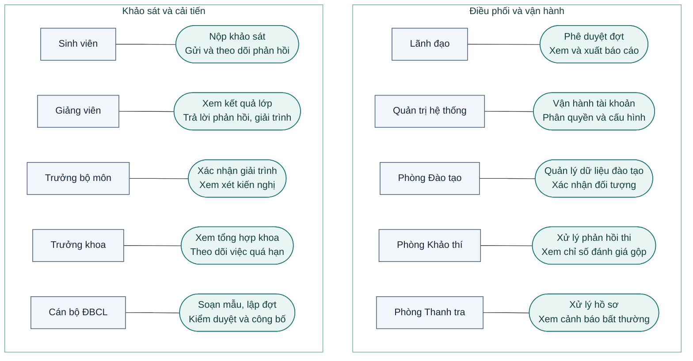

# Sơ đồ ca sử dụng phiên bản 1.0

Sơ đồ thể hiện các ca sử dụng chính của 10 tác nhân. Phạm vi và điều kiện được kiểm trên máy chủ theo vai trò, lớp học phần, bộ môn hoặc khoa, trạng thái nghiệp vụ và MFA khi bắt buộc. [Đặc tả](DAC_TA_NGHIEP_VU.md) · [Điều chỉnh số 01](BO_SUNG_01_TAC_NHAN.md)

[Ảnh sơ đồ dùng trong báo cáo](assets/tuan-15/use-case-v1.png) · [Hướng dẫn 10 vai trò](HUONG_DAN_SU_DUNG.md)

Phòng Thanh tra dùng phần mềm để quản lý và theo dõi hồ sơ. Kết luận và xử lý chính thức vẫn theo thẩm quyền của trường. Phòng Khảo thí xử lý phản hồi thi trong phạm vi được giao, còn phúc khảo thực hiện theo quy trình riêng. Kết quả khảo sát bảo vệ danh tính ở mức ứng dụng và chịu ngưỡng công bố.
