# Thư viện sơ đồ Mermaid đã render — Tuần 2

Ngày thực hiện và kiểm tra: **21/10/2026**. Thư viện có **13 SVG được render thực tế từ 13 khối Mermaid hiện tại**; không phải ảnh mô phỏng sơ đồ. Đây là bằng chứng đọc/hiển thị thiết kế, không phải bằng chứng các nghiệp vụ đã được triển khai hay E2E đã chạy.

## Công cụ, nguồn và giới hạn

- Công cụ render: Mermaid CLI (`@mermaid-js/mermaid-cli`) **12.0.0**, dùng Google Chrome cài trên máy qua cấu hình Puppeteer (`executablePath`). Công cụ được cài riêng trong thư mục làm việc, không thêm vào dependency ứng dụng.
- Đầu vào render: `work/week2-qa/diagrams.md` ngoài repository, với ánh xạ `diagram-index.json`; đầu ra gốc `rendered-1.svg` đến `rendered-13.svg`. Trước khi đưa vào thư viện, từng khối nguồn hiện tại được đối chiếu trùng nội dung với đầu vào render; 13/13 khớp. File SVG bàn giao là bản sao nguyên byte của đầu ra render, không vẽ lại.
- SHA-256 nguồn ở bảng dưới được tính trên **nội dung trong hàng rào Mermaid**, bỏ dòng mở/đóng hàng rào, chuẩn hóa CRLF thành LF, bỏ khoảng trắng cuối khối rồi kết thúc bằng đúng một LF. SHA SVG tính trên byte file bàn giao. Khi sửa khối Mermaid phải render lại và cập nhật bảng; sửa phần văn bản ngoài khối không làm thay hash nguồn.
- **Phân biệt hai loại ERD:** bốn SVG `assets/tuan-02/erd-*.svg` nằm ngoài thư mục `mermaid/` là tổng quan dạng thẻ do exporter sinh trực tiếp từ DMMF. Bốn SVG số 07–10 bên dưới là bản **render Mermaid thật**, có đầy đủ thuộc tính và liên kết. Không dùng hai loại ảnh thay bằng chứng cho nhau.
- Mở liên kết SVG để phóng to. ERD toàn thuộc tính rất rộng; ảnh thu vừa trang chỉ giúp nhìn bố cục, chữ chi tiết cần zoom hoặc đọc cùng bảng khóa trong [ERD.md](ERD.md). Hoạt động khảo sát là sơ đồ dài dọc, nên mở riêng/cuộn để đọc từng bước. Một số đường trong use case cắt nhau do có nhiều vai trò; cần đối chiếu [ma trận quyền](PHAN_QUYEN.md), không suy ra quyền từ vị trí đường.
- Các SVG được raster bằng Chrome để kiểm tra chữ/nhãn HTML (foreignObject), vì bộ raster SVG thông thường có thể bỏ mất chữ HTML. Đã xem ảnh toàn cảnh và phần phóng to theo nhóm; đây là rà trực quan, không phải kiểm chứng đầy đủ nội dung nghiệp vụ tự động.

## Bản đồ nguồn và dấu vân tay

| Số  | Sơ đồ / file SVG                                                                     | File nguồn, thứ tự khối Mermaid                    | SHA-256 nội dung khối                                              | SHA-256 SVG                                                        |
| --- | ------------------------------------------------------------------------------------ | -------------------------------------------------- | ------------------------------------------------------------------ | ------------------------------------------------------------------ |
| 01  | [Use case toàn hệ thống](assets/tuan-02/mermaid/01-use-case.svg)                     | [SO_DO_NGHIEP_VU.md](SO_DO_NGHIEP_VU.md), khối 1   | `a93ccbb54494d13f8fa39fe5558307a902b69b10cf61124f9799e96475e15756` | `9847dc9fed802a01871708104dfa91455e55bfd1a2f3c9e507c923e98e81d70b` |
| 02  | [Hoạt động khảo sát](assets/tuan-02/mermaid/02-hoat-dong-khao-sat.svg)               | [SO_DO_NGHIEP_VU.md](SO_DO_NGHIEP_VU.md), khối 2   | `385b5beffbc3b099d7da6a950594a84fd36b0181f418a93fe05d05c602961653` | `956735fc6ce9779167d12b17c98d6e109c4cd376ef378b2e8b9fb1a62f9799e8` |
| 03  | [Hoạt động phản hồi và SLA](assets/tuan-02/mermaid/03-hoat-dong-phan-hoi.svg)        | [SO_DO_NGHIEP_VU.md](SO_DO_NGHIEP_VU.md), khối 3   | `1fa4e446e82fef684d27e476f439a7d058837322a8c1c0ce2c9bfaf29d2b5822` | `eed38592fbb583a1024dc8677413c12817cc187b825b73ad77c182922d036a29` |
| 04  | [Máy trạng thái đợt khảo sát](assets/tuan-02/mermaid/04-trang-thai-dot-khao-sat.svg) | [SO_DO_NGHIEP_VU.md](SO_DO_NGHIEP_VU.md), khối 4   | `5f446da990ac4affa42c48a3af8e559495f465d8ab2fd2092392da429616a75b` | `fc71e58c07bbad22e3928fd02b21748a83ab74531560a412d9004027658898f0` |
| 05  | [Máy trạng thái phản hồi](assets/tuan-02/mermaid/05-trang-thai-phan-hoi.svg)         | [SO_DO_NGHIEP_VU.md](SO_DO_NGHIEP_VU.md), khối 5   | `bc96e9987cfda01706705a72c8992406e37dddba09eea1798ebc535925f128b8` | `6ecac9a075c2fb5f606aa137955bbb74b7d59b6fa267004c144aed3653b11587` |
| 06  | [Máy trạng thái giải trình](assets/tuan-02/mermaid/06-trang-thai-giai-trinh.svg)     | [SO_DO_NGHIEP_VU.md](SO_DO_NGHIEP_VU.md), khối 6   | `f908d0db64520b3acbf893e01978651cb94413a7414db665b2435599aa3951fa` | `7cb782f9e397189344b8fdddbef95136053acecdb28e8f7c975ef457e64e7992` |
| 07  | [ERD nền người dùng và danh mục](assets/tuan-02/mermaid/07-erd-nen-danh-muc.svg)     | [ERD.md](ERD.md), khối 1                           | `7af6cd198b47b32b22f0a7df0c9af4f978e55c91a96d057305cb0e9c2ed09dd0` | `4f97f34e5a64cd7b8a8a111651d83401b91a19568b4d39aa2b30c4a6734519f7` |
| 08  | [ERD khảo sát, giải trình, nhắc hạn](assets/tuan-02/mermaid/08-erd-khao-sat.svg)     | [ERD.md](ERD.md), khối 2                           | `40d9def46040c12d0aca6a9601e9b65fc8d2ee2ca1179ad40da91b6b8a72616a` | `65691cd7b2909a22b65a236853564553d2764981490ae2b6585d77a795081d49` |
| 09  | [ERD phản hồi liên tục](assets/tuan-02/mermaid/09-erd-phan-hoi.svg)                  | [ERD.md](ERD.md), khối 3                           | `f7380a9072b2909c07bbcdbe988f5d1c0cd58b0c66db289a493e0868cd67c226` | `73255969f72c9325f82ad4c55f25989c8f7281e7b3c98384acdaac03c6870c00` |
| 10  | [ERD xác thực và hệ thống](assets/tuan-02/mermaid/10-erd-he-thong.svg)               | [ERD.md](ERD.md), khối 4                           | `6c739fc5fbbff9f3b1605fe8c40222c1b2af6d4345aa06cc93a180ecbfe03512` | `8f3eb50d1fd307d50999585d0bbfba10183b774cbbde5398657065eb46e1ef28` |
| 11  | [Ranh giới dữ liệu ẩn danh](assets/tuan-02/mermaid/11-ranh-gioi-an-danh.svg)         | [THIET_KE_AN_DANH.md](THIET_KE_AN_DANH.md), khối 1 | `c20563dab11ebeda16d2a170131050194225359a81bdb82bb9a4c9be0246f5cb` | `b9d982fe5ed756524cef12671aaa3844e9180150c443d22a731a14dcb26912a5` |
| 12  | [Tuần tự nộp phiếu ẩn danh](assets/tuan-02/mermaid/12-nop-phieu-an-danh.svg)         | [THIET_KE_AN_DANH.md](THIET_KE_AN_DANH.md), khối 2 | `9e1e02d0febdfda67caf4bb065fddd52d5e0b741f08bd0f76e015bef887d9a2f` | `78e7fed63b9021fe32da9ba08b01b5fcf400efb04dbd3e9b6b160e4cfe9fff4f` |
| 13  | [Kiến trúc và luồng xử lý](assets/tuan-02/mermaid/13-kien-truc.svg)                  | [KIEN_TRUC.md](KIEN_TRUC.md), khối 1               | `2bff22f9c536d3ea0dec68ea6c55dfe83a2a54ad7aff3dfe2b4188deca6e21dc` | `6bd4dbc6f3df1f52eace3d86084c7f76e638f45eb4db5a597108536f457b9907` |

## Sơ đồ nghiệp vụ

### 01. Use case toàn hệ thống

[Mở SVG](assets/tuan-02/mermaid/01-use-case.svg) · [Nguồn SO_DO_NGHIEP_VU.md](SO_DO_NGHIEP_VU.md), khối 1.


### 02. Hoạt động khảo sát

[Mở SVG](assets/tuan-02/mermaid/02-hoat-dong-khao-sat.svg) · [Nguồn SO_DO_NGHIEP_VU.md](SO_DO_NGHIEP_VU.md), khối 2.


### 03. Hoạt động phản hồi và SLA

[Mở SVG](assets/tuan-02/mermaid/03-hoat-dong-phan-hoi.svg) · [Nguồn SO_DO_NGHIEP_VU.md](SO_DO_NGHIEP_VU.md), khối 3.


### 04. Máy trạng thái đợt khảo sát

[Mở SVG](assets/tuan-02/mermaid/04-trang-thai-dot-khao-sat.svg) · [Nguồn SO_DO_NGHIEP_VU.md](SO_DO_NGHIEP_VU.md), khối 4.


### 05. Máy trạng thái phản hồi

[Mở SVG](assets/tuan-02/mermaid/05-trang-thai-phan-hoi.svg) · [Nguồn SO_DO_NGHIEP_VU.md](SO_DO_NGHIEP_VU.md), khối 5.


### 06. Máy trạng thái giải trình

[Mở SVG](assets/tuan-02/mermaid/06-trang-thai-giai-trinh.svg) · [Nguồn SO_DO_NGHIEP_VU.md](SO_DO_NGHIEP_VU.md), khối 6.


## ERD toàn thuộc tính — render Mermaid thật

### 07. ERD nền người dùng và danh mục

[Mở SVG để phóng to](assets/tuan-02/mermaid/07-erd-nen-danh-muc.svg) · [Nguồn ERD.md](ERD.md), khối 1.


### 08. ERD khảo sát, giải trình, nhắc hạn

[Mở SVG để phóng to](assets/tuan-02/mermaid/08-erd-khao-sat.svg) · [Nguồn ERD.md](ERD.md), khối 2.


### 09. ERD phản hồi liên tục

[Mở SVG để phóng to](assets/tuan-02/mermaid/09-erd-phan-hoi.svg) · [Nguồn ERD.md](ERD.md), khối 3.


### 10. ERD xác thực và hệ thống

[Mở SVG để phóng to](assets/tuan-02/mermaid/10-erd-he-thong.svg) · [Nguồn ERD.md](ERD.md), khối 4.


## Ẩn danh và kiến trúc

### 11. Ranh giới dữ liệu ẩn danh

[Mở SVG](assets/tuan-02/mermaid/11-ranh-gioi-an-danh.svg) · [Nguồn THIET_KE_AN_DANH.md](THIET_KE_AN_DANH.md), khối 1.


### 12. Tuần tự nộp phiếu ẩn danh

[Mở SVG](assets/tuan-02/mermaid/12-nop-phieu-an-danh.svg) · [Nguồn THIET_KE_AN_DANH.md](THIET_KE_AN_DANH.md), khối 2.

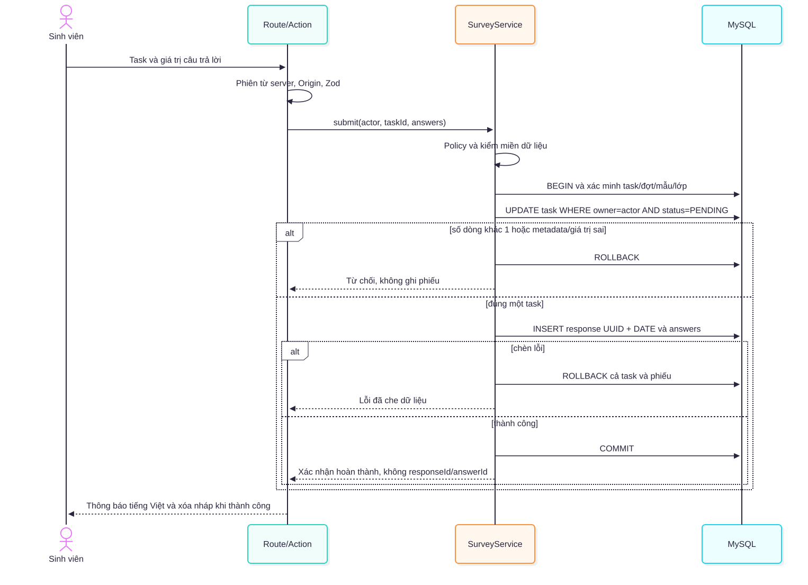

### 13. Kiến trúc và luồng xử lý

[Mở SVG](assets/tuan-02/mermaid/13-kien-truc.svg) · [Nguồn KIEN_TRUC.md](KIEN_TRUC.md), khối 1.

