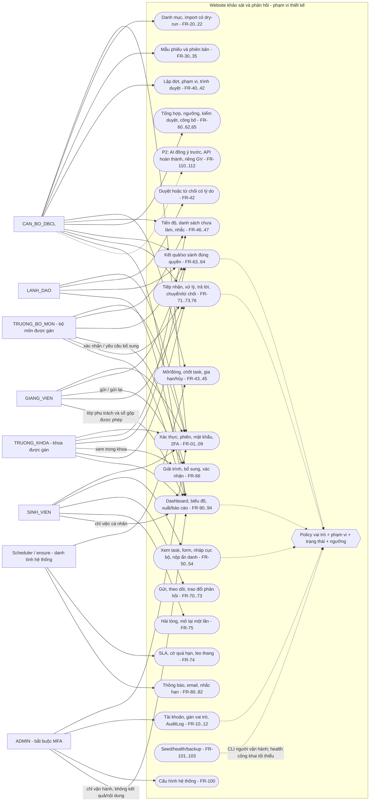
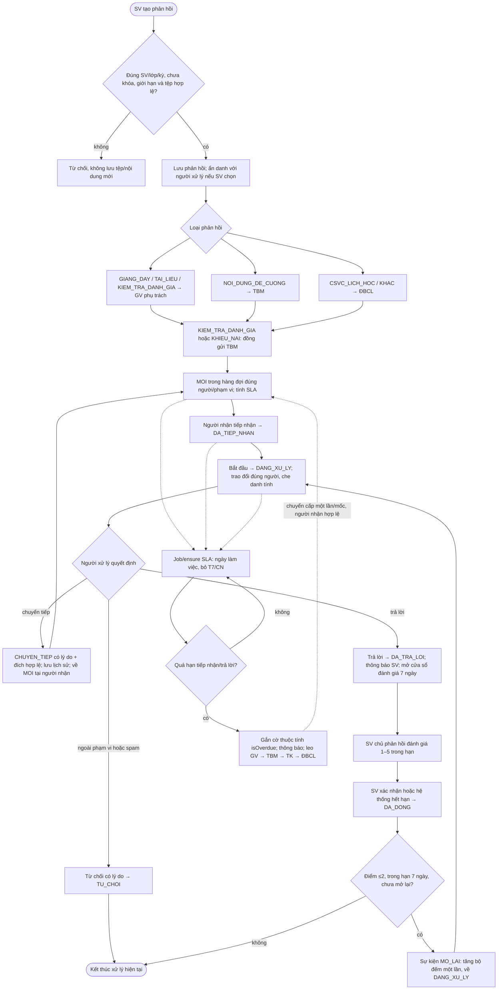
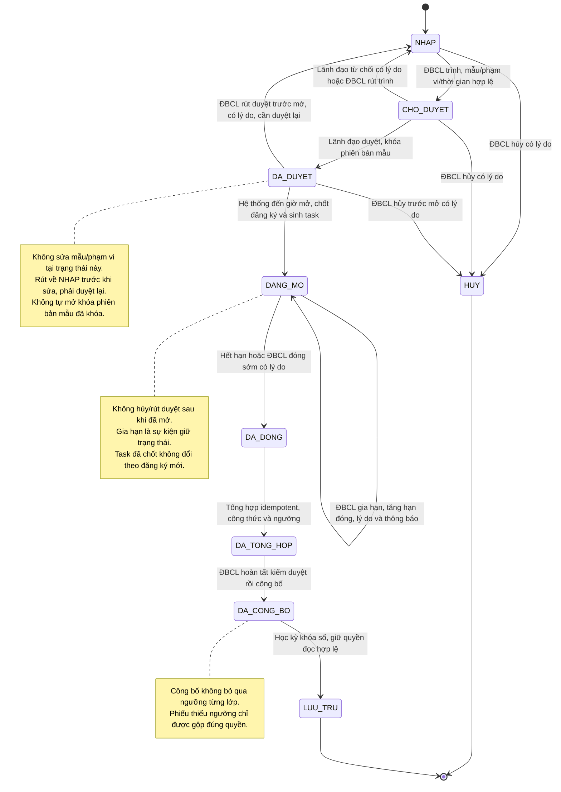
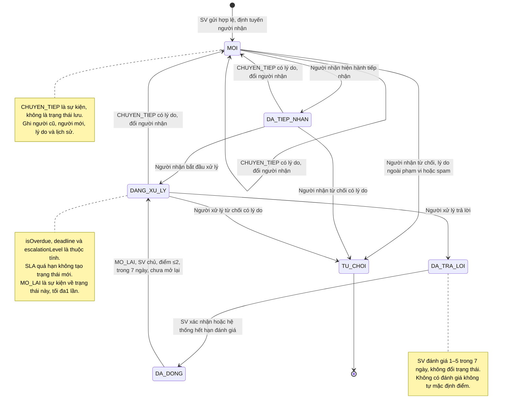
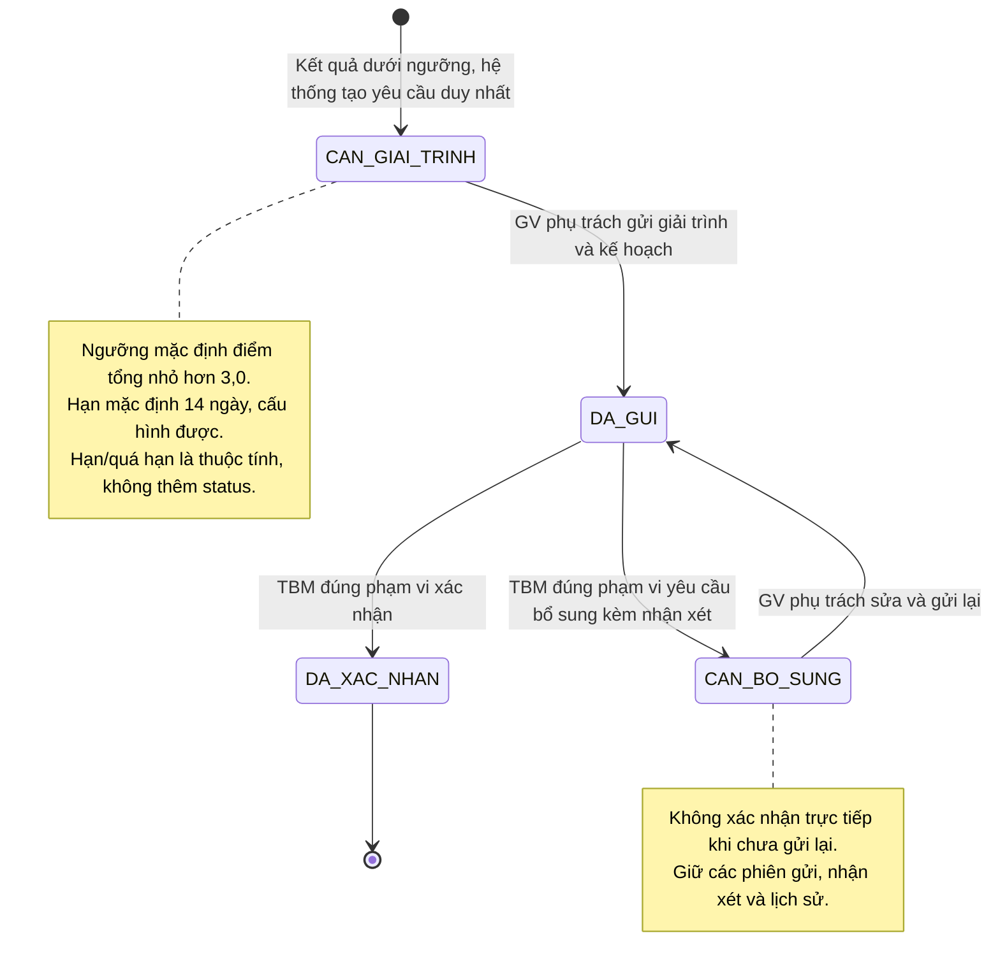

# Sơ đồ nghiệp vụ đề xuất — Tuần 2

Soạn thực tế **21/10/2026**, nguồn [DAC_TA_NGHIEP_VU.md](DAC_TA_NGHIEP_VU.md), Mục 4–6. Kế hoạch Tuần 2 giả định07–13/10; không ghi công việc đã diễn ra vào khoảng đó. Tài liệu chỉ thiết kế **quy trình đề xuất**, không mô tả quy trình hiện tại tại trường theo yêu cầu người dùng. Chưa có service/UI nghiệp vụ hoạt động; các sơ đồ không phải bằng chứng chạy E2E.

Có **6 sơ đồ Mermaid**: 1 use case biểu diễn bằng flowchart, 2 hoạt động, 3 máy trạng thái. Đọc cùng [YEU_CAU.md](YEU_CAU.md) và [PHAN_QUYEN.md](PHAN_QUYEN.md). Actor ở sơ đồ không vượt phạm vi quyền trong ma trận; lịch sử là bất biến, các chuyển ghi dùng trạng thái cũ và transaction khi cần, lặp/đồng thời chỉ một tác dụng.

## 1. Use case toàn hệ thống (flowchart)

Mermaid không dùng cú pháp usecaseDiagram; flowchart dưới đây biểu diễn tác nhân và nhóm ca sử dụng. Mũi tên nối actor với ca sử dụng, không biểu thị tự cấp quyền mọi hành động trong nhóm. Các include/điều kiện được ghi bằng nhãn và các sơ đồ tiếp theo.

Không có cạnh ADMIN→RESULT/HANDLE. Quản trị tài khoản/cấu hình không mặc định quyền xem nghiệp vụ (BR-18). Hệ thống điểm, SMTP thật và AI là điểm mở rộng/triển khai có điều kiện, không phải đã kết nối. CLI seed/backup là quyền người vận hành hạ tầng riêng, không tự trở thành quyền web của ADMIN.

## 2. Hoạt động khảo sát từ thiết kế đến cải tiến

Luồng bám UC-GOLD (Mục 5.1); mục tiêu chạy xuyên suốt ở Tuần 12, không phải Tuần 2. Nộp phiếu có hai vùng dữ liệu tách biệt về quan hệ lưu trữ: task chứa danh tính, phiếu không chứa định danh/khóa trỏ về task. Mũi tên trong hoạt động là thứ tự xử lý, **không phải FK/schema**.

```mermaid
flowchart TD
  START(["Bắt đầu - dữ liệu giả, học kỳ chưa khóa"])
  TEMPLATE["ĐBCL tạo mẫu/phiên bản, nhóm, câu hỏi, trọng số"]
  DRAFT["ĐBCL lập đợt: mẫu, phạm vi, thời gian, ngưỡng"]
  VALID{"Hợp lệ và đúng quyền?"}
  SUBMIT["ĐBCL trình: NHAP → CHO_DUYET"]
  DECIDE{"Lãnh đạo quyết định"}
  REJECT["Từ chối có lý do: về NHAP"]
  APPROVE["DA_DUYET; khóa phiên bản mẫu/phạm vi"]
  WAIT{"Đến giờ mở, chưa hủy?"}
  SNAPSHOT["Hệ thống mở idempotent: chốt đăng ký, tạo task unique đợt/lớp/SV"]
  LIST["SV chỉ thấy task của mình; điền form, nháp chỉ ở trình duyệt"]
  GATE{"Policy, task PENDING, DANG_MO, giờ hợp lệ, câu trả lời đúng?"}
  DENY["Từ chối, không ghi phiếu; không lộ chi tiết nội bộ"]
  TX["Một transaction: cập nhật có điều kiện PENDING → DONE, số dòng = 1"]
  SAVE["Chèn response/answer UUID: chỉ đợt/lớp/ngày, không studentId/taskId/IP/UA"]
  COMMIT{"Toàn transaction thành công?"}
  ROLLBACK["Rollback task và phiếu; không log nội dung/định danh phiếu"]
  CONFIRM["Xác nhận task đã nộp, không cho sửa/xóa/nộp lại"]
  CLOSE["Hết hạn hoặc ĐBCL đóng sớm có lý do: DA_DONG"]
  AGG["Tổng hợp trọng số; bỏ NA; làm tròn cuối; DA_TONG_HOP"]
  MOD["ĐBCL kiểm duyệt tự luận: HIEN_THI hoặc DA_AN"]
  PUBLISH["ĐBCL công bố: DA_CONG_BO"]
  THRESH{"Lớp đủ số phiếu VÀ tỉ lệ tham gia?"}
  MASK["Chưa đủ mẫu để công bố; chỉ số gộp đúng quyền, không drill-down"]
  VIEW["GV/TBM/TK xem đúng phạm vi; chỉ tự luận HIEN_THI; xuất giữ cùng quyền"]
  LOW{"Điểm dưới ngưỡng cảnh báo?"}
  EXPLANATION["Tạo yêu cầu giải trình, GV gửi, TBM xét/bổ sung/xác nhận"]
  ARCHIVE["Khóa sổ học kỳ: LUU_TRU, chỉ đọc"]
  END(["Kết thúc"])

  START --> TEMPLATE --> DRAFT --> VALID
  VALID -->|"không"| DRAFT
  VALID -->|"có"| SUBMIT --> DECIDE
  DECIDE -->|"từ chối"| REJECT --> DRAFT
  DECIDE -->|"duyệt"| APPROVE --> WAIT
  WAIT -->|"chưa đến giờ"| WAIT
  WAIT -->|"đến giờ"| SNAPSHOT --> LIST --> GATE
  GATE -->|"không"| DENY
  GATE -->|"có"| TX --> SAVE --> COMMIT
  COMMIT -->|"lỗi hoặc mất quyền cạnh tranh task"| ROLLBACK
  COMMIT -->|"thành công"| CONFIRM --> CLOSE
  CLOSE --> AGG --> MOD --> PUBLISH --> THRESH
  THRESH -->|"không"| MASK --> ARCHIVE
  THRESH -->|"có"| VIEW --> LOW
  LOW -->|"có"| EXPLANATION --> ARCHIVE
  LOW -->|"không"| ARCHIVE
  ARCHIVE --> END
```

Chi tiết không thể hiện hết trên luồng chính: hủy/rút duyệt/gia hạn xem máy trạng thái ở Mục 4. Cả nhánh từ chối/rollback đều kết thúc request thất bại, không làm mất khả năng nộp hợp lệ về sau nếu còn hạn và task còn PENDING. Đợt đóng độc lập với việc một SV đã nộp: hệ thống không đợi tất cả SV hay request cụ thể mới đóng. Scheduler/ensure vẫn đóng đúng hạn kể cả không có người nộp; trong một đợt có nhiều luồng SV chạy song song.

ĐBCL/LĐ được xem kết quả từ DA_TONG_HOP theo BR-08, vẫn bị ràng buộc BR-07; GV/trưởng đơn vị chỉ sau công bố. Nhắc danh sách PENDING là luồng riêng không nối tới phiếu; mỗi lần xem/xuất có audit, không ghép cùng dữ liệu câu trả lời.

## 3. Hoạt động phản hồi liên tục và SLA

Các đường nét đứt SLA là tác vụ song song, không đòi hỏi người dùng đánh giá mới được đóng. Nhánh không đánh giá: hệ thống vẫn có thể đóng khi cửa sổ7 ngày kết thúc; không tự gán điểm hài lòng. Tiếp nhận hoặc đang xử lý vẫn có thể chuyển/từ chối đúng điều kiện ở Mục 5. Các job dùng khóa sự kiện, cập nhật có điều kiện để không gửi trùng/leo thang lặp. Đến ĐBCL không quay vòng về GV; vẫn giữ cờ quá hạn và thông báo theo chính sách cấu hình.

Ẩn danh của phản hồi **khác** khảo sát: phản hồi giữ liên kết nội bộ tới người gửi để thông báo/trao đổi nhưng người xử lý chỉ thấy “Sinh viên ẩn danh”; phiếu khảo sát không có đường quan hệ tới người dùng/task. Không áp nhầm thiết kế phản hồi vào SurveyResponse.

## 4. Máy trạng thái đợt khảo sát

### Ràng buộc chuyển đợt

- Cạnh không có trong sơ đồ bị từ chối. Mọi ghi kiểm `expectedStatus`, quyền actor, học kỳ chưa khóa; lưu lý do khi quy định bắt buộc, thời gian và sự kiện. Job có thể nối mở rồi đóng khi truy cập đến muộn sau cả khoảng khảo sát, vẫn chốt đúng một lần và không nhận phiếu ngoài hạn.
- Rút duyệt có cơ sở BR-06; đề xuất ĐBCL thực hiện trước mở với lý do. Rút trình từ CHO_DUYET và actor hủy ĐBCL là làm rõ thiết kế, vì nguồn chưa chỉ định từng actor/cạnh này. Không đổi mã/ưu tiên BR-06 hay bỏ bước lãnh đạo duyệt lại.
- Gia hạn chỉ tăng hạn kết thúc khi còn DANG_MO và chưa hết hạn theo giờ máy chủ; không thay giờ bắt đầu/mẫu/phạm vi, không dùng gia hạn để DA_DONG→DANG_MO. Khi xử lý request sau giờ đóng, ensure đóng trước, vì vậy không lách bằng trạng thái DB cập nhật chậm.
- Chốt đăng ký/task và chuyển mở phải nằm trong đơn vị công việc nguyên tử hoặc cơ chế tương đương bảo đảm chỉ trạng thái mở khi đã chốt đầy đủ; lỗi phải khôi phục để chạy lại an toàn, không mở đợt nửa chừng. Tổng hợp không chấp nhận nộp phiếu mới.
- Phiên bản mẫu đã khóa không tự mở lại khi rút/hủy: có thể đang được đợt khác tham chiếu. Khi thay nội dung dùng phiên bản mới, đợt nháp tham chiếu lại rồi trình.
- Lưu trữ chỉ đọc: quyền đọc vẫn áp điều kiện công bố trước lưu trữ/ngưỡng/phạm vi. Đề xuất quy trình khóa sổ chặn khi còn đợt đang mở/công việc ghi chưa giải quyết, cần chốt trước Tuần 5–7; không âm thầm bỏ việc giải trình/phản hồi đang mở.

## 5. Máy trạng thái phản hồi

Không vẽ `DA_DONG→[*]` vì trạng thái đóng còn khả năng mở lại có điều kiện. Hết cửa sổ mở lại thì DA_DONG là trạng thái cuối nghiệp vụ về mặt hành vi; không cần thêm trạng thái “hết hạn”. `TU_CHOI` là trạng thái từ chối kết thúc; `CHUYEN_TIEP`, `MO_LAI`, “quá hạn”, “leo thang” là sự kiện/thuộc tính, không phải giá trị status bổ sung.

### Điều kiện và điểm thiết kế cần thống nhất khi triển khai

| Sự kiện/thuộc tính | Quy định và cách xử lý dự kiến |
| --- | --- |
| Gửi | BR-20/26/28: lớp đã/đang đăng ký, kỳ hiện hành/liền trước cấu hình; không kỳ khóa; tối đa5 phản hồi/ngày mặc định; tối đa3 tệp×5 MB PNG/JPG/PDF kiểm magic bytes. |
| Chuyển tiếp | BR-21: lý do bắt buộc, đích có vai trò/phạm vi hợp lệ; đề xuất chỉ trước khi DA_TRA_LOI, không đổi chủ SV/ẩn danh; cập nhật recipient + status MOI + lịch sử trong một transaction. Người xử lý cũ mất quyền ghi; quyền chỉ đọc còn hay không theo gán và lịch sử tham gia cần chốt trong ADR. |
| Từ chối | BR-22: có lý do, actor là người xử lý hiện hành. Đề xuất được từ MOI/DA_TIEP_NHAN/DANG_XU_LY; sau đã trả lời không chuyển ngược TU_CHOI để bỏ lịch sử. |
| Tiếp nhận/trả lời | Chỉ người nhận hoặc hàng đợi được giao; người chỉ đồng gửi/TBM đọc đơn vị không tự ghi. Có thể trao đổi nhiều lần mà không thay trạng thái, không lộ danh tính SV nếu chọn ẩn danh. |
| Đóng | Nguồn có DA_TRA_LOI→DA_DONG nhưng chưa chỉ định actor. Đề xuất SV chủ xác nhận đóng hoặc hệ thống đóng khi hết7 ngày đánh giá; không bắt buộc SV phải đánh giá mới đóng và không tự đặt điểm. |
| Hài lòng/mở lại | BR-25 gắn đánh giá với7 ngày sau trả lời; Mục 5.3 không nêu rõ mốc7 ngày mở lại tính từ đóng hay trả lời. Đề xuất dùng **cùng cửa sổ7 ngày từ thời điểm trả lời**, từ DA_DONG, rating≤2, reopenCount<1; mở lại atomic tăng bộ đếm và về DANG_XU_LY. Nếu tự đóng đúng cuối7 ngày thì chỉ SV đóng sớm mới còn cửa sổ mở lại. Phải chốt mốc trong ADR trước Tuần 11; không tự mở rộng thành7 ngày mới sau mỗi đóng. |
| SLA | Thuộc tính `receiveDueAt`, `replyDueAt`, `isOverdue`, cấp leo thang; tiếp nhận2 ngày làm việc, trả lời7 ngày hoặc5 ngày khiếu nại, bỏ T7/CN. Đề xuất tính từ lúc gửi, không reset vì chuyển tiếp để tránh kéo dài vô hạn; deadline sau mở lại/đổi cấu hình và lịch ngày nghỉ lễ chưa được nguồn quy định, cần chốt trước Tuần 11. |
| Leo thang | Job idempotent theo phản hồi+cấp+mốc; GV→TBM→TK→ĐBCL. Thực hiện đổi người nhận về MOI theo cùng cơ chế chuyển cấp được ghi lịch sử, giữ cờ quá hạn và bảo mật; tới ĐBCL không lặp vòng. Việc đồng gửi thông báo không tự cho mọi người quyền xử lý. |
| Học kỳ khóa sổ | Chỉ đọc theo BR-17; không tạo/trao đổi/chuyển/mở lại hay cập nhật nghiệp vụ sau khóa. Quy trình khóa sổ nên giải quyết hồ sơ đang xử lý trước khi khóa; chưa giả định tự đóng tất cả khi khóa. |

## 6. Máy trạng thái giải trình cải tiến

BR-10 và Mục 5.4 yêu cầu GV gửi, TBM xác nhận hoặc yêu cầu bổ sung. Chuỗi `CAN_GIAI_TRINH→DA_GUI→CAN_BO_SUNG→DA_XAC_NHAN` trong mô tả ngắn được làm rõ thành vòng **DA_GUI→CAN_BO_SUNG→DA_GUI**, rồi mới xác nhận từ DA_GUI; nếu không cần bổ sung thì xác nhận ngay từ DA_GUI. TK/ĐBCL xem theo phạm vi, không tự có quyền xác nhận thay TBM; LĐ chỉ số dashboard, ADMIN không có nội dung nghiệp vụ.

Tạo yêu cầu phải có khóa nghiệp vụ duy nhất để job tổng hợp/chạy lại không tạo yêu cầu trùng cho cùng kết quả/lớp và người chịu trách nhiệm. Với lớp nhiều GV, nguồn mặc định đánh giá mức lớp nhưng chưa xác định ai là người chịu trách nhiệm giải trình duy nhất: thiết kế dữ liệu cần có người được giao rõ ràng, chốt trước Tuần 11; không mặc định mở nhiều yêu cầu trùng cho mọi GV. Thông báo, hạn và audit được ghi nhưng không chứa phiếu hay quan hệ tới SV.

## 7. Cách xem và rà soát sơ đồ

Mở Markdown có hỗ trợ Mermaid trong trình xem hoặc GitHub; 6 khối dùng `flowchart`/`stateDiagram-v2`. Nếu trình xem chỉ hiện mã, dùng trình xem Mermaid hỗ trợ tại máy, không cần triển khai website công khai hay gửi dữ liệu thật ra dịch vụ ngoài.

Checklist rà soát: đủ 7 vai trò; ADMIN tách quyền; use case có scope; hoạt động nộp đúng transaction/ẩn danh; 3 máy có cạnh chính và nhánh từ chối/hủy/rút/gia hạn; phản hồi có sự kiện chuyển tiếp/mở lại và SLA thuộc tính; giải trình có vòng bổ sung/gửi lại; không có cạnh bỏ qua duyệt/công bố/ngưỡng. Kết quả render và các kiểm tra thực tế do phiên chính ghi trong báo cáo Tuần 2, không suy ra từ sự tồn tại khối Mermaid.
