# ERD được render lại — Tuần 4

Thực hiện và kiểm trực quan **22/10/2026**. Đã đối chiếu hash cả **4/4 khối Mermaid hiện tại** trong [ERD.md](ERD.md) với [thư viện lịch sử Tuần 2](SO_DO_DA_RENDER.md): **3 khối giữ nguyên, 1 khối thay đổi**. Chỉ render lại khối 4; giữ nguyên thư viện và các SVG Mermaid Tuần 2.

## Phạm vi thay đổi

Khối xác thực/hệ thống bổ sung `UserSession.purpose` và `UserSession.mfaVerifiedAt` theo blueprint hiện tại. Enum SessionPurpose nằm ở danh mục enum của ERD. Các khối nền/danh mục, khảo sát và phản hồi không đổi nội dung Mermaid; dùng lại bản render lịch sử có hash nguồn còn khớp.

ERD là cấu trúc thiết kế **39 model**, runtime hiện **16 model**. Trong khối này vẫn có Notification/EmailOutbox thuộc tuần sau; hình không phải bằng chứng các chức năng đó đã chạy. SVG dưới đây là render Mermaid đầy đủ thuộc tính/liên kết, khác bốn SVG tổng quan dạng thẻ do exporter sinh trực tiếp từ DMMF.

## Đối chiếu nguồn

Quy tắc hash nguồn như Tuần 2: chỉ nội dung trong hàng rào Mermaid, chuẩn hóa CRLF thành LF, bỏ khoảng trắng cuối khối, kết thúc đúng một LF. SHA-256 SVG tính trên byte file bàn giao.

| Khối ERD.md | Sơ đồ | SHA-256 nguồn hiện tại | Kết quả |
| --- | --- | --- | --- |
| 1 | [Nền người dùng và danh mục — bản Tuần 2](assets/tuan-02/mermaid/07-erd-nen-danh-muc.svg) | `7af6cd198b47b32b22f0a7df0c9af4f978e55c91a96d057305cb0e9c2ed09dd0` | Khớp lịch sử, giữ nguyên SVG |
| 2 | [Khảo sát, giải trình, nhắc hạn — bản Tuần 2](assets/tuan-02/mermaid/08-erd-khao-sat.svg) | `40d9def46040c12d0aca6a9601e9b65fc8d2ee2ca1179ad40da91b6b8a72616a` | Khớp lịch sử, giữ nguyên SVG |
| 3 | [Phản hồi liên tục — bản Tuần 2](assets/tuan-02/mermaid/09-erd-phan-hoi.svg) | `f7380a9072b2909c07bbcdbe988f5d1c0cd58b0c66db289a493e0868cd67c226` | Khớp lịch sử, giữ nguyên SVG |
| 4 | [Xác thực và hệ thống — bản Tuần 4](assets/tuan-04/erd-he-thong-tuan-04.svg) | `0755adbcd09c0230a99b27cb3203f534bb8e73ca5de6f666ebe19aedfed671f4` | Khác nguồn Tuần 2, đã render lại |

Nguồn khối 4 lịch sử Tuần 2: `6c739fc5fbbff9f3b1605fe8c40222c1b2af6d4345aa06cc93a180ecbfe03512`. Hash SVG Tuần 4 bàn giao: `d0c3e06ec324eb3252d4c4da34a71d68087d3d12111736921087756ec4c0396a`.

## Render và kiểm trực quan đã chạy

- Mermaid CLI **12.0.0** đã cài ngoài repository; Google Chrome headless qua cấu hình Puppeteer có sẵn. Không thêm dependency ứng dụng.
- Đầu vào là nguyên nội dung khối 4 hiện tại; mmdc thoát mã 0 và sinh một SVG. Bản bàn giao sao nguyên byte đầu ra.
- Raster thật bằng Chrome ở kích thước **3709 × 1451 px**, giữ nhãn HTML/foreignObject; phát hiện **10 entity** gồm 9 model chính và User ngữ cảnh, **291 foreignObject**.
- Đã xem ảnh toàn cảnh thu gọn và ảnh phóng riêng UserSession/TotpCredential. Thuộc tính purpose/mfaVerifiedAt hiện đủ; tên cột, PK/FK/UK và chú thích đọc được khi phóng. Bản thu vừa trang có chữ nhỏ, nên mở SVG để zoom.
- File kiểm ngoài repository: `work/week4-erd/erd-4.mmd`, `hashes.json`, `raster-metrics.json`, `full.png`, `fit.png`, `UserSession.png`, `TotpCredential.png`.

Đây là bằng chứng sơ đồ được render và đọc được, không thay test migration, phân quyền, MFA hoặc CI.

## Xem sơ đồ cập nhật

[Mở SVG để phóng to](assets/tuan-04/erd-he-thong-tuan-04.svg) · [Nguồn ERD.md, khối 4](ERD.md).

