# Kiểm sơ đồ Tuần 7 — 29/10/2026

Đã chạy `node scripts/export-erd.mjs --check`: bốn khối Mermaid và bốn SVG tổng quan khớp DMMF sinh thật, **46 model thiết kế / 34 runtime / 12 chỉ thiết kế**. Tuần 7 đưa `CampaignDataConfirmation`, `Notification`, `EmailOutbox` vào runtime; bảy bảng đợt/xác nhận/thông báo có chức năng của tuần, bảy bảng phiếu/kết quả/phản hồi vẫn chỉ có seed. Kết quả này kiểm sơ đồ/schema, không thay nghiệm thu migration, dịch vụ hoặc giao diện.

Đã mở từng SVG tổng quan bằng **Puppeteer và Chrome headless**, kiểm vị trí toàn bộ phần tử chữ trong biên SVG: **0 phần tử vượt biên ở cả bốn ảnh**. Đã chụp và mở xem bốn PNG; không thấy cắt nhãn, khóa hoặc chân trang. Các thẻ `SurveyCampaign`, `CampaignHistory`, `CampaignDataConfirmation`, `EmailOutbox` ghi rõ phần Tuần 7; vùng phiếu ẩn danh chỉ có liên kết Response–Answer. Đây là SVG thẻ sinh trực tiếp từ DMMF, không phải bản render Mermaid.

| SVG tổng quan | Kích thước | SHA-256 |
| --- | --- | --- |
| [Nền và danh mục](assets/tuan-07/erd-nen-danh-muc.svg) | 1632 × 1093 | `bb70a3c89741d9abec57082a29f2d4e0718a051b06d99068c5b8efe15ea8a3e8` |
| [Khảo sát](assets/tuan-07/erd-khao-sat.svg) | 1632 × 2159 | `9541b51f50882edfd09e6d51579247ab8cb9c5d1a4f12bd995233ec6643b5896` |
| [Phản hồi](assets/tuan-07/erd-phan-hoi.svg) | 1632 × 1532 | `b5a25a4e91cc39ce4fdfbc2b77ace4c311cee931c8f714bdae1c64f3c9bcd49d` |
| [Xác thực và hệ thống](assets/tuan-07/erd-he-thong.svg) | 1632 × 1116 | `72e8b94a8bb1d8390b70465a5d71abec934f27b238aaa15399da537e2f2c41b2` |

Đã trích cả bốn khối Mermaid từ [ERD.md](ERD.md), chuẩn hóa CRLF thành LF và render bằng **Mermaid CLI 12** với Chrome hiện có: **4/4 thành công**, không lỗi cú pháp. Đã mở xem bốn PNG toàn miền ở chiều rộng 2400 px và ảnh riêng `CriterionGroup`, tổng **9 PNG đã xem** kể cả SVG thẻ. Sơ đồ khảo sát/phản hồi có nhiều bảng và đường nối; ảnh toàn miền dùng kiểm bố cục, cần phóng SVG để đọc chi tiết.

Harness `work/week7-erd/verify.mjs`, nguồn `.mmd`, SVG render, PNG và `verification.json` nằm ngoài Git trong workspace. Báo cáo/gallery G1 và các tuần trước được giữ nguyên. Việc kiểm này không chạy DB, generate client hoặc build; không suy kết quả chức năng từ hình. Sơ đồ trạng thái quy trình chạy thật được nghiệm thu riêng cùng workflow Tuần 7.

## Sơ đồ trạng thái của workflow hiện thực

[Mở SVG trạng thái](assets/tuan-07/campaign-state.svg) · [Nguồn Mermaid](assets/tuan-07/campaign-state.mmd).

Đã đối chiếu `campaigns.ts` và `campaign-lifecycle.ts`: sơ đồ có bảy trạng thái NHAP, CHO_XAC_NHAN_DL, CHO_DUYET, DA_DUYET, DANG_MO, DA_DONG và HUY. Các nhánh trả về, từ chối, rút trước mở, hủy trước mở, gia hạn, đóng sớm và đóng tự động có đủ vai trò/lý do. Chú thích nêu RS-01–03 chặn xác nhận, cảnh báo RS-04–06 cần ghi chú, duyệt khóa mẫu, chặn khóa kỳ đang có đợt đã duyệt/đang mở, chốt dữ liệu hiện tại và không đổi nhiệm vụ sau mở. Tổng hợp/công bố chỉ được nhắc là ngoài phạm vi, không vẽ thành node đã hiện thực.

Đã render bằng Mermaid CLI 12/Chrome headless, mở xem PNG ở chiều rộng 2400 px; không thấy cắt nhãn hoặc chú thích. Kiểm `text`/`foreignObject` vượt biên SVG trả về **0**. ViewBox **1611,56 × 2238**; nguồn được chuẩn hóa CRLF → LF, bỏ khoảng trắng cuối và giữ một LF trước khi băm/render:

- SHA-256 nguồn LF: `4c337063aae1c2bc9d5bcf5c8f2298049180c799379821e4a78f4b6f566858ff`.
- SHA-256 SVG: `855d214aa523353466c7a54c0254dab5dcb429a698c3915c9a36f2242deb9b83`.

Harness `work/week7-erd/verify-state.mjs`, PNG và `state-verification.json` giữ ngoài Git. Kể cả phần ERD phía trên, đã render **5 sơ đồ Mermaid** và xem **10 PNG cuối** trong lượt kiểm Tuần 7 này. Sơ đồ là mô tả mã; bằng chứng HTTP/MySQL của chuyển trạng thái nằm riêng trong nghiệm thu.
