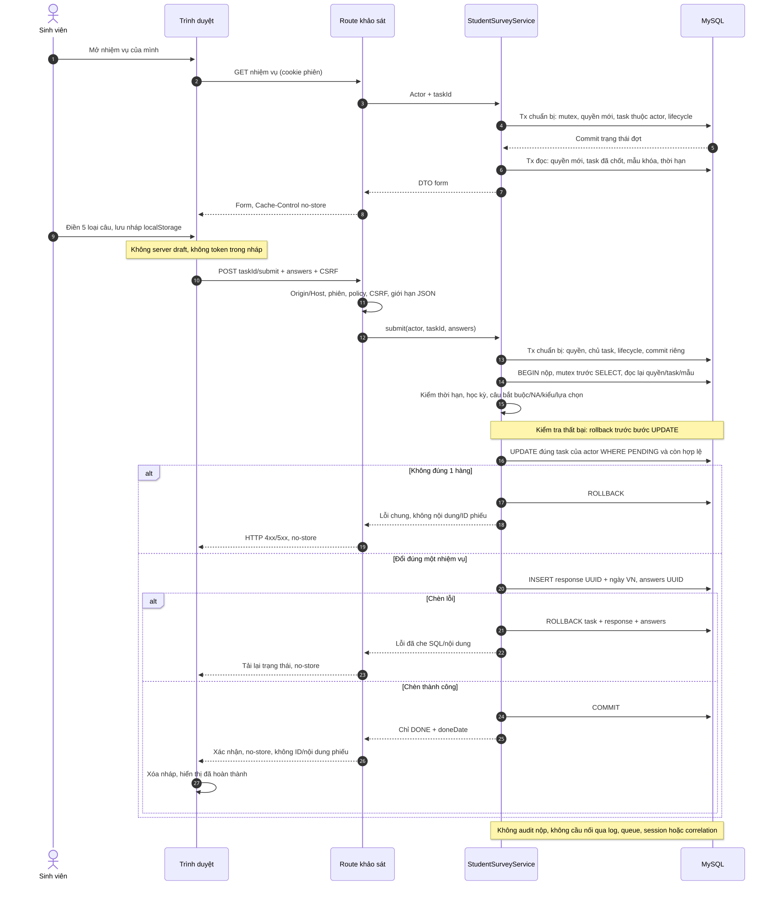

# Sơ đồ nộp khảo sát ẩn danh Tuần 8

Ngày kiểm thực tế: **29/10/2026 (Asia/Saigon)**. Ba sơ đồ mô tả luồng Tuần 8 đã đối chiếu với `student-surveys.ts`, `student-survey-input.ts`, route khảo sát, policy, CSRF, cấu hình Prisma và phần nháp/đăng xuất phía trình duyệt. Quyết định tại [ADR-009](decisions/ADR-009-nop-phieu-an-danh.md); phần trả lời bằng lời thường tại [Giải thích Tuần 8](GIAI_THICH/tuan-08.md).

## 1. Luồng đọc form và nộp phiếu

[SVG tuần tự](assets/tuan-08/nop-phieu-sequence.svg) · [Nguồn Mermaid](assets/tuan-08/nop-phieu-sequence.mmd).

Sơ đồ phân biệt transaction chuẩn bị lifecycle với transaction ghi phiếu. Chuẩn bị xác minh chủ nhiệm vụ trước khi chuyển trạng thái đợt; transaction nộp đọc lại actor/task/mẫu sau mutex. Lỗi validation không tạo phiếu; cập nhật task phải ảnh hưởng đúng một hàng trước khi chèn response/answer. Lỗi chèn rollback cả ba phần. HTTP xác nhận chỉ trả DONE/ngày và no-store; trình duyệt xóa nháp sau xác nhận. Lịch sử/audit/thông báo của lifecycle đợt là luồng Tuần 7 riêng, không phải audit nộp và không chứa ID/nội dung phiếu.

## 2. Ranh giới giao dịch nguyên tử

[SVG giao dịch](assets/tuan-08/giao-dich-nop-phieu.svg) · [Nguồn Mermaid](assets/tuan-08/giao-dich-nop-phieu.mmd).

Ngày nghiệp vụ lấy theo Asia/Ho_Chi_Minh một lần cho cả doneDate và submittedDate. Điều kiện ghi gồm task thuộc actor, còn PENDING, đợt DANG_MO, kỳ chưa khóa, mẫu khóa và giờ server trong `[startsAt, endsAt]`. Đúng mốc kết thúc còn hợp lệ; đóng tự động chỉ sau mốc đó. Lần nộp sau bị từ chối dựa trên trạng thái DB. Sơ đồ không thay bằng chứng 20 request đồng thời hoặc rollback trên MySQL thật.

## 3. Ranh giới tin cậy và dữ liệu ẩn danh

[SVG ranh giới](assets/tuan-08/ranh-gioi-an-danh.svg) · [Nguồn Mermaid](assets/tuan-08/ranh-gioi-an-danh.mmd).

Mũi tên service → response là luồng ghi dữ liệu đã kiểm, **không phải quan hệ Prisma**. Task có danh tính và vùng phiếu không có đường quan hệ nối nhau. Chỉ response–answer có relation; mã đợt/lớp/câu hỏi trong phiếu là scalar. Không có server draft, endpoint đọc lại nội dung phiếu hay cầu nối qua audit/queue/log. localStorage trên thiết bị vẫn chứa nội dung nháp; người dùng chung trình duyệt hoặc XSS có thể đọc. DBA/binlog, thời điểm request, lớp ít người và tự luận tự nhận diện nằm ngoài bảo đảm ẩn danh của ứng dụng.

## Kết quả render và giới hạn kiểm

Đã render **3/3 nguồn Mermaid** bằng Mermaid CLI 12 với Chrome headless/Puppeteer sẵn có, không thêm dependency vào dự án. Đã mở xem cả ba PNG cuối ở chiều rộng 1.800 px; không thấy cắt nhãn, chú thích hoặc nhánh commit/rollback. Kiểm vị trí toàn bộ `text` và `foreignObject` trong SVG trả **0 phần tử vượt biên** ở cả ba ảnh. Sơ đồ dài cần phóng SVG để đọc đầy đủ.

| Sơ đồ | ViewBox (rộng × cao) | Nhãn vượt biên |
| --- | --- | --- |
| Nộp phiếu tuần tự | 1800 × 2106 | 0 |
| Giao dịch | 982,12 × 1442 | 0 |
| Ranh giới ẩn danh | 1510,69 × 1510 | 0 |

Nguồn được chuẩn hóa CRLF → LF, bỏ khoảng trắng cuối và giữ một LF trước băm/render. Hash SHA-256 nguồn LF / SVG:

- Tuần tự: `12fac60996688065e11a93b9b43afb587a3b0b626da41f1044774119f03b7c4a` / `9e5a0a15983ba79988733b4c739c20f0746125669574d792d260397e6b9fd3dc`.
- Giao dịch: `8c3a3ad724d439c6de305b9f55160156fbd6b6579f1b744290f0501707efd3c3` / `eea7d064f9ab583516509037ef70351d4eeca365fd8d5130b63f08892ad978f9`.
- Ranh giới: `837421ea15e0c6aff80a999843e8a75fc44e4961aab511cb3fe1c8c1fd46ca18` / `308b4cc2ccf568f61e1765b060549ee8aa994a5ce98074925ee83ec7947a5e46`.

Harness `work/week8-diagrams/verify.mjs`, PNG và `verification.json` ở workspace ngoài Git. Lượt kiểm sơ đồ không chạy generate, build, migration hoặc HTTP/MySQL. Chạy riêng `npx vitest run tests/student-survey-privacy.test.ts`: **10/10 qua**; ESLint riêng tệp qua. Đây là test các biên DTO/ghi DB/log với DB và xác thực/CSRF/lifecycle giả lập, không phải kiểm đồng thời MySQL hay toàn bộ tiêu chí xuất file 5.6(d). Xuất kết quả khảo sát CSV/Excel/PDF thuộc Tuần 12, chưa có ở Tuần 8; tổng hợp/công bố/kiểm duyệt thuộc Tuần 9.

## 4. ERD toàn hệ thống đối chiếu Tuần 8

[ERD đầy đủ thuộc tính, PK/UK/FK và enum](ERD.md) có **46 model thiết kế / 34 runtime / 12 model chỉ thiết kế**. Tuần 8 dùng `SurveyResponse`/`SurveyAnswer` sẵn có cho chức năng nộp phiếu, không thêm model hoặc migration. Hai bảng này được gắn nhãn Tuần 8; `SurveyTask` ghi rõ cập nhật có điều kiện PENDING → DONE và chỉ ngày, không ID phiếu. Còn **5 bảng chỉ seed demo**: `AggregateResult`, `Feedback`, `FeedbackRecipient`, `FeedbackMessage`, `FeedbackHistory`. Các bảng đợt/xác nhận/thông báo vẫn ghi nguồn Tuần 7.

- [Nền người dùng và danh mục](assets/tuan-08/erd-nen-danh-muc.svg): 10 model chính, không có ngữ cảnh lặp.
- [Khảo sát, giải trình và nhắc khảo sát](assets/tuan-08/erd-khao-sat.svg): 17 model chính, 6 ngữ cảnh lặp; Response/Answer chỉ nối với nhau.
- [Phản hồi liên tục](assets/tuan-08/erd-phan-hoi.svg): 10 model chính, 4 ngữ cảnh lặp; workflow phản hồi chưa được hiện thực ở Tuần 8.
- [Xác thực, thông báo, cấu hình và kiểm toán](assets/tuan-08/erd-he-thong.svg): 9 model chính, 1 ngữ cảnh lặp.

Bốn SVG liên kết ở trên là **thẻ tổng quan do exporter sinh trực tiếp từ DMMF**, không phải ảnh render Mermaid. Bốn khối Mermaid trong `ERD.md` thể hiện đầy đủ cột và quan hệ; đã render riêng để kiểm. Bốn nhóm có đúng 46 model chính; model ngữ cảnh không cộng vào tổng. Các ảnh và báo cáo Tuần 7 được giữ nguyên.

Đã chạy trực tiếp `node scripts/export-erd.mjs` và `node scripts/export-erd.mjs --check`: đều qua. DMMF thiết kế có SHA-256 `bca4073a102d6c09bbee9b90882d08c750e6ea82ec7fafeaacd9a153538eb20`. Runtime/design Prisma chỉ đổi chú thích phạm vi đầu tệp, không đổi cấu trúc, quan hệ hoặc vùng ẩn danh.

Đã render **4/4 khối Mermaid và 4/4 SVG thẻ**, mở xem **8/8 PNG** cuối; không thấy nhãn bị cắt. Đo biên `text` của thẻ và `text`/`foreignObject` của Mermaid trả **0 nhãn vượt biên** ở cả tám SVG. Mermaid có nhiều bảng và đường nối, cần phóng SVG để đọc các thuộc tính; kiểm biên và xem ảnh không bảo đảm mọi nhãn/đường nối đều tách biệt ở mọi mức thu phóng.

| Nhóm ERD | SVG thẻ (px) | Mermaid viewBox (rộng × cao) | Nhãn vượt biên (thẻ / Mermaid) |
| --- | --- | --- | --- |
| Nền, danh mục | 1632 × 1093 | 2488,56 × 2087,25 | 0 / 0 |
| Khảo sát | 1632 × 2228 | 6726,39 × 4243,75 | 0 / 0 |
| Phản hồi | 1632 × 1532 | 5472,38 × 3149,50 | 0 / 0 |
| Hệ thống | 1632 × 1116 | 3772,26 × 1626 | 0 / 0 |

SHA-256 bốn SVG thẻ Tuần 8:

- Nền, danh mục: `5e044e7669bf11ff4cf24e72ba6c6c918689ad40ce6b7b4d03d69d0796369fb8`.
- Khảo sát: `638dcaf269d5f469a738a4a4747b6715b99478231f9ef3209713a7fd64968830`.
- Phản hồi: `b29e582d918453c9332ef3e489f1d05ed316c3892d9598592dd371a7a07dd241`.
- Hệ thống: `c4890bde6f91b5d58e41d78054ff1cf61b9919f78d42810c7d70546bc6b442b5`.

Harness `work/week8-erd/verify.mjs`, `verify-bounds.mjs`, tám PNG và `verification.json` chứa hash nguồn Mermaid/SVG render nằm ở workspace ngoài Git. Lượt kiểm ERD này dùng Mermaid CLI/Puppeteer/Chrome đã có, không cài dependency và không chạy generate, build, Next, migration hoặc DB. ERD không thay kiểm thử giao dịch, phân quyền, HTTP/MySQL, ngưỡng công bố hay tiêu chí export Tuần 12.
