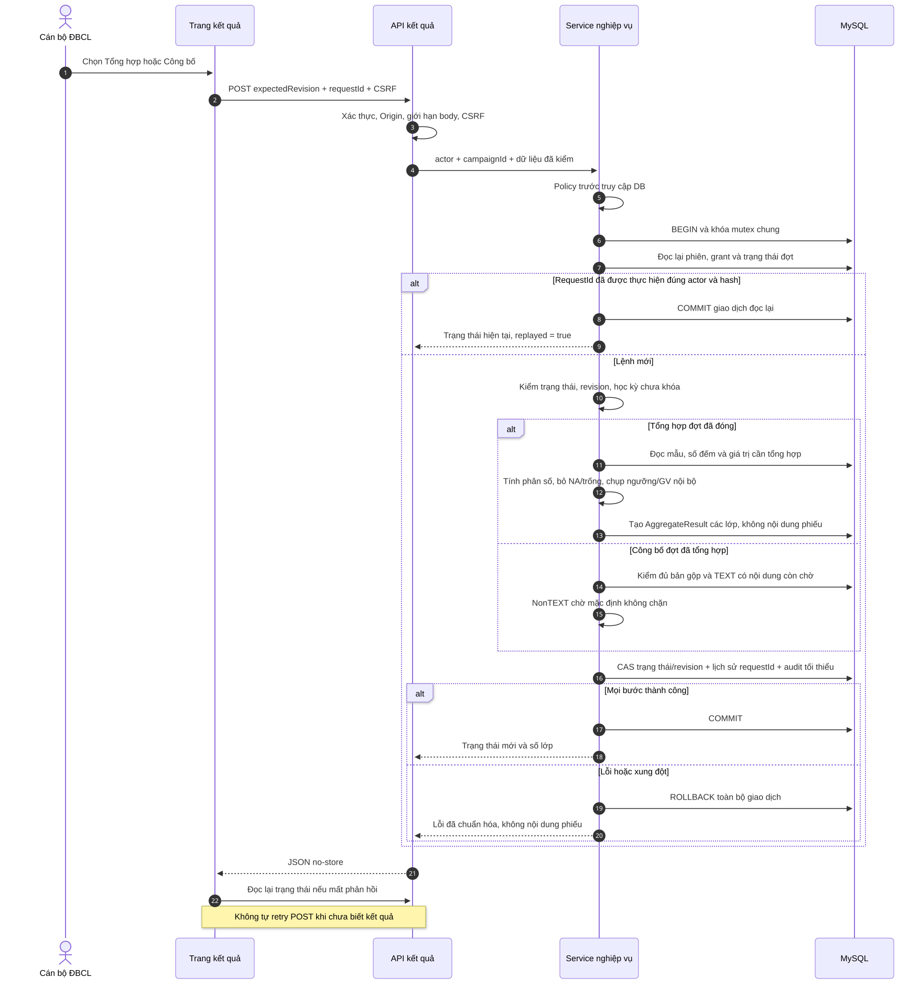

# Sơ đồ tổng hợp và công bố Tuần 9

Ngày kiểm thực tế: **30/10/2026 (Asia/Saigon)**. Ba sơ đồ mới mô tả trạng thái, transaction và quyền của Tuần 9. Quyết định tại [ADR010](decisions/ADR-010-tong-hop-cong-bo-va-kiem-duyet.md), công thức tại [bảng tổng hợp](CONG_THUC_TONG_HOP.md), phạm vi bằng chứng tại [nghiệm thu](NGHIEM_THU_TUAN_09.md). Các ảnh và báo cáo Tuần 1–8 giữ nguyên.

## 1. Trạng thái kết quả

[Nguồn Mermaid](assets/tuan-09/ket-qua-state.mmd) · [SVG](assets/tuan-09/ket-qua-state.svg).

ĐBCL tổng hợp sau khi đợt đã đóng, công bố khi đã tổng hợp và kiểm duyệt xong các TEXT có nội dung. Các bước ghi yêu cầu học kỳ chưa khóa. Khóa sổ đưa đợt đã công bố sang lưu trữ, giữ quyền đọc; mở khóa kỳ không tự đưa đợt về trạng thái trước. Cờ đủ mẫu áp dụng từng lớp, không chặn công bố toàn đợt chỉ vì một lớp thiếu mẫu. Sơ đồ dài, cần phóng SVG để đọc chú thích.

## 2. Transaction tổng hợp và công bố

[Nguồn Mermaid](assets/tuan-09/tong-hop-sequence.mmd) · [SVG](assets/tuan-09/tong-hop-sequence.svg).

Route kiểm cookie/Origin/body/CSRF; service kiểm policy trước DB và đọc lại phiên/grant sau mutex. requestId gắn actor/hành động/hash để retry có kiểm soát. Lệnh mới kiểm trạng thái/revision/kỳ khóa trước ghi, CAS đợt và ghi lịch sử/audit trong cùng transaction. Trình duyệt đọc lại trạng thái khi mất phản hồi, không tự retry POST. Mũi tên thể hiện luồng nghiệp vụ, không thêm quan hệ từ phiếu tới User/SurveyTask.

## 3. Quyền và projection kết quả

[Nguồn Mermaid](assets/tuan-09/ket-qua-quyen.mmd) · [SVG](assets/tuan-09/ket-qua-quyen.svg).

Quyền ADMIN không suy ra quyền dữ liệu khảo sát. GV/TBM/TK đọc đúng phạm vi sau công bố/lưu trữ; lớp thiếu mẫu bị ẩn điểm/TEXT. Khảo thí có projection riêng chỉ nhóm đánh giá gộp và ngưỡng ít nhất hai GV; không có lớp/GV/TEXT. Nhánh danh sách chưa hoàn thành chỉ dùng nhiệm vụ PENDING, có audit và nhắc theo ngày; không ghép câu trả lời.

## Kết quả render và giới hạn

Đã render **3/3 nguồn Mermaid** bằng Mermaid CLI/Puppeteer/Chrome sẵn có, không thêm dependency dự án. Đã mở xem **3/3 PNG cuối**; không thấy nhãn/chú thích bị cắt. Phép đo `text`/`foreignObject` trên SVG trả **0 phần tử vượt biên** ở cả ba ảnh. Đây là kiểm hiển thị sơ đồ, không chứng minh nghiệp vụ chạy đúng hoặc thay kiểm HTTP/MySQL/UI ứng dụng.

| Sơ đồ | ViewBox rộng × cao | Phần tử chữ vượt biên |
| --- | --- | --- |
| Trạng thái | 698,21 × 2138 | 0 |
| Tuần tự | 1755 × 1906 | 0 |
| Quyền | 1694,25 × 800 | 0 |

Hash SHA-256 nguồn chuẩn hóa LF / SVG tại lượt render cuối:

- Trạng thái: `4f8a59addd5c7280b7dd61b1b824be7cda18344a478e1f220c8eec62b3f5b7d9` / `c9c8e082185d1df7f305a3429c5d51d3f6c17962559d481a564cd4ece1b7c5e2`.
- Tuần tự: `cfbb33201065a3146ee51bc912082bc0e11b8342e36c2b2025e25fd1d4dd952e` / `234ca9857de6fabcbaa2a0b68466b43d9b06185e42b340666664adc90fa34b9f`.
- Quyền: `7dc76e463bd2cad4b947d88aa57f3b31d2d8635145c79603ce19a6c36c456db8` / `d10cbb4dc588b56042ffb1da2a79f5f45da2c128ac8c3269f2eb280b592e4368`.

Harness và ảnh PNG nằm trong workspace `work/week9-diagrams`, ngoài Git; `verification.json` lưu thời điểm/hash/kích thước. SVG được commit cùng nguồn, không ghi đè assets Tuần 8. Không thêm model/FK vào vùng khảo sát ẩn danh; [ERD](ERD.md) là thiết kế dữ liệu riêng, không suy từ sơ đồ này rằng các model tương lai đã hiện thực.

## 4. ERD đối chiếu phạm vi Tuần 9

Đã cập nhật exporter và [ERD hiện tại](ERD.md) để ghi đúng **46 model thiết kế / 34 runtime / 12 model chỉ thiết kế**. AggregateResult có dịch vụ tổng hợp/công bố Tuần 9, không còn nhãn chỉ seed; còn bốn bảng Feedback/FeedbackRecipient/FeedbackMessage/FeedbackHistory chỉ có dữ liệu demo. Tuần này dùng cấu trúc và JSON đã có, không thêm model/FK/migration. SurveyReminder vẫn chỉ thiết kế vì nhắc khảo sát dùng Notification/EmailOutbox hiện có; không suy số bảng migrate thành số chức năng hoàn thành.

- [Nền và danh mục](assets/tuan-09/erd-nen-danh-muc.svg): 10 model chính.
- [Khảo sát và các thiết kế liên quan](assets/tuan-09/erd-khao-sat.svg): 17 model chính, 6 ngữ cảnh lặp.
- [Phản hồi liên tục](assets/tuan-09/erd-phan-hoi.svg): 10 model chính, 4 ngữ cảnh lặp; workflow chưa làm ở Tuần 9.
- [Hệ thống](assets/tuan-09/erd-he-thong.svg): 9 model chính, 1 ngữ cảnh lặp.

Đã chạy `npm run design:diagrams` rồi `npm run design:check`: cả hai qua. Exporter ghi SVG mới ở `assets/tuan-09`, giữ nguyên ảnh/báo cáo Tuần 1–8. Hai schema chỉ sửa chú thích phạm vi đầu tệp; không generate Prisma trong lượt kiểm riêng này. SHA-256 DMMF thiết kế vẫn `bca4073a102d6c09bbee9b90882d08c750e6ea82ec7fafaeaacd9a153538eb20`.

Đã render **4/4 khối Mermaid** trong ERD và **4/4 SVG thẻ**, mở xem **8/8 PNG**. Đo `text`/`foreignObject` cho Mermaid và `text` cho thẻ trả **0 nhãn vượt biên**. SVG thẻ là tổng quan khóa do exporter sinh trực tiếp từ DMMF, không phải bản render Mermaid; khối Mermaid chứa đầy đủ thuộc tính. Sơ đồ nhiều bảng cần phóng SVG để đọc; phép đo không bảo đảm mọi đường nối tách biệt ở mọi mức thu phóng.

| Nhóm | Thẻ SVG rộng × cao | Mermaid viewBox rộng × cao | Chữ vượt biên thẻ / Mermaid |
| --- | --- | --- | --- |
| Nền/danh mục | 1632 × 1093 | 2488,56 × 2087,25 | 0 / 0 |
| Khảo sát | 1632 × 2228 | 6726,39 × 4243,75 | 0 / 0 |
| Phản hồi | 1632 × 1532 | 5472,38 × 3149,50 | 0 / 0 |
| Hệ thống | 1632 × 1116 | 3772,26 × 1626 | 0 / 0 |

SHA-256 bốn SVG thẻ Tuần 9:

- Nền/danh mục: `09cd2da9744f346cde00eadffe626945989a3955a739157a346de6274e51c144`.
- Khảo sát: `6dd5339a087b13991865a01716c3f9a181efb746643a7ca29c12a971bdd81e38`.
- Phản hồi: `e250d3df7729a7407774d84202ce274dc025e4cef40f92a062aade3d5d7975e3`.
- Hệ thống: `56139164cc1239cc75f841f0e8638c19cded528ca456065fbea91ca9468853bd`.

Harness `work/week9-erd/verify.mjs`, `verify-bounds.mjs`, tám PNG và `verification.json` nằm ngoài Git. Lượt này không khởi động Next, migrate hay ghi DB; không thay kiểm thật phân quyền/ngưỡng/giao dịch.
