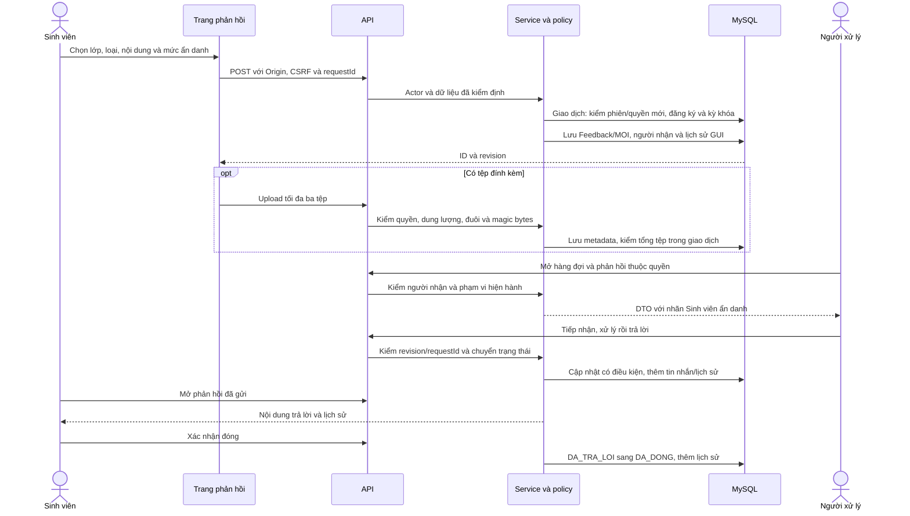
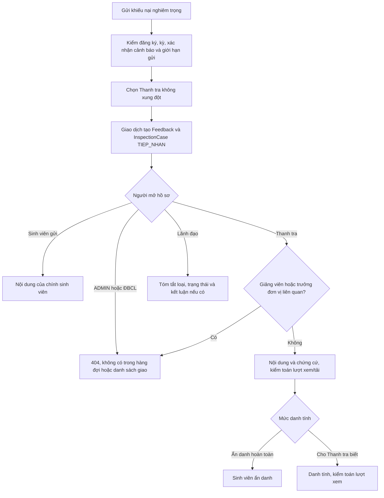

# Sơ đồ Tuần 10: phản hồi và hồ sơ tiếp nhận

Ngày thực hiện: 01/11/2026. Các sơ đồ thể hiện hành vi Tuần 10; trạng thái Thanh tra sau tiếp nhận được để lại Tuần 11.

Luồng thường: `MOI → DA_TIEP_NHAN → DANG_XU_LY → DA_TRA_LOI → DA_DONG`. Chuyển tiếp phải có lý do, thay người nhận và quay về MOI; từ chối phải có lý do. Không sửa lịch sử. Đóng không tự kích hoạt đánh giá hài lòng hoặc mở lại ở Tuần 10.

[ERD hiện tại](ERD.md) được sinh từ DMMF; [ADR-011](decisions/ADR-011-phan-hoi-va-tiep-nhan-thanh-tra.md) giải thích quyền và giới hạn. Có thể xem trực tiếp Mermaid trong trình xem Markdown hỗ trợ Mermaid hoặc đưa đoạn sơ đồ vào công cụ Mermaid để xuất SVG.
