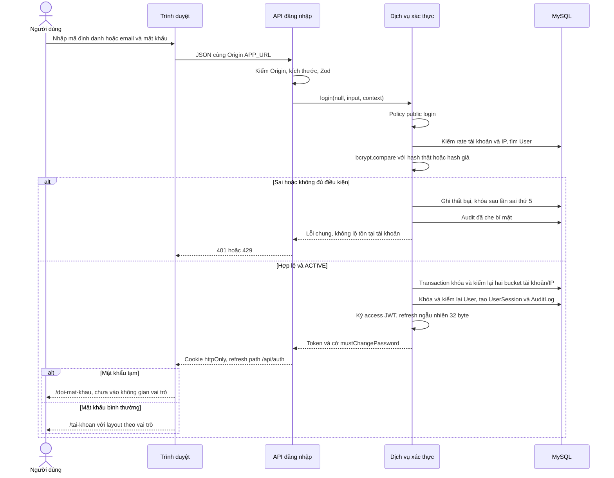
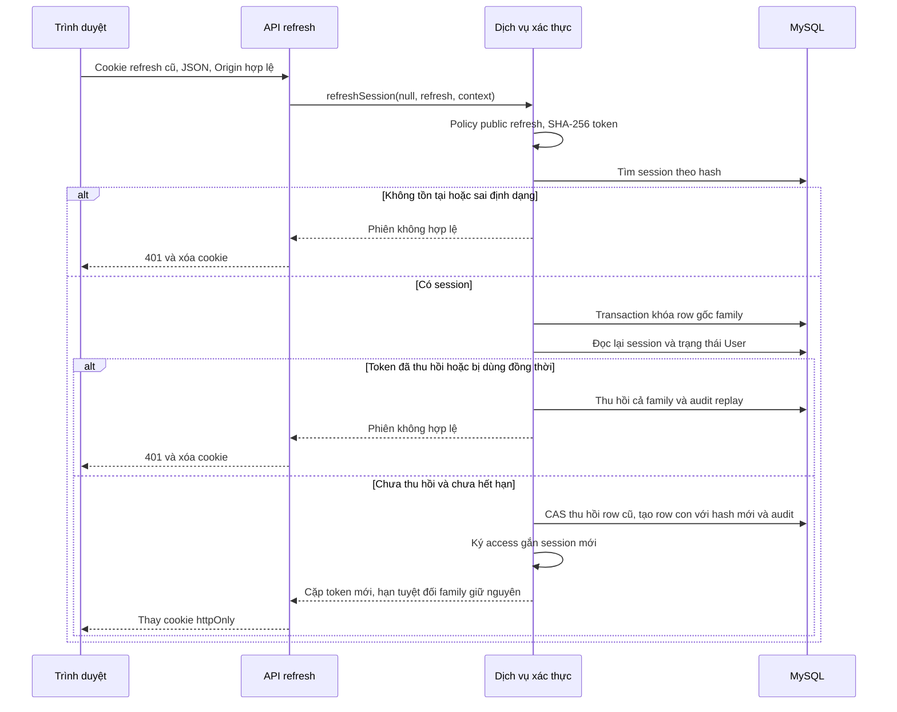
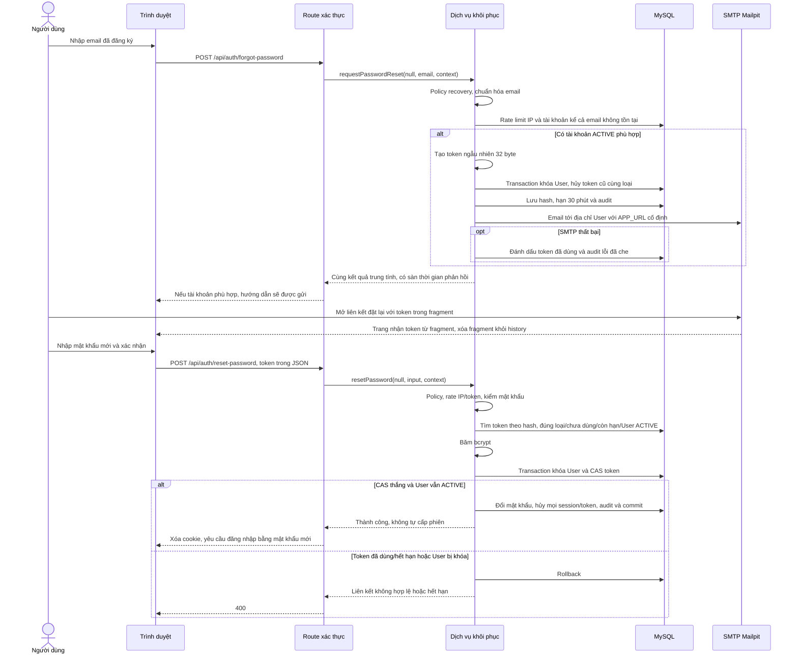

# Sơ đồ tuần tự xác thực — Tuần 3

Khởi động thực tế 21/10/2026, sau mốc kế hoạch giả định 14–20/10. Ba sơ đồ dưới mô tả mã Tuần 3; kết quả test/render ghi riêng tại [nghiệm thu](NGHIEM_THU_TUAN_03.md). Service gọi policy trước truy cập dữ liệu; POST phải qua kiểm Origin/JSON/Zod ở route.

## 1. Đăng nhập và bắt buộc đổi mật khẩu tạm

Cookie Secure chỉ ở production HTTPS. Token không nằm trong JSON trả về client hoặc localStorage. Giao diện tài khoản mới là khung theo vai trò; menu khảo sát/phản hồi chưa mở không được xem là FR-50/FR-70 hoàn thành.

## 2. Refresh xoay vòng và phát hiện dùng lại

Access của row cũ vô hiệu ngay sau rotation vì service kiểm session trong DB, dù exp của JWT chưa tới. Logout khóa cùng gốc family rồi thu hồi mọi row của family đó. Đổi mật khẩu/reset thu hồi mọi family của user. Client tuần tự hóa refresh; replay có chủ đích hoặc race vẫn thu hồi family theo cùng quy tắc.

## 3. Yêu cầu và hoàn tất đặt lại mật khẩu

Kích hoạt dùng cùng cấu trúc, nhưng chỉ PENDING_ACTIVATION và hạn 24 giờ; hoàn tất chuyển ACTIVE. Không mở khóa DISABLED. Phần fragment tránh token trong HTTP URL mở trang, không bảo vệ trước người có quyền đọc hộp thư hoặc mã độc trong trình duyệt. Không ghi payload, mật khẩu, cookie hoặc raw token vào audit/log.

## Bản sơ đồ đã render ngày 22/10

Ba khối Mermaid phía trên được render thành SVG bằng **Mermaid CLI 12.0.0 (`mmdc`) và Chrome**. Các SVG được sao chép nguyên byte vào thư mục bằng chứng. Đã mở từng SVG trong Chrome với hồ sơ tạm, raster hóa và xem ảnh thật của cả ba sơ đồ; không dùng bộ chuyển đổi làm mất nhãn HTML. Ba SVG hiện tại dùng nhãn SVG `text`, không có phần tử `foreignObject`.

| Sơ đồ | SVG đã render | Kích thước viewBox làm tròn |
| --- | --- | --- |
| Đăng nhập | [Mở sơ đồ đăng nhập](assets/tuan-03/dang-nhap-sequence.svg) | 1660 × 1345 |
| Refresh xoay vòng | [Mở sơ đồ refresh](assets/tuan-03/refresh-sequence.svg) | 1437 × 1147 |
| Đặt lại mật khẩu | [Mở sơ đồ đặt lại mật khẩu](assets/tuan-03/reset-sequence.svg) | 2060 × 1763 |

SHA-256 dưới đây xác định phần thân UTF-8 của từng khối Mermaid, bỏ hai dòng hàng rào và giữ xuống dòng trong phần thân, cùng byte của file SVG tương ứng:

- **Đăng nhập** — nguồn: `de1aad6339d484b0e24c9fd636d335f0fab8a39a701529ca7c18c0435a84f0f1`; SVG: `0dbdfc8001eb60cab83f2018e21824e01775e234238fbb21bb84685706bdfe9a`.
- **Refresh** — nguồn: `c2225c89071e32597337235364169abe7edd960e874bd69f59e1f20d89abc630`; SVG: `3183415466aa918fad6934853b4d691024bd58e0f8638d36cc4537284ebd9bc3`.
- **Đặt lại mật khẩu** — nguồn: `a6e97f53cf0e3bf719d7ccb32065949e4eefb838737ad3da1e24e605e5762021`; SVG: `fdc81ce6b73aad851c5961da69e8355ad637baff2f28e0a2aa08309208c4e48b`.

Giới hạn quan sát: sơ đồ rộng, nhãn thông điệp dài nên cần mở SVG riêng và phóng to khi đọc trên điện thoại hoặc trang tài liệu thu nhỏ. Đã rút gọn tên participant để vừa hộp. Renderer từng làm mất hậu tố fragment trong nhãn mở liên kết; đã đổi riêng nhãn thành “Mở liên kết đặt lại với token trong fragment”, render lại 3/3 và xem lại ảnh, chi tiết token trong fragment hiện đọc được. Các thông điệp nghiệp vụ còn lại giữ nguyên. Kết quả render xác nhận sơ đồ đọc được; kiểm đúng nghiệp vụ và API được ghi riêng trong nghiệm thu.
