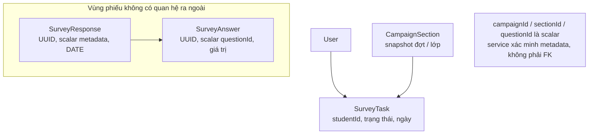
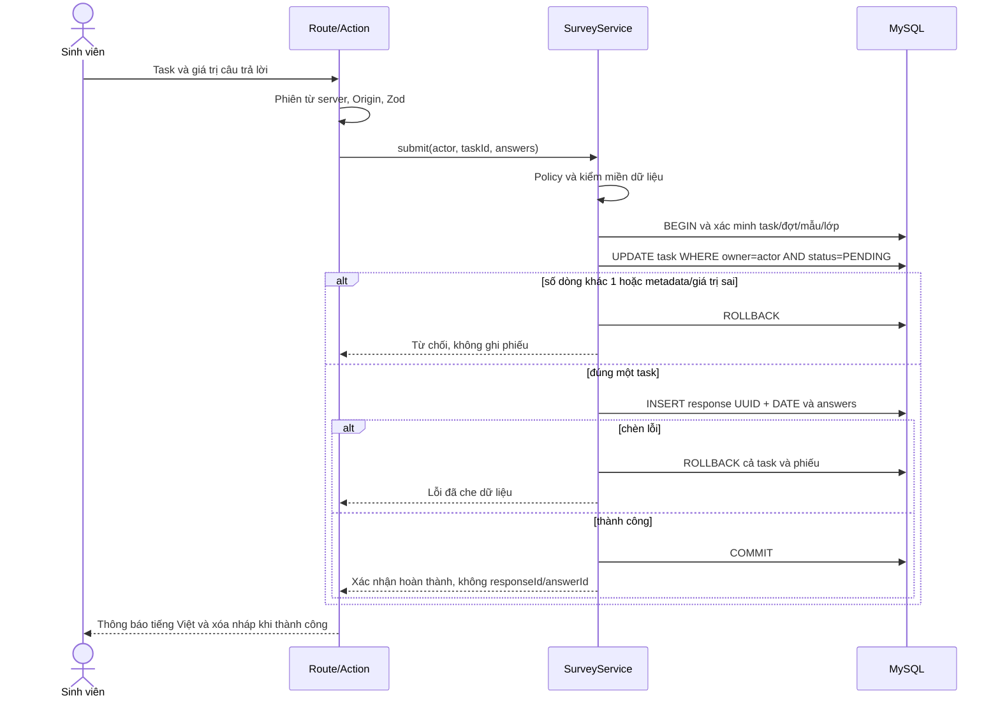

# Thiết kế ẩn danh khảo sát — Mục 5.6

Ngày thiết kế thực tế: **21/10/2026**, thuộc phần việc Tuần 2 theo yêu cầu tiếp tục của người dùng. Đây là thiết kế và hợp đồng kiểm thử; API nộp phiếu, kiểm duyệt và export chưa được triển khai trong Tuần 2.

## 1. Mục tiêu và giới hạn

Ứng dụng biết **ai đã/chưa làm**, phục vụ chặn trùng và nhắc nhở, nhưng không giữ liên kết từ phiếu trả lời đến người nộp. Thiết kế phục vụ BR-01/02/03/04/07/09/13/30/34 và FR-43/46/50/52/53/54/60/65/92. Đây là ẩn danh ở mức ứng dụng, không phải bảo đảm chống quản trị database hoặc người có toàn quyền hạ tầng.

Tách hai khu vực:

| Khu vực             | Biết gì                                                                     | Không được chứa                                                                                   |
| ------------------- | --------------------------------------------------------------------------- | ------------------------------------------------------------------------------------------------- |
| Nhiệm vụ SurveyTask | Đợt, lớp, sinh viên, PENDING/DONE và doneDate DATE                          | responseId, answerId, nội dung hoặc bản sao phiếu                                                 |
| SurveyResponse      | UUID, campaignId/sectionId scalar, submittedDate DATE; danh sách answers    | studentId, taskId, người tạo, IP, User-Agent, session/request/correlation ID, thời điểm chính xác |
| SurveyAnswer        | UUID, responseId, questionId scalar, giá trị và trạng thái/lý do kiểm duyệt | FK sang người dùng/câu hỏi/đợt/lớp, actor sinh viên, timestamp nộp chính xác                      |

Sơ đồ không có đường T → R. Notification và danh sách chưa hoàn thành chỉ dựa T. Quan hệ Response–Answer là quan hệ duy nhất của vùng phiếu. Không thêm FK từ R sang đợt/lớp hoặc từ Answer sang Question: quan hệ gián tiếp qua CampaignSection → SurveyTask/User hay Question → Template → createdBy(User) cũng vi phạm 5.6a. Không tạo model ánh xạ bên ngoài để lách quy tắc. Xem [ADR-003](decisions/ADR-003-an-danh.md).

## 2. Metadata scalar được kiểm ở đâu?

Không có FK metadata là lựa chọn có đánh đổi. Prisma validate chỉ xác nhận schema, **không** xác nhận các ID scalar đúng đợt/mẫu/lớp. Service nộp Tuần 8 phải tự xác minh:

1. Task tồn tại trong phạm vi actor đăng nhập; task thuộc CampaignSection đã chốt, không tính lại bằng Enrollment đang thay đổi (BR-01).
2. Campaign là DANG_MO, thời gian máy chủ trong khoảng cho phép; học kỳ chưa khóa theo quy tắc áp dụng; mẫu và phạm vi đã cố định theo BR-05/06.
3. Mỗi questionId thuộc đúng phiên bản template khóa của campaign; không thiếu câu bắt buộc, không lặp câu, không thêm câu ngoài mẫu.
4. Mỗi giá trị đúng loại, thang, cờ Không áp dụng và điều kiện bắt buộc; mọi option ID thuộc đúng câu và chỉ là option, không chứa user/task ID. Chuỗi tự luận có giới hạn và được xử lý như văn bản.
5. campaignId/sectionId lấy từ task đã xác minh phía server; không tin giá trị client tự nhận là hợp lệ.

Các kiểm tra gắn dữ liệu và ghi phiếu phải nằm trong transaction có đọc/khóa hoặc điều kiện phù hợp, phối hợp với quy tắc không sửa mẫu/phạm vi sau duyệt để tránh kiểm xong dữ liệu bị đổi. Không mở route ghi trực tiếp SurveyResponse/SurveyAnswer bỏ qua service. Thiết kế này cần test giả mạo question/option/campaign/section khi hiện thực, chưa có kết quả runtime trong Tuần 2.

## 3. Hợp đồng nộp một lần — Tuần 8

Task unique `(campaignId, sectionId, studentId)` ngăn danh sách nhiệm vụ trùng. Chặn nộp trùng dựa cập nhật có điều kiện PENDING → DONE và kiểm đúng một dòng, cùng transaction chèn phiếu. Không tạo unique studentId trên phiếu vì sẽ tái tạo liên kết danh tính. Không tự động retry POST bằng cách tạo thêm UUID khi lần trước đã commit; truy vấn trạng thái task của mình để đưa xác nhận, không trả lại nội dung/ID phiếu.

Khi rollback, task còn PENDING và không tồn tại response/answer dở dang; cần test lỗi cưỡng bức giữa các bước. doneDate/submittedDate được lấy từ cùng quy ước ngày nghiệp vụ phía server, lưu DATE. Không tạo createdAt/updatedAt precise trong vùng phiếu.

## 4. Nháp, UI, DTO, kiểm duyệt và xuất file

- **Nháp:** chỉ phía trình duyệt theo FR-52; không endpoint lưu nháp, không bảng draft trên server, không autosave analytics. Không lưu token cùng nháp. Khi hiện thực cần xóa nháp sau nộp/đăng xuất, cảnh báo thiết bị dùng chung và không bảo đảm browser localStorage an toàn trước người dùng chung hoặc XSS.
- **Xác nhận:** chỉ trả trạng thái nhiệm vụ/đã nộp; không trả responseId/answerId cùng người nộp. Danh sách chưa làm chỉ cho vai trò có phạm vi BR-13, mỗi lần xem/xuất có audit, không có nội dung phiếu.
- **Hiển thị:** trộn thứ tự phiếu/tự luận; không sắp xếp theo thời điểm nộp hay hiển thị thời điểm chính xác; không cung cấp màn hình ghép phiếu và task.
- **Kiểm duyệt:** tự luận mặc định CHO_KIEM_DUYET; chỉ HIEN_THI mới được người nhận kết quả thấy. Cán bộ kiểm duyệt để lại lý do trong dữ liệu kiểm duyệt và AuditLog với actor cán bộ + objectType/objectId scalar của answer. Không thêm moderatorId relation vào Answer. Audit không chứa nội dung phiếu và không liên kết actor sinh viên với answer.
- **Công bố:** chỉ khi responseCount ≥ minResponses (mặc định 5) **và** task DONE/tổng task ≥ minRate (mặc định 30%). Không đủ mẫu: hiển thị “Chưa đủ mẫu để công bố”; số liệu gộp bộ môn/khoa chỉ cho vai trò được phép. Giảng viên/trưởng đơn vị chỉ thấy khi DA_CONG_BO; ĐBCL/lãnh đạo từ DA_TONG_HOP (BR-07/08).
- **Xuất:** dùng DTO danh sách trường cho phép, không xuất sinh viên, taskId, IP, userAgent, session/request ID hoặc mốc nộp chính xác. Phải kiểm tra toàn bộ Excel/CSV/PDF và metadata/sheet ẩn; export danh sách chưa hoàn thành là báo cáo trạng thái riêng, không ghép với phiếu. Kết quả tự luận sau kiểm duyệt vẫn có thể tự tiết lộ danh tính do nội dung.

## 5. Chính sách log và audit

Không log payload khảo sát, câu trả lời, lỗi validation kèm giá trị, SQL params chứa nội dung phiếu, token hoặc secret. Không ghi audit nộp với actor sinh viên và response/answer ID; không dùng outbox, queue, APM trace, request ID hoặc bảng chẩn đoán làm cầu nối thay thế. Các log xác thực/rate limit được tách khỏi vùng phiếu, che dữ liệu và không mang responseId/answerId. Khi triển khai phải rà cả proxy, analytics, error reporter và query log; bỏ trường khỏi schema ứng dụng không tự xóa dấu vết ở hạ tầng.

BR-30 vẫn áp dụng cho hành động nhạy cảm: gán quyền, duyệt đợt, gia hạn/đóng, kiểm duyệt, công bố, xem/xuất trạng thái. Ghi actor của cán bộ theo danh sách hành động cho phép. Danh sách audit phải lọc nội dung; quyền ADMIN xem audit không được trở thành đường xem nội dung phiếu hay phản hồi.

## 6. Khác biệt với phản hồi liên tục

Feedback có `authorId` và FeedbackMessage có tác giả để người gửi đọc, trao đổi, đánh giá và nhận thông báo. `isAnonymous=true` nghĩa là người xử lý chỉ thấy “Sinh viên ẩn danh”; service/projection phải loại tác giả khỏi phản hồi, tin nhắn, attachment, lịch sử, thông báo và export dành cho người xử lý. Việc che mỗi displayName trong UI là chưa đủ. Đây là ẩn danh với người xử lý theo BR-24; không đạt cùng đặc tính “không liên kết DB với User” của phiếu khảo sát. Quy trình tiết lộ danh tính P2 nếu được chọn sau này cần quyền ĐBCL, lý do và audit, không mặc định triển khai.

## 7. Ma trận kiểm thử và giới hạn bằng chứng

| Mã Mục 5.6    | Cách kiểm                                                                                                                                                                                                   | Mốc hiện thực/ý nghĩa                                                                       |
| ------------- | ----------------------------------------------------------------------------------------------------------------------------------------------------------------------------------------------------------- | ------------------------------------------------------------------------------------------- |
| (a), BR-03    | Lấy Prisma DMMF blueprint, xây đồ thị mọi relation và duyệt từ Response/Answer; không tới User/SurveyTask, chỉ hai model trong thành phần; kiểm hợp đồng scalar/UUID/DATE và cấm trường định danh/timestamp | Tuần 2: kiểm **thiết kế cấu trúc**; kết quả thực chạy ghi riêng, không thay test runtime    |
| (b), BR-02    | Nộp thành công rồi nộp lần hai; bị từ chối, số response không tăng                                                                                                                                          | Tuần 8; chưa triển khai ở Tuần 2                                                            |
| (c), BR-02    | Gửi 20 request đồng thời cho một task vào MySQL thật; chỉ một response, đủ answers, task DONE; kiểm rollback khi chèn lỗi                                                                                   | Tuần 8; chưa triển khai ở Tuần 2                                                            |
| (d), BR-03/30 | Tạo dữ liệu giả có chuỗi đánh dấu định danh; duyệt mọi định dạng export và payload DTO/log liên quan, không chứa định danh phiếu                                                                            | Bắt đầu cùng luồng khảo sát Tuần 8, hoàn thiện với export Tuần 12; chưa triển khai ở Tuần 2 |

Các test bổ sung khi triển khai: task người khác, câu hỏi/option từ mẫu khác, ngoài giờ, đợt đóng/học kỳ khóa, giá trị sai, rollback, không server draft, không response ID trong xác nhận, log không PII/nội dung, quyền xem/export và ngưỡng mẫu. Không tick FR-53 hay tuyên bố “ẩn danh đã hoàn tất” chỉ vì (a) xanh.

## 8. Hạn chế phải trình bày khi bảo vệ

Người có quyền DB/binlog/transaction trace có thể suy luận từ thời điểm ghi và những hàng thay đổi cùng transaction. Scalar campaign/lớp có thể được JOIN thủ công để tìm tập sinh viên; không có FK chỉ chặn đường quan hệ được ứng dụng khai báo, không ngăn DBA truy vấn. IP/proxy log, thứ tự request hoặc nội dung “tôi là lớp trưởng…” cũng có thể tiết lộ. Ngày nộp vẫn thu hẹp tập người và lớp ít sinh viên dễ bị suy đoán. Ngưỡng công bố, trộn thứ tự, kiểm duyệt và hạn chế log giảm rủi ro, không bảo đảm ẩn danh tuyệt đối. Đề tài không tuyên bố chống được người quản trị hạ tầng chủ động theo dõi.

## 9. Hiện thực và bằng chứng Tuần 8 — 29–30/10/2026

Mục1–8 giữ thiết kế và bằng chứng lịch sử Tuần 2; những câu “chưa triển khai ở Tuần 2” mô tả đúng mốc cũ. Tuần 8 đã có `student-surveys.ts`/`student-survey-input.ts`, API `/api/student-surveys`, trang `/khao-sat`, nháp cục bộ và xác nhận. [ADR-009](decisions/ADR-009-nop-phieu-an-danh.md) nêu quyết định triển khai; [nghiệm thu Tuần 8](NGHIEM_THU_TUAN_08.md) ghi nguồn/CI/QA cuối. Không sửa hợp đồng đặc tả 5.6.

| Phần kiểm | Kết quả thực tế ngày 30/10 | Giới hạn |
| --- | --- | --- |
| Schema5.6(a) | Fullcheck 646/646 trong 39 tệp qua, gồm DMMF runtime/design, đồ thị và mutation test hiện có | Runtime34/design46, không migration hoặc cầu nối mới; không chặn DBA JOIN thủ công |
| Nộp lần hai5.6(b) | HTTP409, số response/answers không tăng; DONE detail không có ID/nội dung phiếu | Dựa vào task chốt, không dùng danh tính trên phiếu |
| Đồng thời5.6(c) |20 POST trên MySQL thật:1 thành công/19 bị 409,1 response/6 answers/task DONE | Không chứng minh tải1.500 request hoặc mọi tình huống hạ tầng |
| Rollback5.6(c) | Trigger riêng ép lỗi chèn câu trả lời:HTTP 500/task PENDING/0 response/0 answer; bỏ trigger retry thành công | Trigger giới hạn DB marker/server UUID/câu hỏi fixture, đã dọn; không đổiGLOBAL hoặc quyền user ứng dụng |
| DTO/log5.6(d), phần hiện có | Privacy unit qua route→service, whitelist ghi/DTO, sentinel/lỗi/console/audit/queue; HTTP/logscan không nội dung/ID phiếu/cầu nối | Mock không thay đồng thờiMySQL, chưa kiểm proxy/APM/analytics bên ngoài |
| Xuất kết quả5.6(d) | Chưa có chức năng xuất khảo sát ở Tuần 8 | Phải kiểm CSV/Excel/PDF, metadata/sheetẩn khi Tuần 12 hiện thực; không nhận phần tương lai đã qua |

HTTP 16/16 qua với fixture/trigger dọn sạch; buildNext 16.4.3 qua và27 tập main trước/sau khớp hash. UI13 nhóm/34 PNG đã xem và CI nguồn 6edad31/check/smoke đã qua; chốt FR-50–54 theo báo cáo nghiệm thu, CI main/tài liệu cuối đối chiếu riêng. Không suy từ seed đã có phiếu rằng luồng tổng hợp/công bố/kiểm duyệt hoặc export đã hoàn thành.

Hiện thực nhận đúng khoảng đóng `[startsAt, endsAt]`; server kiểm mới phiên/quyền/chủ task/trạng thái/kỳ/mẫu/giá trị trong transaction, không xét lại Enrollment sau chốt. POST chỉ trả DONE/ngày Việt Nam; task và phiếu lưu cùng quy ướcDATE, không giờ nộp chính xác. Không audit nộp hoặc queue mang người với phiếu. Nháp chỉlocalStorage theo user/task/templateversion, không có token/API nháp; dọn theo DONE/trạng thái server/đăng xuất và tín hiệu giữa tab. Mất phản hồi sau POST thì đọc task trước, không tự retry nộp.
