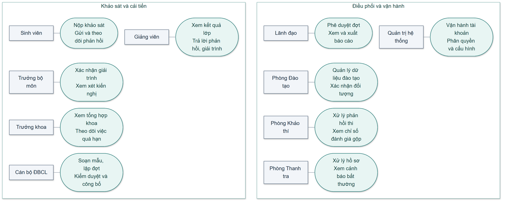
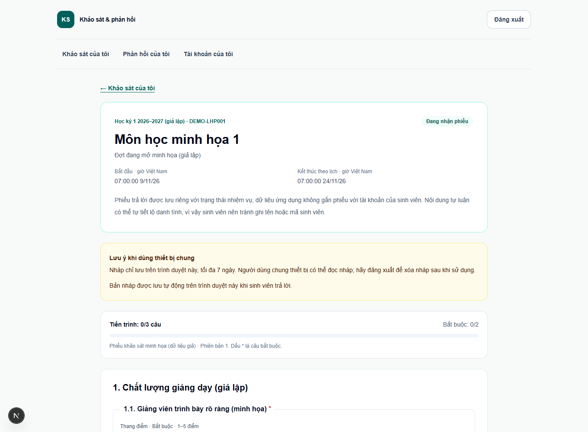
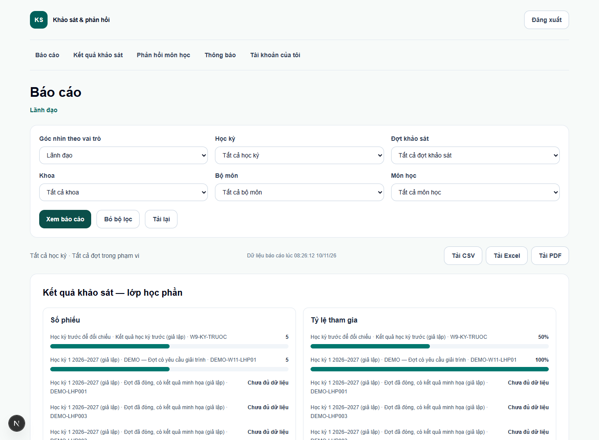

# Xây dựng website quản lý khảo sát và phản hồi của sinh viên về môn học

## Tóm tắt

Đề tài xây dựng website tiếng Việt phục vụ hai quy trình trong cơ sở đào tạo đại học: khảo sát định kỳ về môn học và xử lý phản hồi trong quá trình học. Khảo sát tạo số liệu tổng hợp để cải tiến giảng dạy. Phản hồi tạo hồ sơ để trao đổi, theo dõi thời hạn và chuyển đúng đầu mối. Cả hai dùng chung danh mục đào tạo nhưng có cách bảo vệ danh tính khác nhau.

Hệ thống dùng Next.js, TypeScript, Prisma và MySQL. Mười vai trò được phân quyền theo chức năng, phạm vi tổ chức và quan hệ với từng lớp hoặc hồ sơ. Khi nộp khảo sát, một giao dịch cập nhật trạng thái nhiệm vụ và lưu phiếu tách khỏi danh tính. Kết quả được tổng hợp theo trọng số, áp dụng ngưỡng bảo vệ và kiểm tra quyền trước khi xem hoặc xuất tệp.

Mốc đóng băng ghi nhận 79 trong 84 yêu cầu chức năng đã được xác nhận, tương ứng 213 trên 219 điểm trọng số (97,3%). Lượt đo tải sau tối ưu ghi 200 trên 200 yêu cầu nộp thành công và p95 là 3.595,91 ms, cao hơn mục tiêu 3.000 ms. Bộ demo Docker chạy cục bộ bằng dữ liệu giả. Phạm vi đánh giá gồm luồng nghiệp vụ, phân quyền, nộp đồng thời, vận hành và phục hồi dữ liệu. [1, 5–7]

**Từ khóa** · Khảo sát môn học, phản hồi sinh viên, phân quyền, ẩn danh, kiểm thử đầu cuối.

<!-- toc -->

<!-- page -->

## Chương 1 Tổng quan đề tài

[CẦN SINH VIÊN ĐỌC VÀ VIẾT LẠI BẰNG LỜI CỦA MÌNH]

### 1.1 Bối cảnh và vấn đề

Một đợt khảo sát phục vụ cải tiến môn học cần xác định rõ sinh viên được mời, thời hạn nộp và đối tượng được đọc kết quả. Với phản hồi phát sinh trong kỳ, sinh viên cần biết hồ sơ đã đến ai và đang được xử lý đến đâu. Nếu những bước này nằm ở các biểu mẫu và kênh liên lạc riêng, việc kiểm tra quyền, theo dõi tiến độ và tổng hợp số liệu sẽ khó thống nhất.

Từ đặc tả của đề tài, nhóm xây dựng mô hình quy trình cho một cơ sở đào tạo giả định. Phân tích dựa trên các yêu cầu nghiệp vụ đã thống nhất và Điều chỉnh số 01. Các trạng thái, ngưỡng và thời hạn nêu trong báo cáo là quy tắc của hệ thống, có phần cấu hình được. [1, 2]

### 1.2 Mục tiêu

- Quản lý từ mẫu phiếu, lập và duyệt đợt đến chốt nhiệm vụ, nhận phiếu, tổng hợp và công bố.
- Tiếp nhận phản hồi, chuyển đến người có thẩm quyền, theo dõi lịch sử, thời hạn và phản hồi sau khi xử lý.
- Áp dụng quyền theo vai trò và tài nguyên. Bảo vệ danh tính trong quá trình nhận phiếu, xem kết quả và xuất báo cáo.
- Cung cấp bản demo lặp lại được, có kịch bản nghiệm thu và bằng chứng kiểm thử gắn với yêu cầu.

### 1.3 Phạm vi

Phạm vi gồm website tiếng Việt, dữ liệu đào tạo minh họa hoặc tệp nhập Excel/CSV, biểu mẫu khảo sát, kết quả, phản hồi, giải trình, quản lý hồ sơ và thống kê. Môi trường nghiệm thu dùng tài khoản và dữ liệu giả. Các tích hợp với cổng điểm, đăng nhập một lần, ứng dụng di động native và kết nối trực tiếp với hệ thống của trường nằm ngoài phạm vi.

### 1.4 Phương pháp thực hiện

Yêu cầu chức năng được gắn mã FR, quy tắc nghiệp vụ được gắn mã BR và tiêu chí phi chức năng dùng mã NFR. Thiết kế được triển khai theo các lát cắt có thể kiểm thử. Bảng truy vết nối yêu cầu với quy tắc, mã nguồn hoặc kiểm thử và tài liệu nghiệm thu. Tiến độ chỉ tăng khi yêu cầu có bằng chứng đáp ứng, với trọng số P0, P1 và P2 lần lượt là 3, 2 và 1. [1, 3]

<!-- page -->

## Chương 2 Khảo sát và phân tích nghiệp vụ

[CẦN SINH VIÊN ĐỌC VÀ VIẾT LẠI BẰNG LỜI CỦA MÌNH]

### 2.1 Hai quy trình nghiệp vụ

Khảo sát định kỳ thu thập câu trả lời theo mẫu gắn với đợt và lớp học phần. Mỗi nhiệm vụ xác định một sinh viên đủ điều kiện. Khi đợt mở, hệ thống chốt tập nhiệm vụ để tạo mẫu số ổn định cho tỷ lệ tham gia. Điểm, tỷ lệ và nội dung tự luận đã kiểm duyệt được cung cấp theo trạng thái và phạm vi.

Phản hồi liên tục ghi nhận một sự việc hoặc góp ý, gắn với lớp mà sinh viên đủ điều kiện phản ánh. Hồ sơ đi qua các trạng thái tiếp nhận, xử lý, trả lời và đóng. Bên gửi có thể theo dõi và trao đổi trong phạm vi hồ sơ của mình. Thời hạn xử lý dùng để nhắc và leo thang. Trường hợp nghiêm trọng chuyển vào quy trình hồ sơ Thanh tra riêng. [1, 2]

### 2.2 Sơ đồ ca sử dụng theo tác nhân

*Hình 2.1. Các tác nhân và nhóm ca sử dụng của hệ thống. Sơ đồ Tuần 15 [4].*

Sơ đồ gom quyền theo nhóm công việc để phục vụ trình bày. Khi quyết định truy cập một tài nguyên cụ thể, ứng dụng còn xét phạm vi khoa hoặc bộ môn, quan hệ với lớp, trạng thái công việc và mức xác thực. Ví dụ, giảng viên chỉ mở được kết quả đủ điều kiện của lớp phụ trách. Một người có nhiều vai trò vẫn phải chịu điều kiện từ chối do xung đột lợi ích.

<!-- page -->

### 2.3 Bảng ca sử dụng và giới hạn quyền

| Tác nhân | Ca sử dụng tiêu biểu | Điều kiện hoặc giới hạn |
| --- | --- | --- |
| Sinh viên | Xem nhiệm vụ khảo sát, nộp phiếu, gửi và theo dõi phản hồi. | Chỉ thao tác với lớp và hồ sơ của mình. Một nhiệm vụ nộp một lần. |
| Giảng viên | Xem kết quả lớp, xử lý phản hồi được giao, gửi giải trình cải tiến. | Xem kết quả đã công bố và đủ mẫu của lớp mình phụ trách. |
| Trưởng bộ môn | Xem kết quả trong bộ môn, tiếp nhận leo thang, xác nhận giải trình. | Truy cập trong phạm vi bộ môn. Danh sách chưa hoàn thành chỉ dùng theo dõi tiến độ. |
| Trưởng khoa | Theo dõi kết quả và phản hồi trong khoa, xử lý leo thang. | Quyền giới hạn theo khoa và ngưỡng bảo vệ dữ liệu. |
| Cán bộ Đảm bảo chất lượng | Soạn mẫu, lập đợt, tổng hợp, kiểm duyệt, công bố và xuất báo cáo. | Trình Phòng Đào tạo xác nhận trước khi lãnh đạo duyệt. Hồ sơ Thanh tra tách riêng. |
| Lãnh đạo | Duyệt đợt và theo dõi báo cáo toàn trường. | Với Thanh tra, xem ở mức tóm tắt theo quy tắc nghiệp vụ. |
| Quản trị hệ thống | Quản lý tài khoản, vai trò, khoa, bộ môn, cấu hình và nhật ký. | Bắt buộc TOTP. Quyền quản trị không cấp quyền đọc kết quả, phản hồi hoặc hồ sơ Thanh tra. |
| Phòng Đào tạo | Quản lý danh mục đào tạo, nhập dữ liệu, xác nhận đối tượng khảo sát, xử lý phản hồi tổ chức lớp. | Quản lý học kỳ theo quy tắc khóa sổ. Việc hoàn tác cả lô nhập còn trong backlog. |
| Phòng Khảo thí | Xử lý phản hồi thi kết thúc học phần, đọc kết quả nhóm đánh giá gộp, gửi kiến nghị. | Chỉ xem dữ liệu đã công bố, đủ mẫu và đủ số giảng viên đóng góp. Không giải quyết phúc khảo. |
| Phòng Thanh tra | Tiếp nhận, xác minh, ghi kết luận, thông báo và đóng hồ sơ. | Chỉ người được phép và không xung đột lợi ích xem chi tiết. Cảnh báo bất thường chỉ hỗ trợ xem xét. |

*Bảng 2.1. Tóm tắt quyền của mười tác nhân theo đặc tả và ma trận quyền [1, 2, 4].*

<!-- page -->

### 2.4 Vòng đời đợt khảo sát

Cán bộ ĐBCL tạo mẫu và đợt, chọn kỳ học, phạm vi, thời gian và ngưỡng. Đợt nháp chuyển sang chờ Phòng Đào tạo xác nhận dữ liệu. Các điều kiện sẵn sàng được kiểm trước khi xác nhận. Lỗi chặn phải được xử lý. Khi xác nhận dữ liệu có cảnh báo, người thực hiện ghi chú theo quy tắc tương ứng. Lãnh đạo duyệt hoặc trả về để điều chỉnh.

Khi đến giờ mở, hệ thống chốt danh sách theo dữ liệu đào tạo hiện tại, đối chiếu bản chụp đã xác nhận và ghi nhận thay đổi theo quy tắc. Đợt chưa duyệt không được mở. Phiếu chỉ nhận trong thời gian đợt đang mở theo giờ máy chủ. Khi hết hạn, đợt được đóng để tổng hợp. Sau kiểm duyệt, cán bộ ĐBCL công bố kết quả. Khi khóa sổ học kỳ, kết quả công bố được lưu trữ. [1, 2]

**Trình tự chính** · Nháp → Chờ xác nhận dữ liệu → Chờ duyệt → Đã duyệt → Đang mở → Đã đóng → Đã tổng hợp → Đã công bố → Lưu trữ.

### 2.5 Phản hồi và giải trình cải tiến

Hệ thống định tuyến theo loại phản hồi. Giảng dạy và tài liệu chuyển đến giảng viên phụ trách. Đề cương chuyển đến trưởng bộ môn. Tổ chức lớp chuyển đến Phòng Đào tạo. Thi kết thúc học phần chuyển đến Phòng Khảo thí. Khiếu nại nghiêm trọng vào hàng đợi Thanh tra. Người xử lý có thể chuyển tiếp hoặc từ chối trong phạm vi được phép và phải nêu lý do.

Thời hạn được tính theo ngày làm việc từ cấu hình. Ví dụ, mặc định phản hồi tổ chức lớp và thi cần tiếp nhận trong 2 ngày và trả lời trong 5 ngày làm việc. Quá hạn là cờ theo dõi, đi cùng cơ chế leo thang tương ứng, còn trạng thái hồ sơ phản ánh công việc thực tế. Sinh viên có thể đánh giá sau khi được trả lời và mở lại một lần nếu thỏa điều kiện. Khi lớp có điểm dưới ngưỡng, giảng viên nộp giải trình và biện pháp cải tiến để trưởng bộ môn xác nhận hoặc yêu cầu bổ sung. [1, 2]

### 2.6 Yêu cầu trọng tâm

| Nhóm yêu cầu | Mã đại diện | Điều phải chứng minh |
| --- | --- | --- |
| Khảo sát và công bố | FR-40–66, BR-01–08 | Đúng đối tượng, thời hạn, duy nhất khi nộp, đủ ngưỡng khi công bố. |
| Phản hồi và cải tiến | FR-70–82, BR-20–28 | Đúng tuyến, đúng quyền, lưu lịch sử, giữ thời hạn và danh tính. |
| Tác nhân bổ sung | FR-140–160, BR-50–68 | Đúng quyền đào tạo, thống kê thi, hồ sơ Thanh tra và đối chứng ngoài phạm vi. |

<!-- page -->

## Chương 3 Thiết kế hệ thống

[CẦN SINH VIÊN ĐỌC VÀ VIẾT LẠI BẰNG LỜI CỦA MÌNH]

### 3.1 Kiến trúc và trách nhiệm

Website dùng Next.js App Router và TypeScript. Trình duyệt gửi yêu cầu tới tuyến ứng dụng hoặc API. Tại máy chủ, đầu vào được kiểm bằng Zod. Dịch vụ nghiệp vụ dùng chính sách phân quyền trước khi đọc hoặc ghi tài nguyên. Prisma làm lớp truy cập dữ liệu đến MySQL. Tiến trình scheduler dùng dịch vụ nghiệp vụ để mở, đóng đợt, gửi nhắc hạn và xử lý SLA.

| Thành phần | Trách nhiệm |
| --- | --- |
| Trình duyệt và giao diện | Hiện chức năng theo vai trò, nhập dữ liệu và hiển thị kết quả xử lý. |
| Tuyến máy chủ | Xác thực phiên, kiểm đầu vào và gọi dịch vụ. |
| Dịch vụ và chính sách | Kiểm quyền tài nguyên, trạng thái và điều kiện nghiệp vụ. |
| MySQL qua Prisma | Lưu quan hệ, ràng buộc duy nhất, giao dịch và lịch sử. |
| Scheduler và email | Xử lý mốc thời gian, nhắc hạn và thông báo theo cấu hình. |

### 3.2 Mô hình dữ liệu

Khối danh mục tổ chức khoa, bộ môn, môn học, học kỳ và lớp học phần. Phân công giảng dạy và đăng ký học phần xác định ai được tham gia khảo sát hoặc xem kết quả. Gán vai trò có phạm vi toàn hệ thống, khoa hoặc bộ môn.

Khối khảo sát chứa họ mẫu, phiên bản, nhóm tiêu chí và câu hỏi. Đợt tham chiếu phiên bản mẫu và phạm vi học tập. Khi đã duyệt, mẫu gắn với đợt được khóa. Nhiệm vụ khảo sát, phiếu trả lời, câu trả lời và kết quả tổng hợp là các nhóm dữ liệu có mục đích khác nhau.

Khối phản hồi chứa hồ sơ phản hồi, người xử lý, trao đổi, lịch sử và tệp riêng. Hồ sơ Thanh tra có trạng thái, ghi chú và chính sách đọc riêng. Tệp được tải qua tuyến máy chủ có xác thực và kiểm quyền. Bảng tổng hợp và báo cáo lấy số liệu qua dịch vụ nghiệp vụ theo phạm vi. [1, 8]

<!-- page -->

### 3.3 Ẩn danh và giao dịch nộp phiếu

**SurveyTask** giữ khóa duy nhất theo đợt, lớp và sinh viên. Bản ghi nhiệm vụ cho biết chưa làm hoặc đã làm và chỉ lưu ngày hoàn thành. **SurveyResponse** lưu mã UUID, đợt, lớp và ngày gửi. **SurveyAnswer** tham chiếu phiếu và câu hỏi. Phiếu và câu trả lời không có khóa liên kết trực tiếp tới tài khoản hoặc nhiệm vụ.

Khi nộp, máy chủ đọc lại quyền, tình trạng đợt và điều kiện trả lời. Trong cùng một giao dịch, hệ thống cập nhật nhiệm vụ có điều kiện từ PENDING sang DONE. Chỉ khi đúng một dòng được cập nhật, hệ thống mới tạo phiếu và lưu câu trả lời. Nếu bất kỳ bước lưu nào thất bại, giao dịch hoàn tác để sinh viên còn có thể nộp lại. [1, 5]

Thiết kế cho phép theo dõi ai hoàn thành khảo sát mà không cung cấp đường nối từ nội dung phiếu về sinh viên trong ứng dụng. Phản hồi cá nhân cần lưu người gửi nội bộ để sinh viên nhận thông báo và tiếp tục trao đổi. Với lựa chọn ẩn danh, dịch vụ che danh tính trước khi gửi dữ liệu cho người xử lý. Hồ sơ nghiêm trọng có lựa chọn riêng cho phép Thanh tra biết danh tính, kèm ghi nhật ký khi xem. [2]

### 3.4 Tổng hợp điểm và ngưỡng

Điểm câu lấy trung bình các giá trị hợp lệ. Bỏ qua câu không có giá trị hợp lệ, sau đó tính trung bình theo trọng số câu trong nhóm và theo trọng số nhóm ở cấp tổng. Chỉ làm tròn kết quả cuối đến hai chữ số. Tỷ lệ tham gia tính theo số nhiệm vụ hoàn thành chia cho số nhiệm vụ đã chốt.

Với TC-AGG-01, Q1 đạt 4,50 và Q2 đạt 4,00 sau khi bỏ giá trị Không áp dụng. Nhóm A có trọng số câu lần lượt 1 và 2, nên điểm nhóm là 12,50 chia 3, xấp xỉ 4,1667. Nhóm B đạt 4,00. Trọng số nhóm A và B là 2 và 1, nên điểm tổng là 4,11 khi làm tròn. Nếu 4 trong 10 nhiệm vụ hoàn thành, tỷ lệ là 40%.

Ngưỡng mặc định của khảo sát là 5 phiếu và 30% tham gia. Ví dụ trên vượt ngưỡng tỷ lệ nhưng chỉ có 4 phiếu, nên lớp chưa đủ điều kiện công bố điểm chi tiết. Phòng Khảo thí còn chịu điều kiện chỉ xem nhóm có cờ kiểm tra đánh giá, gộp theo phạm vi hợp lệ và có ít nhất hai giảng viên đóng góp theo BR-57. [1, 2]

<!-- page -->

### 3.5 Xác thực và kiểm soát truy cập

Mật khẩu được băm bằng bcrypt. Phiên sử dụng access token ngắn hạn và refresh token xoay vòng, được lưu trong cookie HttpOnly. Cơ chế giới hạn tần suất và khóa tạm giảm rủi ro thử mật khẩu liên tiếp. Quản trị hệ thống phải hoàn tất TOTP. Bản production được cấu hình HTTPS, Secure cookie và các header bảo vệ đã kiểm trên môi trường loopback. [1, 7]

Chính sách quyết định quyền từ hành động và tài nguyên cụ thể. Khi người dùng mang thêm vai trò nghiệp vụ, quy tắc hạn chế của ADMIN và xung đột lợi ích Thanh tra vẫn phải được áp dụng. Các thao tác nhạy cảm có audit. Nhật ký vận hành của khảo sát được thiết kế để tránh ghi nội dung phiếu và bí mật xác thực.

### 3.6 Thiết kế giao diện

Trang đăng nhập dẫn người dùng vào không gian theo vai trò. Các trang nghiệp vụ có nhãn chức năng nhất quán, thông báo lỗi tại bước thao tác và trạng thái như đang mở, đã hoàn thành hoặc chưa đủ mẫu. Nhóm kiểm tra một số luồng ở màn hình desktop và chiều rộng nhỏ, đồng thời dùng axe để phát hiện vấn đề tự động. [5, 7]

*Hình 3.1. Màn hình sinh viên làm khảo sát trên dữ liệu giả. Bộ ảnh hướng dẫn Tuần 14 [7].*

<!-- page -->

## Chương 4 Hiện thực

[CẦN SINH VIÊN ĐỌC VÀ VIẾT LẠI BẰNG LỜI CỦA MÌNH]

### 4.1 Tổ chức mã nguồn

| Thành phần | Vai trò trong hiện thực |
| --- | --- |
| src/app và src/components | Trang theo vai trò, tuyến API và thành phần giao diện. |
| src/server/services và src/server/policies | Dịch vụ miền nghiệp vụ, xử lý trạng thái và kiểm quyền tài nguyên. |
| prisma và scripts | Schema, migration, công cụ tạo dữ liệu giả, scheduler và sao lưu. |
| tests | Kiểm thử quy tắc, hồi quy tích hợp và Playwright. |
| docs | Đặc tả, sơ đồ, truy vết, báo cáo tuần và hướng dẫn vận hành. |

### 4.2 Hiện thực các nhóm chức năng

Danh mục học tập có giao diện quản lý và luồng nhập tệp kiểm tra trước khi xác nhận. Phiên bản mẫu phiếu hỗ trợ năm loại câu hỏi, trọng số, bắt buộc và lựa chọn Không áp dụng. Phòng Đào tạo xác nhận độ sẵn sàng của đợt, lãnh đạo phê duyệt và dịch vụ chốt đối tượng khi mở. Sinh viên nhận nhiệm vụ theo lớp đủ điều kiện và có thể giữ bản nháp tại trình duyệt trước khi gửi.

Kết quả được tính và công bố sau khi cán bộ ĐBCL xử lý phần tự luận cần kiểm duyệt. Khi chưa đủ số phiếu hoặc tỷ lệ tham gia, dịch vụ trả thông tin giới hạn để tránh suy ra điểm. Dashboard có bộ lọc theo quyền. Các tệp CSV, Excel và PDF sử dụng dữ liệu báo cáo đã kiểm quyền và ngưỡng.

Luồng phản hồi có trao đổi, lịch sử, SLA, thông báo và đánh giá mức hài lòng. Ba vai trò bổ sung có các lát cắt đã chạy được. Phòng Đào tạo xác nhận dữ liệu và nhận phản hồi tổ chức lớp. Phòng Khảo thí xử lý phản hồi thi và xem kết quả đánh giá gộp. Thanh tra xử lý hồ sơ nghiêm trọng và chỉ số bất thường ở phạm vi được phép. [2, 3, 5]

### 4.3 Đồng thời và bảo toàn dữ liệu

Đường nộp phiếu dùng khóa chia sẻ khi dữ liệu đợt ổn định để tránh tuần tự hóa mọi lượt nộp độc lập. Các thay đổi quản trị và vòng đời dùng khóa độc quyền. Kiểm lại trạng thái trong giao dịch và cập nhật có điều kiện trên nhiệm vụ giúp giữ quy tắc nộp một lần. Các tác vụ thời gian dùng chuyển trạng thái có điều kiện để lượt xử lý lặp không nhân đôi kết quả. [5, 6]

<!-- page -->

### 4.4 Đóng gói và vận hành

Dockerfile nhiều giai đoạn tạo image web standalone và image chứa công cụ migration, seed và scheduler. Docker Compose có môi trường demo dùng dữ liệu giả và hộp thư thử Mailpit. Cấu hình triển khai dùng proxy HTTPS, tách biến môi trường và giữ dữ liệu trong volume. Lượt thử production thực hiện trên máy cục bộ với chứng chỉ thử. [7]

FR-103 cung cấp công cụ sao lưu SQL cùng tệp đính kèm tham chiếu và khôi phục vào dự án đích riêng. Lượt phục hồi thử đối chiếu 46 bảng, 811 dòng và một tệp. Kiểm thử trên bản phục hồi đăng nhập bằng tài khoản sinh viên giả, mở phản hồi của chính tài khoản và tải tệp khớp SHA-256. Tệp PNG của fixture đã có lỗi CRC ở nguồn. Phép đối chiếu xác nhận quyền tải và tính toàn vẹn byte. [7]

### 4.5 Báo cáo theo phạm vi

*Hình 4.1. Báo cáo theo vai trò lãnh đạo với bộ lọc. Bộ ảnh hướng dẫn Tuần 14 [7].*

Luồng xuất tệp sử dụng cùng tiêu chí lọc như màn hình. Người dùng chọn kỳ, đợt và phạm vi phù hợp quyền. Với báo cáo dành cho các tác nhân bổ sung, hệ thống áp dụng ngưỡng khi gộp và bỏ trường nhận dạng sinh viên. Báo cáo hồ sơ Thanh tra ở cấp lãnh đạo chỉ chứa thông tin tóm tắt được cấp quyền. [2, 5]

<!-- page -->

## Chương 5 Kiểm thử và đánh giá

[CẦN SINH VIÊN ĐỌC VÀ VIẾT LẠI BẰNG LỜI CỦA MÌNH]

### 5.1 Phương pháp kiểm thử

Kiểm thử đơn vị kiểm các quy tắc công thức, trạng thái và chính sách. Kiểm thử tích hợp chạy với MySQL để kiểm giao dịch, khóa và ràng buộc. Playwright kiểm luồng kết hợp API và giao diện, có đối chiếu quyền theo vai trò và dữ liệu ngoài phạm vi. Kiểm tay trên demo giả được lưu ở một hồ sơ riêng. Kết quả CI và vận hành được đối chiếu theo commit hoặc nguồn thử tương ứng. [3, 5, 7]

| Phép kiểm | Kết quả | Phạm vi |
| --- | --- | --- |
| npm run check | 93/93 tệp, 2.155 ca qua, 1 ca bỏ qua. | Windows. Ca symlink cần quyền tạo liên kết trên máy. |
| Độ phủ mã | Statement 78,49%, branch 73,48%, function 82,22%, line 79,69%. | Phạm vi đo của bộ V8 trên mã nghiệp vụ. |
| Hồi quy Playwright | 6/6 ca ở lượt Tuần 15, 0 ca bỏ qua hoặc thử lại. | Nguồn d39d4cc, database riêng, tổng 206,37 giây. |
| GitHub Actions Tuần 14 | Check, e2e và smoke thành công. | Commit triển khai 077fdf4. |
| Kiểm tay UC-GOLD | Đủ các bước trong kịch bản đã ghi nhận. | Demo giả 04–05/11, có ảnh và tệp xuất đối chứng. |
| Kiểm truy cập tự động | 0 vi phạm tự động ở 34 trạng thái đã thử. | 7 mục axe cần kiểm tay trên 168 nút. |
| Khôi phục | 46 bảng, 811 dòng, 1 tệp đính kèm. | Hai môi trường tách riêng, so từng dòng và SHA-256 tệp. |

*Bảng 5.1. Kết quả đo theo phạm vi từng lượt [5, 7, 9].*

### 5.2 Đối chiếu quy tắc

Ca phân quyền kiểm cả trường hợp hợp lệ và trường hợp yêu cầu ngoài phạm vi lớp, khoa hoặc bộ môn. Kiểm hồ sơ Thanh tra đối chiếu người xung đột lợi ích. Kiểm báo cáo dùng dữ liệu nhận dạng giả làm đối chứng để phát hiện thông tin định danh đi vào tệp xuất. Kiểm tính toàn vẹn khảo sát đối chiếu quan hệ schema, nộp lại, nộp đồng thời và giao dịch thất bại. [3, 5]

<!-- page -->

### 5.3 Kịch bản nghiệm thu UC GOLD

| Bước | Thao tác | Kết quả cần thấy |
| --- | --- | --- |
| 1 | ĐBCL tạo mẫu và đợt, trình đối tượng. | Đợt chờ xác nhận dữ liệu. |
| 2 | Phòng Đào tạo xác nhận, lãnh đạo duyệt. | Đợt đủ điều kiện được duyệt, nhiệm vụ được chốt khi mở. |
| 3 | Sinh viên mở nhiệm vụ và nộp phiếu. | Thấy xác nhận hoàn thành, nội dung phiếu tách khỏi định danh. |
| 4 | Đợt đóng, ĐBCL tổng hợp và kiểm duyệt rồi công bố. | Kết quả chuyển sang đã công bố. Lớp thiếu mẫu chịu giới hạn. |
| 5 | Giảng viên xem kết quả lớp, gửi giải trình. Trưởng bộ môn xác nhận. | Giải trình đổi trạng thái đúng quy trình và phạm vi. |
| 6 | Sinh viên gửi phản hồi ẩn danh, giảng viên xử lý, sinh viên đánh giá. | Đúng tuyến, danh tính được che cho người xử lý và hồ sơ đóng. |
| 7 | Xem nhánh phản hồi thi và hồ sơ nghiêm trọng. | Khảo thí và Thanh tra vào đúng hàng đợi. Quyền ngoài phạm vi bị chặn. |
| 8 | Lãnh đạo và ĐBCL xem báo cáo, tải tệp. | Số liệu khớp phạm vi, tệp xuất không có định danh sinh viên. |

Lượt kiểm tay đã chốt ngày 05/11 trên demo riêng. Bộ Playwright có các bước tạo fixture và phiên giả, sau đó thực hiện các thao tác qua API hoặc trình duyệt. Lượt kiểm tự động chứng minh chuỗi nghiệp vụ và một số đối chứng quyền. Đăng nhập bằng mật khẩu và đăng ký TOTP được xác nhận ở lượt kiểm riêng. [5, 7]

Ca UC-GOLD trong lượt hồi quy Tuần 15 chạy 87,31 giây. Các tệp tải đã kiểm gồm CSV 4.323 byte, XLSX 8.150 byte và PDF 19.424 byte. [9]

### 5.4 Tính đúng khi có nhiều lượt nộp

Lượt kiểm đồng thời gửi 20 yêu cầu cho cùng một nhiệm vụ. Sau khi một yêu cầu nộp thành công, các yêu cầu còn lại nhận phản hồi từ chối phù hợp. Database lưu đúng một phiếu. Kiểm lỗi giữa lúc ghi câu trả lời xác nhận giao dịch được hoàn tác và nhiệm vụ còn có thể thử lại. [5, 6]

<!-- page -->

### 5.5 Kết quả đo tải

Mỗi lượt tải dùng 200 sinh viên và nhiệm vụ riêng trên máy thử cục bộ. Phiếu gồm năm câu Likert. Phiên đăng nhập đã được chuẩn bị trước. Độ trễ tính đến khi đọc xong phản hồi. Chỉ số p95 là thời gian mà 95% số lượt thử có độ trễ không vượt quá. [6]

| Số đo | Trước tối ưu | Sau tối ưu |
| --- | ---: | ---: |
| Yêu cầu thành công | 196/200 | 200/200 |
| HTTP 500 | 4 | 0 |
| Lỗi mạng | 0 | 0 |
| p95 | 12.092,56 ms | 3.595,91 ms |

*Bảng 5.2. So sánh hai lượt tải với 200 nhiệm vụ riêng [6].*

Sau khi điều chỉnh cách lấy khóa, p95 giảm khoảng 70,3%. So với mục tiêu 3.000 ms, lượt cuối còn cao hơn 595,91 ms. Phép đo chưa bao gồm đăng nhập hoặc mạng Internet. Kết quả không dùng để suy ra tải tối đa của một hệ thống triển khai tại trường.

### 5.6 Giới hạn của bằng chứng

- Ẩn danh được bảo vệ ở mức ứng dụng. Người có quyền vào hạ tầng hoặc người đọc nội dung do người gửi tự tiết lộ vẫn có thể suy luận danh tính. Ngưỡng công bố giảm nguy cơ suy ra dữ liệu từ mẫu nhỏ.
- Axe chỉ phát hiện các vấn đề tự động trong các trạng thái đã kiểm. Các mục cần kiểm tay còn mở. Kết quả không phải chứng nhận khả năng tiếp cận đầy đủ.
- Kiểm HTTPS và phục hồi dùng môi trường thử cục bộ. Còn bước xác nhận một người ngoài nhóm tự dựng theo README trên máy của họ. [7]
- Lượt rà nguồn ghi phạm vi kiểm một phần. Audit phụ thuộc từng ghi 24 mục mức moderate trong toàn cây và 8 mục ở cây production. Đây là số mục tại thời điểm đo. [5]

<!-- page -->

## Chương 6 Kết luận và hướng phát triển

[CẦN SINH VIÊN ĐỌC VÀ VIẾT LẠI BẰNG LỜI CỦA MÌNH]

### 6.1 Kết quả của đề tài

Website nối được chuỗi lập đợt, xác nhận dữ liệu, phê duyệt, chốt đối tượng, nhận phiếu ẩn danh và công bố theo ngưỡng. Luồng phản hồi có định tuyến, trao đổi, theo dõi thời hạn và đánh giá sau xử lý. Ma trận mười vai trò bao gồm ba nhóm tác nhân bổ sung cùng các giới hạn đọc dữ liệu. Kịch bản UC-GOLD và phép thử quyền cung cấp bằng chứng cho các luồng chính. [3, 5]

Tiến độ chức năng đạt 79/84 FR. Trọng số đã xác nhận đạt 213/219 điểm, tương đương 97,3%. Năm mục còn lại gồm FR-09 quản lý phiên theo thiết bị, FR-110 gợi ý chủ đề và cảm xúc bằng AI, FR-111 API trạng thái hoàn thành, FR-112 đánh giá riêng từng giảng viên và FR-145 lô nhập có hoàn tác. Các mục này được giữ trong backlog. [3]

### 6.2 Giới hạn nghiệp vụ

Thanh tra dùng hồ sơ để tiếp nhận, xác minh, ghi kết quả và chuyển xử lý ở mức quản lý. Cảnh báo bất thường cung cấp chỉ số để người có trách nhiệm xem xét. Kết luận chính thức và biện pháp xử lý thuộc thẩm quyền của trường. Phòng Khảo thí xử lý phản hồi thi theo phạm vi được giao. Phúc khảo và quản lý điểm theo quy trình riêng của cơ sở đào tạo. Mô hình bảo vệ danh tính ở mức ứng dụng. [1, 2]

### 6.3 Hướng phát triển

Ưu tiên tiếp theo là giảm p95 của đường nộp phiếu bằng đo chi tiết thời gian truy vấn, thời gian chờ pool và khóa ở từng bước. Lặp lại tải trên môi trường được kiểm soát, với bộ dữ liệu và phương pháp so sánh đã ghi. Bổ sung kiểm tay khả năng tiếp cận trên các trạng thái axe chưa kết luận. Với lô nhập, cần thiết kế nhật ký thay đổi và kiểm quan hệ với đợt đã chốt trước khi mở thao tác hoàn tác.

Việc triển khai trên hạ tầng thực cần có đánh giá quyền dữ liệu, chính sách sao lưu, khôi phục và phạm vi liên kết với hệ thống của cơ sở đào tạo. Tính năng AI chỉ có thể xem xét sau khi xác định dữ liệu được phép sử dụng, biện pháp khử định danh và sự đồng ý theo yêu cầu đặc tả. [1, 3, 7]

<!-- page -->

## Phụ lục A Hướng dẫn chạy và tài khoản demo

### A.1 Khởi động

1. Mở Docker Desktop ở chế độ Linux containers và dùng Node.js 24.
2. Mở terminal tại thư mục dự án rồi chạy `node scripts/start-demo-compose.mjs`.
3. Mở http://127.0.0.1:3014/dang-nhap. Đăng nhập theo bảng dưới. Xem email thử tại http://127.0.0.1:8034 nếu cần.

Mật khẩu ban đầu của các tài khoản seed là `Demo2026!HocTap`. Các tài khoản chỉ dùng trên môi trường demo riêng. Quản trị viên thử được tạo theo README và thiết lập TOTP riêng.

| Tác nhân | Mã tài khoản demo | Màn hình gợi ý |
| --- | --- | --- |
| Sinh viên | DEMO-SV00001 | Khảo sát của tôi, Phản hồi. |
| Giảng viên | DEMO-GV00001 | Kết quả lớp, Giải trình. |
| Trưởng bộ môn | TBM2026001 | Giải trình, Kết quả trong bộ môn. |
| Trưởng khoa | TK2026001 | Kết quả và phản hồi trong khoa. |
| Cán bộ ĐBCL | DBCL2026001 | Mẫu phiếu, Đợt khảo sát, Báo cáo. |
| Lãnh đạo | LD2026001 | Phê duyệt đợt, Báo cáo. |
| Quản trị hệ thống | Tạo riêng | Tài khoản, Vai trò, Nhật ký. |
| Phòng Đào tạo | PDT2026001 | Danh mục, Xác nhận dữ liệu. |
| Phòng Khảo thí | KT2026001 | Phản hồi thi, Kết quả gộp. |
| Phòng Thanh tra | TT2026001 | Hồ sơ Thanh tra, Cảnh báo khảo sát. |

Nếu dữ liệu demo đã qua thời hạn nhận phiếu, lập đợt mới theo quy trình. Để chuẩn bị bảo vệ, chọn trước các màn hình, mở các hồ sơ mẫu và giữ video dự phòng. [Hướng dẫn theo vai trò](../HUONG_DAN_SU_DUNG.md) · [Hướng dẫn vận hành](../VAN_HANH_TUAN_14.md)

<!-- page -->

## Phụ lục B Bảng truy vết rút gọn

| Mã | Nội dung | Bằng chứng đối chiếu |
| --- | --- | --- |
| BR-02–04 và FR-50–54 | Nộp đúng nhiệm vụ, đúng thời gian và một lần. | Kiểm dịch vụ khảo sát, nộp lại, race 20 và rollback. |
| BR-07–12 và FR-60–66 | Ngưỡng, điểm, phạm vi công bố, giải trình. | TC-AGG-01, đối chứng thiếu mẫu, UC-GOLD và kết quả lớp. |
| BR-20–28 và FR-70–76 | Điều kiện gửi, tuyến, trạng thái, ẩn danh và tệp. | Kiểm phản hồi, vòng đời hồ sơ, SLA và quyền tệp. |
| BR-50–55 và FR-140–147 | Đào tạo xác nhận dữ liệu, khóa sổ và phản hồi tổ chức lớp. | Luồng ĐBCL → Phòng Đào tạo → Lãnh đạo và bộ kiểm danh mục. FR-145 còn backlog. |
| BR-56–59 và FR-148–152 | Phản hồi thi, nhóm đánh giá gộp, kiến nghị. | Đối chứng hàng đợi thi, ngưỡng và quyền đọc kết quả gộp. |
| BR-60–67 và FR-153–159 | Hồ sơ Thanh tra, xung đột lợi ích và thống kê. | Đối chứng không thấy hồ sơ, kiểm luồng thông báo và tệp xuất. |
| BR-18, BR-32, BR-68 và FR-160 | Quyền quản trị có TOTP và ma trận mười vai trò. | Bộ kiểm policy, dashboard theo vai trò và thử ADMIN qua HTTPS. |
| FR-103 | Sao lưu và khôi phục. | So sánh dữ liệu MySQL, tệp đính kèm và lượt tải sau phục hồi. |
| NFR-16 | Độ trễ nộp phiếu khi đồng thời. | Lượt tải 200 nhiệm vụ, p95 3.595,91 ms, chưa đạt 3.000 ms. |

Phạm vi và vị trí kiểm thử của từng mã được ghi tại [bảng truy vết đầy đủ](../TRUY_VET.md).

### Hồ sơ nguồn

[1] [Đặc tả nghiệp vụ](../DAC_TA_NGHIEP_VU.md) và [kế hoạch 15 tuần](../KE_HOACH_15_TUAN.md).

[2] [Điều chỉnh số 01 về ba tác nhân bổ sung](../BO_SUNG_01_TAC_NHAN.md).

[3] [Tiến độ FR](../PROGRESS.md) và [bảng truy vết](../TRUY_VET.md).

[4] [Sơ đồ ca sử dụng Tuần 15](../SO_DO_CA_SU_DUNG_TUAN_15.md) và [ma trận quyền](../MA_TRAN_QUYEN.md).

[5] [Nghiệm thu kỹ thuật Tuần 13](../NGHIEM_THU_TUAN_13.md), [giới hạn Tuần 13](../LOI_CON_TON_TUAN_13.md) và [hồ sơ UC-GOLD](../UC_GOLD_TUAN_12.md).

[6] [Báo cáo đo hiệu năng nộp phiếu](../HIEU_NANG_TUAN_13.md).

[7] [Nghiệm thu kỹ thuật Tuần 14](../NGHIEM_THU_TUAN_14.md) và [hướng dẫn sử dụng](../HUONG_DAN_SU_DUNG.md).

[8] [Các sơ đồ nghiệp vụ và dữ liệu](../SO_DO_NGHIEP_VU.md).

[9] [Bằng chứng UC-GOLD Tuần 15](../assets/tuan-15/uc-gold.json).
